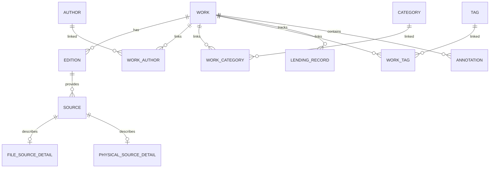

# Baglib — Unified Data Dictionary

This document defines the comprehensive data models, tables, entities, fields, data types, constraints, and relationships across all persistent stores in Baglib:
1. **Core Personal Library Database** (`baglib.db`)
2. **Quran Corpus & Metadata SQLite Packs** (`surah-info-ar.db`, `topics-ar.db`, `ayah-themes-ar.db`, QPC Hafs/Warsh)
3. **Prophetic Sunnah Corpus Store** (`userData/sunnah/` & `catalog.json`)

---

## 1. Core Personal Library Database (`baglib.db`)

Managed via SQLite with automated schema migrations (`src/main/database/migrator.ts`, migrations 1–15). Adheres to the canonical **Work → Edition → Source** domain model.



### 1.1 `work`
The canonical intellectual creation (independent of physical or digital manifestation).

| Column | Type | Constraints | Description |
| :--- | :--- | :--- | :--- |
| `id` | TEXT | PRIMARY KEY | Unique UUID or prefix identifier (e.g. `work-...`) |
| `title` | TEXT | NOT NULL | Canonical work title |
| `author` | TEXT | NULL | Canonical author name string (for quick lookup) |
| `description` | TEXT | NULL | Summary, abstract, or synopsis |
| `author_bio` | TEXT | NULL | Biographical sketch of author |
| `work_type_id` | TEXT | NULL | Classification ID (`wt-book`, `wt-research-paper`, etc.) |
| `primary_category_id` | TEXT | NULL | Foreign key referencing primary `category.id` |
| `metadata_json` | TEXT | NULL | Extensible JSON object storing volume metadata (`volumeNumber`, `totalVolumes`, `seriesTitle`), research papers (DOI, journal), thesis info, and diagnostics |
| `created_at` | TEXT | NOT NULL | ISO-8601 creation timestamp |
| `updated_at` | TEXT | NOT NULL | ISO-8601 last update timestamp |

### 1.2 `edition`
A specific publication, printing, or release of a work.

| Column | Type | Constraints | Description |
| :--- | :--- | :--- | :--- |
| `id` | TEXT | PRIMARY KEY | Unique UUID identifier (e.g. `ed-...`) |
| `work_id` | TEXT | NOT NULL, FK(`work.id`) | Parent work reference |
| `isbn` | TEXT | NULL | Validated ISBN-10 or ISBN-13 identifier |
| `publisher` | TEXT | NULL | Publishing house or entity |
| `publication_year` | INTEGER | NULL | Four-digit calendar publication year |
| `edition_label` | TEXT | NULL | Edition label (e.g., "الطبعة الثانية", "2nd Edition") |
| `pages_count` | INTEGER | NULL | Total page count |
| `language` | TEXT | NULL | Primary language (e.g., "العربية", "English") |
| `format` | TEXT | NULL | Digital format or binding (`PDF`, `EPUB`, `Hardcover`) |
| `cover_url` | TEXT | NULL | Cover image URL or local asset path |
| `created_at` | TEXT | NOT NULL | ISO-8601 timestamp |

### 1.3 `source`
A specific accessible copy or manifestation (either a file on disk or a physical book).

| Column | Type | Constraints | Description |
| :--- | :--- | :--- | :--- |
| `id` | TEXT | PRIMARY KEY | Unique UUID identifier |
| `edition_id` | TEXT | NOT NULL, FK(`edition.id`) | Associated edition |
| `source_type` | TEXT | NOT NULL | Either `'digital'` or `'physical'` |
| `status` | TEXT | NOT NULL | Availability status (`'available'`, `'lent'`, `'missing'`) |
| `added_at` | TEXT | NOT NULL | ISO-8601 acquisition timestamp |

### 1.4 `file_source_detail`
Stores filesystem and storage integrity metadata for digital files.

| Column | Type | Constraints | Description |
| :--- | :--- | :--- | :--- |
| `source_id` | TEXT | PRIMARY KEY, FK(`source.id`) | 1-to-1 link with digital `source` |
| `file_path` | TEXT | NULL | Absolute filesystem path to the ebook file |
| `file_hash` | TEXT | NULL | SHA-256 (64 chars) or verified LibGen MD5 (32 chars) |
| `file_format` | TEXT | NOT NULL | Ebook format (`PDF`, `EPUB`, `MOBI`, `AZW3`, `DJVU`, `TXT`) |
| `file_size_bytes` | INTEGER | NULL | Physical file size in bytes |
| `storage_state` | TEXT | DEFAULT 'available' | Health status: `'available'`, `'missing'`, `'unmounted'`, `'corrupted'`, `'duplicate'` |
| `last_verified_at`| TEXT | NULL | ISO-8601 timestamp of last storage health check |
| `is_managed` | INTEGER | DEFAULT 0 | 1 if managed inside Baglib internal library store; 0 if linked externally |

### 1.5 `physical_source_detail`
Stores location and condition metadata for physical library copies.

| Column | Type | Constraints | Description |
| :--- | :--- | :--- | :--- |
| `source_id` | TEXT | PRIMARY KEY, FK(`source.id`) | 1-to-1 link with physical `source` |
| `room` | TEXT | NULL | Physical room (e.g., "المكتب", "Study Room") |
| `bookcase` | TEXT | NULL | Bookcase or cabinet identifier |
| `shelf` | TEXT | NULL | Shelf number or designation |
| `shelf_section` | TEXT | NULL | Section on shelf |
| `condition` | TEXT | NULL | Physical condition (`'new'`, `'good'`, `'fair'`, `'poor'`) |
| `purchase_date` | TEXT | NULL | ISO-8601 purchase date string |
| `price` | REAL | NULL | Purchase price in local currency |

### 1.6 `author` & `work_author`
Relational author registry and many-to-many link table.

| Table | Column | Type | Constraints | Description |
| :--- | :--- | :--- | :--- | :--- |
| `author` | `id` | TEXT | PRIMARY KEY | Unique author UUID |
| `author` | `name` | TEXT | NOT NULL | Author full name |
| `author` | `bio` | TEXT | NULL | Biographical notes |
| `work_author` | `work_id` | TEXT | FK(`work.id`) | Linked work |
| `work_author` | `author_id`| TEXT | FK(`author.id`) | Linked author |
| `work_author` | `role` | TEXT | DEFAULT 'author' | Contributor role (`'author'`, `'translator'`, `'editor'`, `'illustrator'`) |

### 1.7 `category` & `work_category`
Hierarchical topic and subject classification tree.

| Table | Column | Type | Constraints | Description |
| :--- | :--- | :--- | :--- | :--- |
| `category` | `id` | TEXT | PRIMARY KEY | Category code or UUID |
| `category` | `parent_id` | TEXT | NULL, FK(`category.id`) | Parent category for nesting |
| `category` | `name_ar` | TEXT | NOT NULL | Arabic category label |
| `category` | `name_en` | TEXT | NOT NULL | English category label |
| `work_category` | `work_id` | TEXT | FK(`work.id`) | Linked work |
| `work_category` | `category_id` | TEXT | FK(`category.id`) | Linked category |

### 1.8 `tag` & `work_tag`
Flexible tagging system for personal curation.

| Table | Column | Type | Constraints | Description |
| :--- | :--- | :--- | :--- | :--- |
| `tag` | `id` | TEXT | PRIMARY KEY | Unique tag identifier |
| `tag` | `name` | TEXT | NOT NULL, UNIQUE | Normalized tag text (e.g. `#تاريخ`, `#PDF`) |
| `work_tag` | `work_id` | TEXT | FK(`work.id`) | Linked work |
| `work_tag` | `tag_id` | TEXT | FK(`tag.id`) | Linked tag |

### 1.9 `lending_record`
Tracks physical book circulation, borrower details, due dates, and return condition.

| Column | Type | Constraints | Description |
| :--- | :--- | :--- | :--- |
| `id` | TEXT | PRIMARY KEY | Loan UUID |
| `work_id` | TEXT | NOT NULL, FK(`work.id`) | Lent book reference |
| `borrower_name` | TEXT | NOT NULL | Full name of borrower |
| `borrower_contact`| TEXT | NULL | Phone or email address |
| `borrowed_at` | TEXT | NOT NULL | ISO-8601 date of loan |
| `due_date` | TEXT | NULL | ISO-8601 expected return date |
| `returned_at` | TEXT | NULL | ISO-8601 actual return date (null if active) |
| `condition_out` | TEXT | NULL | Condition when lent |
| `condition_in` | TEXT | NULL | Condition upon return |
| `notes` | TEXT | NULL | Additional circulation notes |

### 1.10 `annotation`
Reader bookmarks, highlights, and annotations.

| Column | Type | Constraints | Description |
| :--- | :--- | :--- | :--- |
| `id` | TEXT | PRIMARY KEY | Annotation UUID |
| `work_id` | TEXT | NOT NULL, FK(`work.id`) | Target book |
| `page_number` | INTEGER | NOT NULL | Page number inside document |
| `type` | TEXT | NOT NULL | `'bookmark'`, `'highlight'`, or `'note'` |
| `color` | TEXT | NULL | Hex highlight color code |
| `selected_text` | TEXT | NULL | Highlighted quotation |
| `note_text` | TEXT | NULL | User's written thoughts or comments |
| `anchor_json` | TEXT | NULL | DOM / CFI / coordinates anchor specification |
| `created_at` | TEXT | NOT NULL | ISO-8601 creation timestamp |
| `updated_at` | TEXT | NOT NULL | ISO-8601 update timestamp |

### 1.11 `app_settings`
System-wide configuration, view preferences, and Khatmah reading plans.

| Column | Type | Constraints | Description |
| :--- | :--- | :--- | :--- |
| `key` | TEXT | PRIMARY KEY | Setting key (e.g., `view_preferences`, `quran.khatmah.v1`, `provider_settings`) |
| `value` | TEXT | NOT NULL | Stored string or serialized JSON configuration object |
| `updated_at` | TEXT | NOT NULL | ISO-8601 last modified timestamp |

### 1.12 `book_content_fts` (Virtual FTS5 Table)
SQLite FTS5 full-text search index for indexed ebook contents.

| Column | Type | Description |
| :--- | :--- | :--- |
| `work_id` | UNINDEXED | Reference to parent `work.id` |
| `page_number` | UNINDEXED | Document page number |
| `content` | TEXT | Extracted plain-text page content for full-text queries |

---

## 2. Quran Corpus & Metadata SQLite Databases

Isolated in immutable SQLite databases under `.baglib-data/` and `repos/Quran/`.

### 2.1 Surah Information (`surah-info-ar.db` & `surah-info-en.db`)
Stores comprehensive surah introductions, historical context, themes, and summaries.

| Column | Type | Constraints | Description |
| :--- | :--- | :--- | :--- |
| `surah_number` | INTEGER | NOT NULL | Surah index (1 to 114) |
| `surah_name` | TEXT | NOT NULL | Arabic name (e.g., `الفاتحة`) or English name |
| `text` | TEXT | NOT NULL | Full HTML rich-text introduction and analysis |
| `short_text` | TEXT | NOT NULL | Concise one-paragraph executive summary |

### 2.2 Quran Thematic Classification (`topics-ar.db` & `topics.db`)
Hierarchical ontology mapping Quranic subjects, prophets, concepts, and moral injunctions.

| Column | Type | Constraints | Description |
| :--- | :--- | :--- | :--- |
| `topic_id` | INTEGER | PRIMARY KEY | Unique topic integer identifier |
| `name` | TEXT | NOT NULL | English topic name (e.g., "Prophets (25 mentioned by name)") |
| `arabic_name` | TEXT | NULL | Arabic topic title (e.g., "يونس (ﷺ)") |
| `parent_id` | INTEGER | NULL | Hierarchical parent topic identifier |
| `thematic_parent_id` | INTEGER | NULL | Semantic grouping parent identifier |
| `ontology_parent_id` | INTEGER | NULL | Ontological parent node reference |
| `description` | TEXT | NULL | Comprehensive explanation and thematic summary |
| `wiki_link` | TEXT | NULL | Wikipedia or encyclopedia reference URL |
| `thematic` | INTEGER | DEFAULT 0 | 1 if thematic node; 0 otherwise |
| `ontology` | INTEGER | DEFAULT 0 | 1 if ontology node; 0 otherwise |
| `ayahs` | TEXT | NULL | Comma-delimited list of referenced verses (`surah:ayah`) |
| `related_topics`| TEXT | NULL | Comma-delimited list of related `topic_id`s |

### 2.3 Ayah Themes Database (`ayah-themes-ar.db` & `ayah-themes.db`)
Ayah-by-ayah themes mapped across specific verse boundaries.

| Column | Type | Constraints | Description |
| :--- | :--- | :--- | :--- |
| `theme` | TEXT | NOT NULL | Theme title or thematic summary for the verse range |
| `surah_number` | INTEGER | NOT NULL | Surah index (1 to 114) |
| `ayah_from` | INTEGER | NOT NULL | Starting ayah number |
| `ayah_to` | INTEGER | NOT NULL | Ending ayah number |
| `keywords` | TEXT | NULL | Comma-separated topical keywords |
| `total_ayahs` | INTEGER | NOT NULL | Number of ayahs covered in the theme interval |

### 2.4 Quran Script & Word-by-Word (`qpc-hafs.db` / `qpc-v4.db`)
Authoritative Quran text and word-level segmentation conforming to the King Fahd Complex for the Printing of the Holy Quran (KFGQPC).

| Column | Type | Constraints | Description |
| :--- | :--- | :--- | :--- |
| `id` | INTEGER | PRIMARY KEY | Word sequential index across the entire Quran |
| `surah` | INTEGER | NOT NULL | Surah number (1–114) |
| `ayah` | INTEGER | NOT NULL | Ayah number within surah |
| `word` | INTEGER | NOT NULL | Word index within ayah (1-based) |
| `text` | TEXT | NOT NULL | Uthmanic script representation or V4 glyph code |

### 2.5 Mushaf Layout Database (`mushaf-layout` packs)
Defines physical 15-line standard Mushaf page layout geometry.

| Column | Type | Constraints | Description |
| :--- | :--- | :--- | :--- |
| `page_number` | INTEGER | NOT NULL | Standard Madani Mushaf page (1 to 604) |
| `line_number` | INTEGER | NOT NULL | Line number on the page (1 to 15) |
| `line_type` | TEXT | NOT NULL | `'ayah'`, `'surah_header'`, or `'basmala'` |
| `is_centered` | INTEGER | DEFAULT 0 | 1 if centered title/basmala line; 0 otherwise |
| `first_word_id`| INTEGER | NULL | Starting `words.id` on this line |
| `last_word_id` | INTEGER | NULL | Ending `words.id` on this line |
| `surah_number` | INTEGER | NULL | Current surah number on this line |

---

## 3. Prophetic Sunnah Corpus Store

Managed via `SunnahService` in `userData/sunnah/` containing authenticated chapter partitions and an authoritative integrity manifest.

### 3.1 Corpus Catalog Manifest (`catalog.json`)
Cryptographically verified integrity descriptor.

```json
{
  "version": 1,
  "sha256": "4a26d25f...",
  "importedAt": "2026-10-26T12:00:00.000Z",
  "hadithCount": 38200,
  "collections": [
    {
      "id": "Bukhari",
      "hadithCount": 7563,
      "chapters": [
        { "number": 1, "title": { "ar": "كتاب بدء الوحي", "en": "Revelation" }, "hadithCount": 7 }
      ]
    }
  ]
}
```

### 3.2 Hadith Record Structure (`${collectionId}-${chapterNumber}.json`)
Every hadith entry is partitioned into a verified JSON structure:

| Field | Type | Description |
| :--- | :--- | :--- |
| `id` | string | Unique hadith identifier (e.g. `bukhari-1`) |
| `number` | string | Universal hadith reference number |
| `section` | object | `{ number: string, title: { ar: string, en: string } }` |
| `text.ar` | object | Arabic `{ full: string, isnad: string, matn: string }` |
| `text.en` | object | English `{ full: string, isnad: string, matn: string }` |
| `comment` | string | Scholarly notes or variant readings |
| `grade` | object | Hadith authenticity evaluation `{ ar: string, en: string }` (e.g., `صحيح / Sahih`) |
