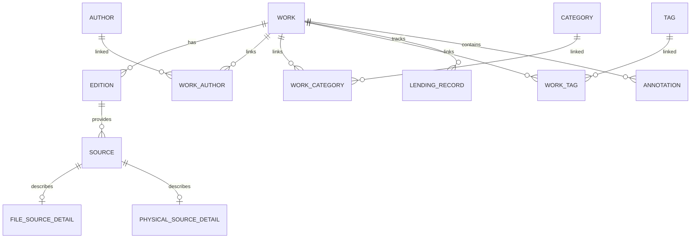

# Baglib — Unified Data Dictionary

## PDF workstation persistence extension — 2026-10-26

No database migration or new canonical entity is introduced. PDF files still belong to **Work → Edition → Source → file_source_detail**. Safe Save updates the exact source's `file_hash`, `file_size_bytes`, `last_verified_at` and invalidates its work's existing FTS rows. New edition saves and cloud pulls use the existing edition/source repository path; they do not create translated duplicate titles.

Existing `annotations.note_content` stores plain review text; `location_cfi_or_page` holds a versioned JSON anchor with marker `baglib-pdf-review-v1`, exact `sourceId`, `sourceHash`, page/rectangle, author display name, kind/status, local reply thread and optional normalized ink strokes. These are private user annotations, not canonical corpus edits. Old source hashes remain read-only; display names are not verified identities.

Existing `app_settings` keys: `pdf-editor.engine.v1` stores local executable/model locations; `private.pdf-cloud.v1:<google|microsoft>` stores OS-encrypted client configuration/tokens; `private.pdf-cloud.links.v1` holds explicit opt-in sync mappings and revision/hash baselines; `private.pdf-audit.key.v1`, `private.pdf-audit.head.v1`, `private.pdf-audit.records.v1` support a keyed local signature audit. Generic renderer settings get/set/delete/get-all reject the `private.` namespace. Tokens, certificate passwords and private-key bytes are never returned by workstation status APIs; no certificate password is persisted. Temporary owner-scoped jobs/assets are outside canonical data and cleaned when sessions/window owners close. Runtime provisioning details and limitations: [PDF workstation setup](pdf-workstation-setup.md).

This document defines the comprehensive data models, schemas, entities, fields, data types, constraints, and relationships across all persistent stores in Baglib:
1. **Core Personal Library Database** (`baglib.db`)
2. **Quran Corpus & Metadata SQLite Packs** (`surah-info-ar.db`, `topics-ar.db`, `ayah-themes-ar.db`, QPC Hafs/Warsh, Tafsir, Recitation Timings, Morphology)
3. **Prophetic Sunnah Corpus Store** (`userData/sunnah/` & `catalog.json`)

---

## 1. Core Personal Library Database (`baglib.db`)

Managed via SQLite with automated schema migrations (`src/main/database/migrator.ts`, migrations 1–17). Adheres to the canonical **Work → Edition → Source** domain model.



### 1.1 `work`
The canonical intellectual creation (independent of physical or digital manifestation).

| Column | Type | Constraints | Description |
| :--- | :--- | :--- | :--- |
| `id` | TEXT | PRIMARY KEY | Unique UUID or prefix identifier (e.g. `work-...`) |
| `title` | TEXT | NOT NULL | Canonical work title |
| `author` | TEXT | NULL | Canonical author name string (for quick indexing/lookup) |
| `description` | TEXT | NULL | Summary, abstract, or synopsis |
| `author_bio` | TEXT | NULL | Biographical sketch of author |
| `work_type_id` | TEXT | NULL | Classification ID (`wt-book`, `wt-research-paper`, `wt-manuscript`, etc.) |
| `primary_category_id` | TEXT | NULL | Foreign key referencing primary `category.id` |
| `metadata_json` | TEXT | NULL | Extensible JSON object storing volume metadata, DOI, journal, and specific diagnostics (see 1.1.1) |
| `created_at` | TEXT | NOT NULL | ISO-8601 creation timestamp |
| `updated_at` | TEXT | NOT NULL | ISO-8601 last update timestamp |
| `deleted_at` | TEXT | NULL | Soft-deletion ISO-8601 timestamp for Trash Bin and restore workflow (Migration 016) |

#### 1.1.1 `work.metadata_json` Schema
```json
{
  "seriesTitle": "تاريخ الرسل والملوك",
  "volumeNumber": "١",
  "totalVolumes": 10,
  "doi": "10.1000/182",
  "journal": "Journal of Islamic Studies",
  "issue": "4",
  "pages": "120-145"
}
```

### 1.2 `edition`
A specific publication, printing, or release of a work.

| Column | Type | Constraints | Description |
| :--- | :--- | :--- | :--- |
| `id` | TEXT | PRIMARY KEY | Unique UUID identifier (e.g. `ed-...`) |
| `work_id` | TEXT | NOT NULL, FK(`work.id`) | Parent work reference |
| `isbn` | TEXT | NULL | Validated ISBN-10 or ISBN-13 identifier |
| `publisher` | TEXT | NULL | Publishing house or entity |
| `publication_year` | INTEGER | NULL | Four-digit calendar publication year |
| `edition_label` | TEXT | NULL | Edition label (e.g., "الطبعة الثانية", "2nd Edition") |
| `pages_count` | INTEGER | NULL | Total page count |
| `language` | TEXT | NULL | Primary language (e.g., "العربية", "English") |
| `format` | TEXT | NULL | Digital format or binding (`PDF`, `EPUB`, `Hardcover`) |
| `cover_url` | TEXT | NULL | Cover image URL or local asset path |
| `created_at` | TEXT | NOT NULL | ISO-8601 timestamp |

### 1.3 `source`
A specific accessible copy or manifestation (either a file on disk or a physical book).

| Column | Type | Constraints | Description |
| :--- | :--- | :--- | :--- |
| `id` | TEXT | PRIMARY KEY | Unique UUID identifier |
| `edition_id` | TEXT | NOT NULL, FK(`edition.id`) | Associated edition |
| `source_type` | TEXT | NOT NULL | Either `'digital'` or `'physical'` |
| `status` | TEXT | NOT NULL | Availability status (`'available'`, `'lent'`, `'missing'`) |
| `added_at` | TEXT | NOT NULL | ISO-8601 acquisition timestamp |

### 1.4 `file_source_detail`
Stores filesystem and storage integrity metadata for digital files.

| Column | Type | Constraints | Description |
| :--- | :--- | :--- | :--- |
| `source_id` | TEXT | PRIMARY KEY, FK(`source.id`) | 1-to-1 link with digital `source` |
| `file_path` | TEXT | NULL | Absolute filesystem path to the ebook file |
| `file_hash` | TEXT | NULL | SHA-256 (64 chars) or verified LibGen MD5 (32 chars) |
| `file_format` | TEXT | NOT NULL | Ebook format (`PDF`, `EPUB`, `MOBI`, `AZW3`, `DJVU`, `TXT`) |
| `file_size_bytes` | INTEGER | NULL | Physical file size in bytes |
| `storage_state` | TEXT | DEFAULT 'available' | Health status: `'available'`, `'missing'`, `'unmounted'`, `'corrupted'`, `'duplicate'` |
| `last_verified_at`| TEXT | NULL | ISO-8601 timestamp of last storage health check |
| `is_managed` | INTEGER | DEFAULT 0 | 1 if managed inside Baglib internal library store; 0 if linked externally |

### 1.5 `physical_source_detail`
Stores location and condition metadata for physical library copies.

| Column | Type | Constraints | Description |
| :--- | :--- | :--- | :--- |
| `source_id` | TEXT | PRIMARY KEY, FK(`source.id`) | 1-to-1 link with physical `source` |
| `room` | TEXT | NULL | Physical room (e.g., "المكتب", "Study Room") |
| `bookcase` | TEXT | NULL | Bookcase or cabinet identifier |
| `shelf` | TEXT | NULL | Shelf number or designation |
| `shelf_section` | TEXT | NULL | Section on shelf |
| `condition` | TEXT | NULL | Physical condition (`'new'`, `'good'`, `'fair'`, `'poor'`) |
| `purchase_date` | TEXT | NULL | ISO-8601 purchase date string |
| `price` | REAL | NULL | Purchase price in local currency |

### 1.6 `author` & `work_author`
Relational author registry and many-to-many link table.

| Table | Column | Type | Constraints | Description |
| :--- | :--- | :--- | :--- | :--- |
| `author` | `id` | TEXT | PRIMARY KEY | Unique author UUID |
| `author` | `name` | TEXT | NOT NULL | Author full name |
| `author` | `bio` | TEXT | NULL | Biographical notes |
| `work_author` | `work_id` | TEXT | FK(`work.id`) | Linked work |
| `work_author` | `author_id`| TEXT | FK(`author.id`) | Linked author |
| `work_author` | `role` | TEXT | DEFAULT 'author' | Contributor role (`'author'`, `'translator'`, `'editor'`, `'illustrator'`) |

### 1.7 `category` & `work_category`
Hierarchical topic and subject classification tree.

| Table | Column | Type | Constraints | Description |
| :--- | :--- | :--- | :--- | :--- |
| `category` | `id` | TEXT | PRIMARY KEY | Category code or UUID |
| `category` | `parent_id` | TEXT | NULL, FK(`category.id`) | Parent category for nesting |
| `category` | `name_ar` | TEXT | NOT NULL | Arabic category label |
| `category` | `name_en` | TEXT | NOT NULL | English category label |
| `work_category` | `work_id` | TEXT | FK(`work.id`) | Linked work |
| `work_category` | `category_id` | TEXT | FK(`category.id`) | Linked category |

### 1.8 `tag` & `work_tag`
Flexible tagging system for personal curation.

| Table | Column | Type | Constraints | Description |
| :--- | :--- | :--- | :--- | :--- |
| `tag` | `id` | TEXT | PRIMARY KEY | Unique tag identifier |
| `tag` | `name` | TEXT | NOT NULL, UNIQUE | Normalized tag text (e.g. `#تاريخ`, `#PDF`) |
| `work_tag` | `work_id` | TEXT | FK(`work.id`) | Linked work |
| `work_tag` | `tag_id` | TEXT | FK(`tag.id`) | Linked tag |

### 1.9 `lending_record`
Tracks physical book circulation, borrower details, due dates, and return condition.

| Column | Type | Constraints | Description |
| :--- | :--- | :--- | :--- |
| `id` | TEXT | PRIMARY KEY | Loan UUID |
| `work_id` | TEXT | NOT NULL, FK(`work.id`) | Lent book reference |
| `borrower_name` | TEXT | NOT NULL | Full name of borrower |
| `borrower_contact`| TEXT | NULL | Phone or email address |
| `borrowed_at` | TEXT | NOT NULL | ISO-8601 date of loan |
| `due_date` | TEXT | NULL | ISO-8601 expected return date |
| `returned_at` | TEXT | NULL | ISO-8601 actual return date (null if active) |
| `condition_out` | TEXT | NULL | Condition when lent |
| `condition_in` | TEXT | NULL | Condition upon return |
| `notes` | TEXT | NULL | Additional circulation notes |

### 1.10 `annotation`
Reader bookmarks, highlights, and annotations.

| Column | Type | Constraints | Description |
| :--- | :--- | :--- | :--- |
| `id` | TEXT | PRIMARY KEY | Annotation UUID |
| `work_id` | TEXT | NOT NULL, FK(`work.id`) | Target book |
| `page_number` | INTEGER | NOT NULL | Page number inside document |
| `type` | TEXT | NOT NULL | `'bookmark'`, `'highlight'`, or `'note'` |
| `color` | TEXT | NULL | Hex highlight color code |
| `selected_text` | TEXT | NULL | Highlighted quotation |
| `note_text` | TEXT | NULL | User's written thoughts or comments |
| `anchor_json` | TEXT | NULL | DOM / CFI / coordinates anchor specification |
| `created_at` | TEXT | NOT NULL | ISO-8601 creation timestamp |
| `updated_at` | TEXT | NOT NULL | ISO-8601 update timestamp |

### 1.11 `app_settings`
System-wide configuration, view preferences, Khatmah reading plans and private study documents.

| Column | Type | Constraints | Description |
| :--- | :--- | :--- | :--- |
| `key` | TEXT | PRIMARY KEY | Setting key (e.g., `view_preferences`, `quran.khatmah.v1`, `provider_settings`) |
| `value` | TEXT | NOT NULL | Stored string or serialized JSON configuration object |
| `updated_at` | TEXT | NOT NULL | ISO-8601 last modified timestamp |

Private study notes use `study.note.v1:<id>` keys with JSON `{id, title, content, aliases, tags, workId?, createdAt, updatedAt}`. Links and backlinks are derived from note content; Quran/Sunnah references do not create library works or mutate source corpora. Book-attached captures also retain their existing `knowledge`/`note_detail` record. Drafts use `dashboard.scratchpad.draft.v1` and `study.capture.draft.v1`. See [Linked Study Notes and Dashboard](features/feature%20-%20Linked%20Study%20Notes%20and%20Dashboard.md). These are existing settings values, not added SQL columns or relations.

### 1.12 `book_content_fts` (Virtual FTS5 Table)
SQLite FTS5 full-text search index for indexed ebook contents.

| Column | Type | Description |
| :--- | :--- | :--- |
| `work_id` | UNINDEXED | Reference to parent `work.id` |
| `page_number` | UNINDEXED | Document page number |
| `content` | TEXT | Extracted plain-text page content for full-text queries |

### 1.13 `poetry_narration` (Migration 017)
User-provided human voice narrations (recordings, local audio files, and online providers) for Ashaar corpus poems. Computer-generated speech is never stored here. Audio bytes live under `userData/poetry-narrations/` with strict UUID-based managed filenames; online narrations store validated provider URLs.

| Column | Type | Constraints | Description |
| :--- | :--- | :--- | :--- |
| `id` | TEXT | PRIMARY KEY | Unique UUID identifier |
| `poem_id` | INTEGER | NOT NULL, CHECK(`poem_id > 0`) | Stable identifier referencing poem in read-only partition |
| `kind` | TEXT | NOT NULL, CHECK(`kind IN ('recording', 'file', 'online')`) | Narration source type |
| `provider` | TEXT | NOT NULL, CHECK(`provider IN ('local', 'youtube', 'soundcloud', 'vimeo', 'url')`) | Audio provider or platform |
| `label` | TEXT | NULL | Optional reciter name or user description (max 200 chars) |
| `file_name` | TEXT | NULL | Managed filename under `userData/poetry-narrations/` for local files/recordings |
| `url` | TEXT | NULL | Validated external player/media URL for online narrations |
| `mime_type` | TEXT | NULL | Detected audio container MIME type (e.g. `audio/webm`, `audio/mpeg`) |
| `duration_seconds` | REAL | NULL | Recorded audio duration in seconds |
| `created_at` | TEXT | NOT NULL | ISO-8601 creation timestamp |

---

## 2. Quran Corpus & Metadata SQLite Databases

Isolated in immutable SQLite databases under `.baglib-data/` and `repos/Quran/`. These databases are verified against the King Fahd Complex (KFGQPC) text and the Quran Universal Library (QUL) datasets.

### 2.1 Surah Information Database (`surah-info-ar.db` & `surah-info-en.db`)
Stores comprehensive surah introductions, historical context, themes, and executive summaries (114 rows).

- **Table: `surah_infos`**

| Column | Type | Constraints | Description |
| :--- | :--- | :--- | :--- |
| `surah_number` | INTEGER | NOT NULL | Surah index (1 to 114) |
| `surah_name` | TEXT | NOT NULL | Surah name (`الفاتحة`, `البقرة`, etc.) |
| `text` | TEXT | NOT NULL | Comprehensive HTML rich-text introduction and analysis |
| `short_text` | TEXT | NOT NULL | Concise executive summary |

### 2.2 Quran Thematic Classification Database (`topics-ar.db` & `topics.db`)
Hierarchical ontology mapping Quranic subjects, prophets, concepts, and moral injunctions (2,512 topics).

- **Table: `topics`**

| Column | Type | Constraints | Description |
| :--- | :--- | :--- | :--- |
| `topic_id` | INTEGER | PRIMARY KEY | Unique topic identifier (1 to 2,512) |
| `name` | TEXT | NOT NULL | Topic name (e.g., `الله`, `يونس (ﷺ)`) |
| `arabic_name` | TEXT | NULL | Arabic topic title |
| `parent_id` | INTEGER | NULL | Hierarchical parent topic identifier |
| `thematic_parent_id` | INTEGER | NULL | Semantic grouping parent identifier |
| `ontology_parent_id` | INTEGER | NULL | Ontological parent node reference |
| `description` | TEXT | NULL | Thematic explanation and contextual summary |
| `wiki_link` | TEXT | NULL | Wikipedia or encyclopedia reference URL |
| `thematic` | INTEGER | DEFAULT 0 | 1 if thematic node; 0 otherwise |
| `ontology` | INTEGER | DEFAULT 0 | 1 if ontology node; 0 otherwise |
| `ayahs` | TEXT | NULL | Comma-delimited list of referenced verses (`surah:ayah`, e.g. `10:98`) |
| `related_topics`| TEXT | NULL | Comma-delimited list of related `topic_id`s |

### 2.3 Ayah Themes Database (`ayah-themes-ar.db` & `ayah-themes.db`)
Ayah-by-ayah themes mapped across specific verse boundaries (2,098 theme spans).

- **Table: `themes`**

| Column | Type | Constraints | Description |
| :--- | :--- | :--- | :--- |
| `theme` | TEXT | NOT NULL | Thematic label for the verse interval |
| `surah_number` | INTEGER | NOT NULL | Surah index (1 to 114) |
| `ayah_from` | INTEGER | NOT NULL | Starting ayah number |
| `ayah_to` | INTEGER | NOT NULL | Ending ayah number |
| `keywords` | TEXT | NULL | Comma-separated topical keywords |
| `total_ayahs` | INTEGER | NOT NULL | Number of ayahs covered in the theme interval |

### 2.4 Verse-Level Quran Text (`qpc-hafs.db`)
Authoritative Hafs Quran text with Uthmanic diacritics and verse-level segmentation (6,236 verses).

- **Table: `verses`**

| Column | Type | Constraints | Description |
| :--- | :--- | :--- | :--- |
| `id` | INTEGER | PRIMARY KEY | Sequential verse index (1 to 6,236) |
| `verse_key` | TEXT | NOT NULL | Key formatted as `surah:ayah` (e.g. `1:1`) |
| `surah` | INTEGER | NOT NULL | Surah number (1 to 114) |
| `ayah` | INTEGER | NOT NULL | Ayah number within surah |
| `text` | TEXT | NOT NULL | Complete Uthmanic verse text including ayah end ornament |

### 2.5 Word-by-Word Quran Script (`qpc-hafs-word-by-word.db`)
Word-level tokenization across the entire Holy Quran (83,668 words).

- **Table: `words`**

| Column | Type | Constraints | Description |
| :--- | :--- | :--- | :--- |
| `id` | INTEGER | PRIMARY KEY | Sequential word index (1 to 83,668) |
| `location` | TEXT | NOT NULL | Canonical location coordinate (`surah:ayah:word`, e.g. `1:1:1`) |
| `surah` | INTEGER | NOT NULL | Surah number (1 to 114) |
| `ayah` | INTEGER | NOT NULL | Ayah number within surah |
| `word` | INTEGER | NOT NULL | Word index within ayah (1-based) |
| `text` | TEXT | NOT NULL | Exact Uthmanic word text |

### 2.6 Recitation Audio & Word-Segment Timing (`minshawi-959.db`, `husary.db`)
Synchronized recitation audio metadata and millisecond word timing intervals (6,236 verses per voice).

- **Table: `verses`**

| Column | Type | Constraints | Description |
| :--- | :--- | :--- | :--- |
| `surah_number` | INTEGER | NOT NULL | Surah index (1 to 114) |
| `ayah_number` | INTEGER | NOT NULL | Ayah index within surah |
| `audio_url` | TEXT | NOT NULL | Remote CDN stream endpoint or local audio file key |
| `duration` | INTEGER | NULL | Total audio duration in milliseconds |
| `segments` | TEXT | NOT NULL | JSON array of word intervals: `[[wordIdx, wordOrder, startMs, endMs], ...]` |

### 2.7 Arabic Tafsir Database (`ar-tafsir-ibn-kathir.db`)
Classical Quranic exegesis linked to verse keys (6,236 entries).

- **Table: `tafsir`**

| Column | Type | Constraints | Description |
| :--- | :--- | :--- | :--- |
| `ayah_key` | TEXT | NOT NULL | Primary verse reference (`surah:ayah`) |
| `group_ayah_key`| TEXT | NOT NULL | Grouped passage reference for multi-ayah tafsir sections |
| `from_ayah` | TEXT | NOT NULL | Range start (`surah:ayah`) |
| `to_ayah` | TEXT | NOT NULL | Range end (`surah:ayah`) |
| `ayah_keys` | TEXT | NOT NULL | Comma-delimited list of all ayahs covered |
| `text` | TEXT | NOT NULL | Rich HTML tafsir commentary text |

### 2.8 Word Morphology Databases (`word-root.db`, `word-lemma.db`, `word-stem.db`)
Deep linguistic decomposition of Quranic vocabulary.

#### A. Roots Database (`word-root.db`)
- **Table: `roots`** (1,642 roots)
  - `id`: INTEGER PRIMARY KEY
  - `arabic_trilateral`: TEXT (e.g. `ث و ي`)
  - `english_trilateral`: TEXT (e.g. `vwy`)
  - `words_count`: INTEGER
  - `uniq_words_count`: INTEGER
- **Table: `root_words`** (50,298 word links)
  - `root_id`: INTEGER (FK `roots.id`)
  - `word_location`: TEXT (`surah:ayah:word`, e.g. `41:24:4`)

#### B. Lemmas Database (`word-lemma.db`)
- **Table: `lemmas`** (4,817 lemmas)
  - `id`: INTEGER PRIMARY KEY
  - `text`: TEXT (e.g. `كَذَّاب`)
  - `text_clean`: TEXT (e.g. `كذاب`)
  - `words_count`: INTEGER
  - `uniq_words_count`: INTEGER
- **Table: `lemma_words`** (72,510 word links)
  - `lemma_id`: INTEGER (FK `lemmas.id`)
  - `word_location`: TEXT (`surah:ayah:word`, e.g. `54:26:4`)

#### C. Stems Database (`word-stem.db`)
- **Table: `stems`** (12,113 stems)
  - `id`: INTEGER PRIMARY KEY
  - `text`: TEXT (e.g. `دَّوَآئِرَ`)
  - `text_clean`: TEXT (e.g. `دواير`)
- **Table: `stem_words`** (77,427 word links)
  - `stem_id`: INTEGER (FK `stems.id`)
  - `word_location`: TEXT (`surah:ayah:word`, e.g. `9:98:10`)

---

## 3. Prophetic Sunnah Corpus Store

### Optional derived research corpus (2026-10-27)

The Sunnah reader can attach `sunnah_kutub_tisah_itqan.sqlite` read-only through `SunnahResearchCorpus`, exposing the existing 34-column derived `hadiths`, narrator, chain, root bridge and FTS tables. These are the standalone research pipeline's existing tables, not additions to `baglib.db` or canonical sources. Dev discovery uses `tools/hadith-alignment/data/output/`; installed apps can choose a local database file. `userData/sunnah/research-source.json` records `{ filename: absolutePath }` or `{ legacy: true }`; it is source-selection configuration, not a domain entity. The transient catalog has `research: true` and nine collection entries; its `sha256` is a metadata fingerprint, not a claim of a fresh whole-file content hash. Optional `researchId` on reader records addresses derived row identity. The original six-book source and saved chapter/ordinal identities remain compatible. See [Hadith Commentary Alignment](features/feature%20-%20Hadith%20Commentary%20Alignment.md).

### Optional merged QuranLab research corpus (2026-11-01)

`sunnah_merged_quranlab_v1.sqlite` is a separate artifact built from a copy of the corpus above. It is not part of `baglib.db`. All original `hadiths`, narrator, chain, root and FTS rows are unchanged, and `id` values stay the same; separate source books are appended after them with their own `book_key`. `SunnahResearchCorpus` reads it only when `merge_metadata.schema_kind` is `baglib-sunnah-merged` and `merge_schema_version` is `1`; any other file reads as the base corpus. Optional reader fields: `SunnahHadith.gradingSummary`, `SunnahHadith.translation`, `SunnahCatalog.merged`, `SunnahResearch.merged`.

| Addition | Purpose |
|---|---|
| `hadiths.source_datasets_json` | Datasets behind the row |
| `hadiths.field_provenance_json` | Field groups with source, record, transformation and 16-hex value hash, plus `missing` and `added` entries |
| `hadiths.grading_judgments_json` | Row copy of its judgments |
| `merge_metadata` | Capability and version values |
| `source_registry` | Every input with revision, hash, license and attribution |
| `quranlab_records` | One row per source record and language. Arabic and English keep text; other languages keep hash and length only |
| `hadith_crosswalk` | Decision for each source record: `verified_match`, `candidate_review`, `source_only` or `conflicting_identity`. `hadith_id` is set only for `verified_match` |
| `grading_judgments` | One attributed judgment, with scope, assessed part, review state and lineage. Staged when `hadith_id` is null |
| `hadith_grading_summary` | Per-row counts and flags for the reader. Holds no verdict |
| `source_book_rows` | Rows appended after the base rows for separate source books, with kind and review candidates |
| `grade_terms`, `grader_mappings` | Every raw grade and grader with its localization and evidence |
| `variant_translation_fts` | Search over attributed English used for rows that have none |

Legacy `Arabic_Grade` and `English_Grade` stay the original fields and keep their display policy; structured judgments are authoritative for attribution. See [QuranLab Hadith](features/QuranLab-Hadith.md).

The legacy six-book store below remains the fallback and ZIP import format.

Managed via `SunnahService` under `userData/sunnah/` containing authenticated chapter partitions and an authoritative integrity manifest. Derived from the authenticated LK-Hadith-Corpus archive (**34,088 hadiths across 335 chapters and six canonical collections**).

### 3.1 Collections Covered

| Collection ID | Collection Name | Chapters | Hadiths Count |
| :--- | :--- | :--- | :--- |
| `Bukhari` | Sahih al-Bukhari (صحيح البخاري) | 97 | 7,563 |
| `Muslim` | Sahih Muslim (صحيح مسلم) | 56 | 7,500 |
| `AbuDawud` | Sunan Abi Dawud (سنن أبي داود) | 43 | 5,274 |
| `Tirmidhi` | Jami` al-Tirmidhi (جامع الترمذي) | 49 | 3,956 |
| `Nasai` | Sunan an-Nasa'i (سنن النسائي) | 52 | 5,758 |
| `IbnMajah` | Sunan Ibn Majah (سنن ابن ماجه) | 37 | 4,341 |
| **Total** | **Six Canonical Books (الكتب الستة)** | **335** | **34,088** |

### 3.2 Corpus Catalog Manifest (`catalog.json`)
Cryptographically verified integrity descriptor stored under `<Electron userData>/sunnah/catalog.json`:

```json
{
  "version": 1,
  "sha256": "4a26d25f8a6...",
  "importedAt": "2026-10-24T14:30:00.000Z",
  "hadithCount": 34088,
  "collections": [
    {
      "id": "Bukhari",
      "hadithCount": 7563,
      "chapters": [
        { "number": 1, "title": { "ar": "كتاب بدء الوحي", "en": "Revelation" }, "hadithCount": 7 },
        { "number": 2, "title": { "ar": "كتاب الإيمان", "en": "Belief" }, "hadithCount": 51 }
      ]
    }
  ]
}
```

### 3.3 Partitioned Chapter File (`<archive SHA-256>/${collectionId}-${chapterNumber}.json`)
Every hadith entry is partitioned into an immutable JSON file per chapter:

| Field | Type | Description |
| :--- | :--- | :--- |
| `id` | string | Unique hadith identifier composed of collection, chapter, and row (e.g. `bukhari-1-1`) |
| `number` | string | Universal hadith reference number from source compilation |
| `section.number` | string | Source section/bab index within the chapter |
| `section.title.ar`| string | Arabic section title (e.g., "باب كَيْفَ كَانَ بَدْءُ الْوَحْيِ") |
| `section.title.en`| string | English section title |
| `text.ar.full` | string | Complete canonical Arabic text with diacritics and punctuation |
| `text.ar.isnad` | string | Segmented chain of transmission (sanad) |
| `text.ar.matn` | string | Primary Prophetic saying or narrational core text |
| `text.en.full` | string | Complete English translated text |
| `text.en.isnad` | string | Translated chain of transmission |
| `text.en.matn` | string | Translated narrational core text |
| `comment` | string | Scholarly notes or variant textual readings |
| `grade.ar` | string | Authenticity grading in Arabic (e.g., `صحيح`, `حسن`, `ضعيف`) |
| `grade.en` | string | Authenticity grading in English (e.g., `Sahih`, `Hasan`, `Da'if`) |

#### 3.3.1 Presentation & Export Heuristics
- **Isnad Coloring:** Narrator-like words are styled with `rgb(96, 207, 208)` and contiguous name words share subtle hover highlights, stopping at transmission terms (`حَدَّثَنَا`, `عَنْ`, `أَخْبَرَنَا`).
- **Grading Suppression:** For Bukhari and Muslim collections, individual grades are suppressed in the UI by default as their entire contents are canonical Sahih.
- **Shortened Chain Export:** When exporting with "Reference off", Arabic text shortens dynamically to `عن ` followed by the final narrator and matn, while preserving diacritics and context.
- **Personal Reflections:** User comments are stored in local storage keyed by stable record ID (`bukhari-1-1`), strictly isolated from the immutable corpus JSON files.

---

## 4. Al-Bayan Arabic Poetry Corpus Store (`userData/partitions/bayan_poetry.sqlite`)

Isolated read-only partition containing the complete classical and modern Arabic poetry corpus (254,630 poems across 8,184 poets) from the official `arbml/ashaar` dataset, managed with WAL, NORMAL synchronous, MEMORY temp_store, 256MB mmap, and 64MB cache pragmas.

### 4.1 `poets`
| Column | Type | Constraints | Description |
| :--- | :--- | :--- | :--- |
| `id` | INTEGER | PRIMARY KEY | Canonical poet ID |
| `name` | TEXT | NOT NULL | Vocalized canonical poet name |
| `bio` | TEXT | NULL | Biographical sketch |
| `era` | TEXT | NULL | Literary era (e.g., العصر الجاهلي, العصر العباسي) |
| `location` | TEXT | NULL | Geographic origin/homeland |
| `external_url` | TEXT | NULL | Canonical poet source URL |

### 4.2 `poems`
| Column | Type | Constraints | Description |
| :--- | :--- | :--- | :--- |
| `id` | INTEGER | PRIMARY KEY | Canonical poem ID |
| `title` | TEXT | NOT NULL | Vocalized title (empty string if untitled in source) |
| `meter` | TEXT | NULL | Classical prosodic meter (e.g. بحر الطويل, بحر البسيط) |
| `verses_json` | TEXT | NOT NULL | JSON array of canonical verse strings (paired hemistichs) |
| `poet_id` | INTEGER | NOT NULL, FK(`poets.id`) | Foreign key to `poets` |
| `theme` | TEXT | NULL | Poetic theme/genre (e.g. مدح, غزل, رثاء) |
| `language` | TEXT | NOT NULL | Language code (`'ar'` or `'en'`) |
| `layout_type` | TEXT | NOT NULL | Effective layout (`'bayt'`, `'free_verse'`, `'stanza'`) |
| `source_url` | TEXT | NULL | Canonical poem source URL |
| `description_json` | TEXT | NULL | Structured poem commentary/description JSON |
| `language_variant` | TEXT | NULL | Language variant metadata |

### 4.3 `poems_fts` (Virtual FTS5 Table)
FTS5 full-text index on normalized title, poet name, and poem verse content for instant diacritic-insensitive search.

## 5. Knowledge Cards and Spaced Repetition (ADR-006, migrations 018 and 019)

These tables live in the main library database. A card is a `knowledge` row with `knowledge_type = 'card'`. `work_id` is set only for cards from a library book.

Deleting a book never deletes knowledge. A `BEFORE DELETE` trigger on `work` detaches `knowledge` and `annotations` rows and copies the title into `former_work_title`. `annotations.book_id` is nullable from migration 019, and notes, highlights and cards keep their details, tags, comments and review history.

### 5.1 `card_detail`
| Column | Type | Constraints | Description |
|---|---|---|---|
| `knowledge_id` | TEXT | PK, FK(`knowledge.id`) ON DELETE CASCADE | Parent knowledge row |
| `front` | TEXT | NOT NULL | Card prompt. Sacred text is a verbatim copy |
| `back` | TEXT | NOT NULL | Card answer. Sacred text is a verbatim copy |
| `source_kind` | TEXT | NOT NULL | `book`, `quran`, `hadith`, `poetry`, `note`, `term` or `person` |
| `source_ref` | TEXT | NULL | Stable reference, such as `quran:2:255` |
| `source_label` | TEXT | NULL | Attribution shown on the card |
| `language` | TEXT | NULL | Language code |

### 5.2 `srs_state`
Exists only for cards added to memorization.

| Column | Type | Constraints | Description |
|---|---|---|---|
| `knowledge_id` | TEXT | PK, FK(`knowledge.id`) ON DELETE CASCADE | Scheduled card |
| `state` | TEXT | NOT NULL | `new`, `learning`, `review`, `relearning` or `suspended` |
| `due_at` | TEXT | NOT NULL, indexed | Next review time |
| `stability` | REAL | NULL | FSRS stability |
| `difficulty` | REAL | NULL | FSRS difficulty |
| `reps` | INTEGER | NOT NULL, default 0 | Completed reviews |
| `lapses` | INTEGER | NOT NULL, default 0 | Times forgotten |
| `last_review` | TEXT | NULL | Latest review time |

### 5.3 `srs_review_log`
Append-only review history.

| Column | Type | Constraints | Description |
|---|---|---|---|
| `id` | TEXT | PK | Review id |
| `knowledge_id` | TEXT | NOT NULL, FK(`knowledge.id`) ON DELETE CASCADE, indexed | Reviewed card |
| `reviewed_at` | TEXT | NOT NULL, indexed | Review time |
| `rating` | INTEGER | NOT NULL | 1 again, 2 hard, 3 good, 4 easy |
| `duration_ms` | INTEGER | NULL | Time spent |
| `state_before` | TEXT | NULL | State before this review |
