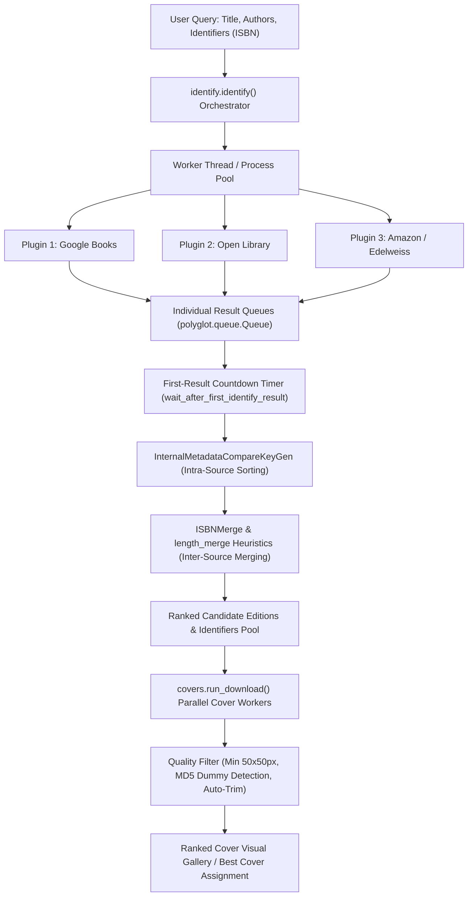

# Reverse-Engineering Calibre: Metadata Discovery & Cover Fetching Architecture

**Target Examined**: Calibre (Official Repository `kovidgoyal/calibre`, installed and source package `repos/calibre-master.zip`)  
**Technology Stack**: Python 3, PyQt (GUI), C/C++ extensions, LXML / Regex / BeautifulSoup, Multi-threaded/Multi-process worker pool  
**Analysis Date**: October 2026  
**Artifact Context**: Baglib Library Management System (Electron 32, Next.js 16, TypeScript 5, SQLite)

---

## 1. Executive Summary & Architecture Overview

Calibre's book metadata and cover discovery engine is a **parallel, multi-provider, pluggable pipeline** designed to query disparate catalog APIs, web feeds, and HTML scrapers concurrently, merge heterogeneous fields using deterministic heuristics, and rank candidates using a multi-tiered sort key.



### Core Architecture Components
1. **Plugin Definition (`calibre.ebooks.metadata.sources.base.Source`)**: The abstract contract all providers subclass. Declares capabilities (`'identify'`, `'cover'`), touched fields, option definitions, and browser headers.
2. **Identification Engine (`calibre.ebooks.metadata.sources.identify`)**: Spawns concurrent workers per plugin, monitors a shared result queue, runs a grace-period countdown once the first result arrives, and merges cross-provider metadata.
3. **Cover Retrieval Engine (`calibre.ebooks.metadata.sources.covers`)**: Downloads candidate covers in parallel, validates raster dimensions, calculates aspect ratios, prunes known placeholder dummy images via MD5 hashsets, and optionally auto-trims borders.
4. **Plugin Management (`calibre.customize.ui`)**: Dynamically discovers, installs (from `.zip`), configures, enables, or disables built-in and external metadata plugins.

---

## 2. In-Depth Analysis of the 8 Investigation Areas

### 2.1 How Calibre Searches External Providers for Metadata and Covers
- **Source File**: `src/calibre/ebooks/metadata/sources/identify.py` (lines 358–485) and `covers.py` (lines 91–150).
- **Execution Workflow**:
  1. `identify()` resolves enabled plugins via `metadata_plugins(['identify'])`.
  2. For every plugin, a dedicated daemon `Worker(Thread)` is instantiated with an independent `Queue()`, thread-safe logger, and `abort` event.
  3. All workers start simultaneously: `[w.start() for w in workers]`.
  4. Each worker executes `plugin.identify(log, result_queue, abort, title, authors, identifiers, timeout)`.
  5. The main thread polls `Queue.get_nowait()` every 200ms.
- **Verification Evidence**:
  ```python
  # identify.py:387-390
  workers = [Worker(p, kwargs, abort) for p in plugins]
  for w in workers:
      w.start()
  ```

---

### 2.2 Providers, Plugins, APIs, and Search Strategies
Calibre segregates providers by capability flags:
- **`GoogleBooks` (`google.py`)**:
  - Capabilities: `frozenset({'identify'})`.
  - Endpoint: OpenSearch Atom feeds (`https://books.google.com/books/feeds/volumes?q=...`).
  - Fetches volume XML feeds using XPath queries for `dc:title`, `dc:creator`, `dc:identifier`, `dc:publisher`, and thumbnail links.
- **`OpenLibrary` (`openlibrary.py`)**:
  - Capabilities: `frozenset(['cover'])` exclusively in core.
  - Endpoint: `https://covers.openlibrary.org/b/isbn/%s-L.jpg?default=false`.
  - Strategy: Bypasses search APIs and leverages direct CDN resolution using verified ISBNs.
- **`Amazon` (`amazon.py`)**:
  - Capabilities: `frozenset({'identify', 'cover'})`.
  - Strategy: HTML scraping across regional TLDs (`.com`, `.co.uk`, `.de`, `.fr`, `.co.jp`), user-agent rotation, and ASIN-to-ISBN mapping.
- **`Edelweiss` (`edelweiss.py`)**:
  - Capabilities: `frozenset({'identify', 'cover'})`.
  - Strategy: Queries interactive catalog APIs (`api.edelweiss.plus`) for advance publishing industry metadata.
- **`GoogleImages` (`google_images.py`)**:
  - Capabilities: `frozenset(['cover'])`.
  - Strategy: Fallback search scraping book title and author tokens specifically on Google Image Search.

---

### 2.3 Title & Author Search When ISBN is Unavailable
When no ISBN is provided, Calibre prevents query over-constraining through aggressive token sanitization and single-author scoping.

- **Source File**: `src/calibre/ebooks/metadata/sources/base.py` (lines 341–407) and `google.py` (lines 250–273).
- **Title Sanitization (`get_title_tokens`)**:
  1. **Subtitle Stripping**: Cuts off strings following `:`, `/`, `\`, or enclosing `()`, `[]`, `{}`.
  2. **Cruft Elimination**: Strips format descriptors, e.g., `(2010)`, `(Omnibus)`, `(anthology)`, `(hardcover)`, `(paperback)`, `(audiobook)`, `(edition)`.
  3. **Separator Normalization**: Converts `1,000` to `1000` and replaces punctuation (`:;,!@$%^&*()`) with whitespace.
  4. **Stop-word Removal**: Drops common joiners (`'a'`, `'and'`, `'the'`, `'&'`).
- **Author Sanitization (`get_author_tokens`)**:
  1. **`only_first_author=True`**: Ignores secondary/tertiary authors in initial queries to prevent zero-result failures when catalog formats disagree.
  2. **Surname-First Detection**: If `,` is present (e.g. `"Asimov, Isaac"`), swaps parts to `"Isaac Asimov"`.
  3. **Honorific & Particle Stripping**: Drops `'von'`, `'van'`, and tokens $\le 2$ characters.
- **Google Query Generation**:
  ```python
  # google.py:265-271
  title_tokens = list(self.get_title_tokens(title))
  if title_tokens:
      q += ' '.join('intitle:' + x for x in title_tokens)
  author_tokens = list(self.get_author_tokens(authors, only_first_author=True))
  if author_tokens:
      q += ('+' if q else '') + ' '.join('inauthor:' + x for x in author_tokens)
  ```

---

### 2.4 Discovering, Ranking, and Validating Candidate Editions
Calibre divides ranking into two distinct phases: **Intra-Source Relevance** and **Inter-Source Attribute Merging**.

#### A. Intra-Source Relevance Key (`InternalMetadataCompareKeyGen`)
- **Source File**: `src/calibre/ebooks/metadata/sources/base.py` (lines 44–120).
- Builds a deterministic tuple key `(same_identifier, has_cover, all_fields, language, exact_title)` where `1` precedes `2`:
  1. `same_identifier`: `1` if an identifier (ISBN, ASIN, Google ID) strictly matches the query; otherwise `2`.
  2. `has_cover`: `1` if the candidate has a reliable cached cover URL; otherwise `2`.
  3. `all_fields`: `1` if all fields in `touched_fields` are populated; otherwise `2`.
  4. `language`: `1` if language matches the user's active UI locale; otherwise `2`.
  5. `exact_title`: `1` if normalized `cleanup_title(candidate.title) == cleanup_title(query.title)`; otherwise `2`.
  6. **Tie-Breaker**: Longest book description (`comments_len`) if difference $> 10\%$.
  7. **Final Tie-Breaker**: Source engine search relevance index.

#### B. Inter-Source Cross-Catalog Merging (`ISBNMerge`)
- **Source File**: `src/calibre/ebooks/metadata/sources/identify.py` (lines 261–343).
- When multiple providers return candidates for the same book, Calibre applies field-specific heuristics:
  - **Title**: `length_merge(shortest=True)` — Assumes shortest title has the least commercial cruft/marketing junk.
  - **Authors**: `length_merge(shortest=False)` — Keeps the longest author list to capture translators and co-authors.
  - **Publisher**: `length_merge(shortest=True)` — Assumes shortest publisher is cleanest (avoids `"Penguin Books LLC, a division of..."`).
  - **Comments / Description**: `length_merge(shortest=False)` — Selects the longest, most comprehensive book synopsis.
  - **Publication Date**: Earliest non-zero date (`min_date = min(min_date, candidate.pubdate)`).
  - **Identifiers**: Set union (`ans.identifiers.update(r.identifiers)`).

---

### 2.5 Cover Retrieval, Quality Validation, and Dummy Image Filtering
- **Source File**: `src/calibre/ebooks/metadata/sources/covers.py` (lines 71–89) and `google.py` (lines 229, 319–323).
- **Validation Pipeline**:
  1. **Dimension Floor**: Validates image width and height via binary headers (`identify(data)`). Images with `width < 50` or `height < 50` raise `ValueError('Image too small')` and are discarded (preventing 1x1 tracking pixels).
  2. **Dummy Image Hashset (MD5 Pruning)**: Google Books frequently returns a 200 OK containing an empty generic placeholder. Calibre checks the MD5 hash against a known blacklist:
     ```python
     DUMMY_IMAGE_MD5 = frozenset((
         '0de4383ebad0adad5eeb8975cd796657',
         'a64fa89d7ebc97075c1d363fc5fea71f'
     ))
     if hashlib.md5(cdata).hexdigest() in self.DUMMY_IMAGE_MD5:
         log.warning('Google returned a dummy image, ignoring')
     ```
  3. **Auto-Trimming**: If `auto_trim_covers = True`, strips surrounding solid black/white border bars using `remove_borders_from_image()`.
  4. **Cover Caching**: Identifiers are mapped to URLs in memory (`_identifier_to_cover_url_cache`), avoiding re-identification during cover-only passes.

---

### 2.6 Handling Timeouts, Failures, and Race Conditions
- **Source File**: `src/calibre/ebooks/metadata/sources/identify.py` (lines 409–426).
- **The "Grace-Period Countdown" Pattern**:
  - Calibre does *not* block for the full 30-second timeout if fast providers succeed.
  - As soon as the **first result** is received from any plugin, a countdown timer starts: `wait_after_first_identify_result` (default: 3–5 seconds).
  - If lagging providers do not finish before this grace period expires, `abort.set()` is fired, and surviving results are merged immediately.
  - This eliminates UI freezing caused by slow or unresponsive scraping sources.

---

### 2.7 Plugin Architecture & Extensibility
- **Source File**: `src/calibre/customize/__init__.py` and `src/calibre/customize/ui.py`.
- **Plugin Lifecycle**:
  1. Base class `Source(Plugin)` inherits from `Plugin`.
  2. Plugins are packaged as self-contained `.zip` archives containing an entry point `.py` file.
  3. `calibre.customize.ui.add_plugin()` copies the `.zip` into the user's config directory, validates minimum Calibre version, and registers the instance into `_initialized_plugins`.
  4. Priority ordering: `external > system > builtin`.
  5. UI configuration: Each plugin declares `options = (Option('max_covers', 'number', 5, ...))` which auto-generates Qt configuration dialogs without custom GUI code.

---

### 2.8 Division Between Core Framework and Individual Plugins

| Feature | Core Framework (`identify.py`, `covers.py`, `base.py`) | Plugin (`google.py`, `openlibrary.py`, etc.) |
| :--- | :--- | :--- |
| **Concurrency & Workers** | Thread pooling, timeout loops, countdown aborts | Single synchronous `identify()` execution |
| **Token Sanitization** | `get_title_tokens()`, `get_author_tokens()` helpers | Calls core helper, constructs provider syntax |
| **Result Merging** | `ISBNMerge`, `length_merge`, tag mapping, author swap | Returns raw candidate `Metadata` objects |
| **Cover Validation** | Minimum dimensions, border trimming, candidate queue | Fetches raw image buffer, provides zoom links |
| **Configuration** | Settings persistence, enabled/disabled plugin registry | Declares `Option` definitions & touched fields |

---

## 3. Comparative Architecture: Calibre vs. Baglib

| Dimension | Calibre Architecture | Baglib Current Architecture | Baglib Target Evolution |
| :--- | :--- | :--- | :--- |
| **Runtime & Language** | Python 3 + PyQt desktop application | Electron 32 + Next.js 16 + TypeScript 5 | TypeScript in Electron Main Process |
| **Concurrency Model** | Multi-threaded worker pool (`polyglot.queue.Queue`) | Async `Promise.allSettled` / Sequential cascade | Asynchronous racing with `AbortController` countdown |
| **Provider Extensibility** | Python `.zip` plugins with class loaders | Hardcoded provider classes in service constructor | Typed `MetadataProvider` interface registry |
| **Title Search** | Subtitle stripping, parenthetical removal, `intitle:` tokens | Exact string and token overlap matching | Multi-stage title cruft stripping & first-author filter |
| **Candidate Selection** | Heuristic attribute merging (`shortest` vs `longest`) | Weighted score (0–100) selecting single winning object | **Hybrid**: Best-match for import + ranked picker in modal |
| **Cover Validation** | Format inspection, min 50x50px, MD5 dummy detection | HTTP 200, Content-Type, Content-Length $\ge 1000$ | Keep HTTP checks + add MD5 hashset & dimension floor |

---

## 4. Reusable Design Patterns for Baglib

### Pattern 1: First-Result Grace Period Countdown (`AbortController`)
Instead of waiting for all providers or taking the first blindly, start an early-return timer upon receiving the first valid candidate:
```typescript
async function raceWithGracePeriod<T>(
  tasks: Array<(signal: AbortSignal) => Promise<T>>,
  gracePeriodMs: number = 2500,
  maxTimeoutMs: number = 10000
): Promise<T[]> {
  const controller = new AbortController();
  const results: T[] = [];
  let timer: NodeJS.Timeout | null = null;

  await Promise.race([
    Promise.allSettled(
      tasks.map(async (task) => {
        const res = await task(controller.signal);
        results.push(res);
        if (!timer && results.length > 0) {
          timer = setTimeout(() => controller.abort(), gracePeriodMs);
        }
      })
    ),
    new Promise((_, reject) => setTimeout(() => {
      controller.abort();
      reject(new Error('TIMEOUT'));
    }, maxTimeoutMs))
  ]).catch(() => {});

  if (timer) clearTimeout(timer);
  return results;
}
```

### Pattern 2: Title & Author Cruft Stripping
Adopt Calibre's `get_title_tokens` regex sequence in Baglib's [`filename-parser.ts`](file:///D:/Ammar's/Projects/Baglib/repo/Baglib/src/main/services/metadata/filename-parser.ts):
```typescript
export function sanitizeTitleForQuery(title: string): string {
  return title
    // Strip parenthetical publication details (year, edition, format)
    .replace(/\((?:\d{4}|omnibus|anthology|hardcover|paperback|edition|ed\.)\)/gi, '')
    // Strip subtitles after colon, slash, or brackets
    .replace(/[:/\\].*$/g, '')
    // Strip trailing parentheses
    .replace(/\(.*?\)$/g, '')
    // Strip common noise punctuation
    .replace(/[;!@$%^&*(){}`~"[\]]/g, ' ')
    .replace(/\s+/g, ' ')
    .trim();
}
```

### Pattern 3: Deterministic Field Merging (`length_merge`)
When combining data across multiple catalog providers, avoid picking a single object wholesale:
- `title`: Shortest non-empty title (eliminates advertising slogans and format qualifiers).
- `authors`: Longest array of authors (captures translators, illustrators, co-authors).
- `description`: Longest non-empty description (provides the most comprehensive summary).
- `publicationYear`: Earliest valid year (captures original first edition).

### Pattern 4: Dummy Image MD5 Blacklisting
Google Books and Internet Archive occasionally return generic "Image Unavailable" graphics with HTTP 200. Baglib should hash incoming cover buffers and check against known dummy signatures before accepting:
```typescript
import crypto from 'crypto';

const DUMMY_COVER_MD5 = new Set([
  '0de4383ebad0adad5eeb8975cd796657', // Google Books "No Image Available"
  'a64fa89d7ebc97075c1d363fc5fea71f',
]);

export function isDummyCover(buffer: Buffer): boolean {
  const hash = crypto.createHash('md5').update(buffer).digest('hex');
  return DUMMY_COVER_MD5.has(hash);
}
```

### Pattern 5: Extensible TypeScript Metadata Provider Registry
```typescript
export interface MetadataProvider {
  readonly id: string;
  readonly name: string;
  readonly version: string;
  readonly capabilities: ('identify' | 'cover')[];
  readonly priority: number;
  
  isConfigured(): boolean;
  searchByIsbn?(isbn: string, signal: AbortSignal): Promise<BibliographicWork | null>;
  searchByQuery?(params: QueryParams, signal: AbortSignal): Promise<BibliographicWork[]>;
  downloadCover?(identifiers: Record<string, string>, signal: AbortSignal): Promise<Buffer | null>;
}

export class MetadataProviderRegistry {
  private providers = new Map<string, MetadataProvider>();

  register(provider: MetadataProvider): void {
    this.providers.set(provider.id, provider);
  }

  getProviders(capability: 'identify' | 'cover'): MetadataProvider[] {
    return Array.from(this.providers.values())
      .filter(p => p.capabilities.includes(capability) && p.isConfigured())
      .sort((a, b) => b.priority - a.priority);
  }
}
```

---

## 5. Architectural Recommendations for Baglib

1. **Retain TypeScript in the Main Process**: Do not attempt to run Python subprocesses. Calibre uses Python because it is a 17-year-old Python application. Baglib's Node.js event loop with native `fetch` and `AbortController` handles I/O concurrency with superior performance and lower memory overhead.
2. **Implement Hybrid Workflow**:
   - **Fast Import**: Automatic progressive discovery using the shortest-title + longest-description heuristics.
   - **Interactive Modal**: In [`BookDetailModal.tsx`](file:///D:/Ammar's/Projects/Baglib/repo/Baglib/src/renderer/components/library/BookDetailModal.tsx), allow users to inspect ranked candidate editions and browse a cover gallery when multiple candidate covers exist.
3. **Upgrade Google Books Query Syntax**: Replace raw query strings with `intitle:` and `inauthor:` scoping with `onlyFirstAuthor = true` to increase match success rates for unindexed titles.
4. **Direct Open Library Covers CDN**: Continue using `https://covers.openlibrary.org/b/isbn/{isbn}-L.jpg?default=false` as a dedicated cover stage, exactly as Calibre's `openlibrary.py` does.

---

## 6. Deep Dive: Instant File Import & Embedded Metadata Extraction Pipeline

When an ebook file is added to Calibre, metadata is extracted instantaneously **locally** before (or even without) querying online search providers. This section documents the exact mechanics of this lifecycle, verified directly against Calibre's source code and the sample PDF [`docs/31-10-2020-084952101 Essays That Will Change The Way You Think - Brianna Wiest.pdf`](file:///D:/Ammar's/Projects/Baglib/repo/Baglib/docs/31-10-2020-084952101%20Essays%20That%20Will%20Change%20The%20Way%20You%20Think%20-%20Brianna%20Wiest.pdf).

### 6.1 The Two-Tiered Add-Book Pipeline

When a user adds a file via drag-and-drop or the "Add books" action:
1. **Entry Point (`calibre.gui2.add.Adder`)**: Collects file paths, validates permissions, and dispatches background worker jobs to a process pool:
   ```python
   # gui2/add.py line 348
   pool(group_id, 'calibre.ebooks.metadata.worker', 'read_metadata', file_groups[group_id], ...)
   ```
2. **Worker Execution (`calibre.ebooks.metadata.worker.read_metadata`)**: Calls `metadata_from_formats(paths)` in `calibre.ebooks.metadata.meta`.
3. **Two-Pass Hybrid Extraction**:
   - **Pass 1 (Filename Baseline)**: Extracts baseline metadata (`base`) strictly from the file path string (`metadata_from_filename`).
   - **Pass 2 (Embedded File Properties Overwrite)**: If `prefs['read_file_metadata']` is active (default), calls `get_file_type_metadata(stream, stream_type)`. For PDF, this invokes `calibre.ebooks.metadata.pdf.get_metadata()`.
   - **Pass 3 (Smart Merge via `Metadata.smart_update`)**: Any non-empty metadata found embedded inside the file **overrides** the filename guess:
     ```python
     # ebooks/metadata/meta.py lines 132-135
     base = metadata_from_filename(name, pat=pattern, fallback_pat=...)
     if force_read_metadata or prefs['read_file_metadata']:
         mi = get_file_type_metadata(stream, stream_type)
     base.smart_update(mi)
     ```

---

### 6.2 Filename Parsing: Author and Title Separation

When metadata is extracted from the filename, Calibre executes `metadata_from_filename()` (`src/calibre/ebooks/metadata/meta.py` lines 148–230):

1. **Sanitization**: Strips the file extension (`name.rpartition('.')[0]`) and converts underscores to spaces (`name.replace('_', ' ')`).
2. **Regex Named Captures**: Matches against the user-configured or default regular expressions:
   - Default pattern: `(?P<title>.+) - (?P<author>[^_]+)`
   - Fallback pattern: `^(?P<title>.+) - (?P<author>[^-]+)$`
   - Named capture groups extracted: `title`, `author`, `series`, `series_index`, `isbn`, `publisher`, `published`.
3. **Author String Splitting (`src/calibre/ebooks/metadata/__init__.py` lines 27–34)**:
   ```python
   _author_pat = re.compile(r'(?i),?\s+(and|with)\s+')

   def string_to_authors(raw):
       if not raw:
           return []
       raw = raw.replace('&&', '\uffff')
       raw = _author_pat.sub('&', raw)
       authors = [a.strip().replace('\uffff', '&') for a in raw.split('&')]
       return [a for a in authors if a]
   ```
   Splits multiple authors on `" and "`, `" with "`, `&`, and `;`, while preserving escaped ampersands.
4. **Name Order Swapping**: If `prefs['swap_author_names']` is set, converts `"Last, First"` into `"First Last"`.
5. **Sort Key Generation**:
   - **Author Sort (`author_to_author_sort`)**: Detects surname prefixes (`von`, `de`, `al-`, `van der`), honorific suffixes (`Jr.`, `III`, `Ph.D.`), and bracketed nicknames, transforming `"Brianna Wiest"` into `"Wiest, Brianna"`.
   - **Title Sort (`get_title_sort_pat`)**: Uses per-language stopword rules to strip leading grammatical articles (`"The"`, `"A"`, `"An"` in English; `"Le"`, `"La"`, `"Les"` in French; `"El"`, `"La"`, `"Los"` in Spanish).

---

### 6.3 In-File Metadata & Cover Extraction: Case Study of the Sample PDF

Inspecting `docs/31-10-2020-084952101 Essays That Will Change The Way You Think - Brianna Wiest.pdf` using Calibre's native tools revealed the exact origin of every field:

#### 1. PDF Info Dictionary (`pdfinfo -enc UTF-8 -isodates src.pdf`)
Poppler's `pdfinfo` extracts low-level document headers:
```
Title:       101 Essays That Will Change The Way You Think
Author:      Brianna Wiest
Creator:     calibre (4.22.0) [https://calibre-ebook.com]
Keywords:    philosophy, inspirational, psychology, Self-help
Pages:       343
CreationDate: 2020-08-22T16:38:59Z
```
*Directly populates: Title, Author, Pages (343), and Creator.*

#### 2. Embedded Adobe XMP Packet (`pdfinfo -meta src.pdf` -> `xmp.py`)
Calibre parses the embedded `<x:xmpmeta>` XML packet using `metadata_from_xmp_packet()`:
- **`dc:title`**: `"101 Essays That Will Change The Way You Think"`
- **`dc:creator`**: `["Brianna Wiest"]`
- **`dc:publisher`**: `"Thought Catalog Books"`
- **`dc:subject`**: `["philosophy", "inspirational", "psychology", "Self-help"]` (populated as Tags)
- **`dc:description`**: The complete multi-paragraph synopsis:
  > *"Over the past few years, Brianna Wiest has gained renown for her deeply moving, philosophical writing. This new compilation of her published work features pieces on why you should pursue purpose over passion, embrace negative thinking, see the wisdom in daily routine..."*
- **`dc:date`**: `2016-11-14` (displayed as `Nov 2016`)
- **`dc:language`**: `en` (displayed as `English`)
- **`xmp:Identifier`**: Contains Amazon's identifier:
  ```xml
  <rdf:li rdf:parseType="Resource">
    <xmpidq:Scheme>MOBI-ASIN</xmpidq:Scheme>
    <rdf:value>B01MYMUGQL</rdf:value>
  </rdf:li>
  ```
  Mapped into `mi.identifiers['mobi-asin'] = 'B01MYMUGQL'`.

#### 3. Overcoming the Corrupted Filename Prefix
The file on disk is named:  
`31-10-2020-084952101 Essays That Will Change The Way You Think - Brianna Wiest.pdf`  
When Pass 1 ran, the filename regex captured:  
`title = "31-10-2020-084952101 Essays That Will Change The Way You Think"` (polluted with the timestamp `31-10-2020-084952`).  
However, during Pass 3, `Metadata.smart_update()` detected that the internal XMP stream had a non-empty `dc:title` (`"101 Essays That Will Change The Way You Think"`). Because embedded file properties take precedence over filename heuristics, Calibre automatically discarded the noisy filename prefix.

#### 4. Automatic First-Page Cover Rasterization (`pdf.py` line 90)
```python
# calibre/ebooks/metadata/pdf.py:
check_call(pdftoppm, '-singlefile', '-jpeg', '-cropbox', 'src.pdf', 'cover')
```
Calibre does not rely on guessing embedded JPEG streams inside the PDF. Instead, it uses Poppler's `pdftoppm` to render **page 1** at native resolution into a JPEG (`cover.jpg`) and sets `mi.cover_data = ('jpeg', cdata)`. This ensures that even vector covers, text-only title pages, and composite layout pages generate crisp covers.

#### 5. Additional Book Properties
- **Size (1.68 MB)**: `os.path.getsize(path)` formatted to human-readable units.
- **Date (11 Oct 2026)**: The timestamp when the book was imported into the database.
- **UUID (`0c577ba1-cabf-45c7-aff4-8023c65ff8a2`)**: A unique identifier generated on insertion using `uuid.uuid4()`.

---

### 6.4 ISBN & Identifier Discovery and Verification

Calibre scans for identifiers through a multi-stage validation pipeline (`src/calibre/ebooks/metadata/__init__.py` lines 435–464):

1. **Extraction Sources**:
   - **XMP Identifiers**: Queries `//xmp:Identifier`, `//prism:isbn`, `//pdfx:isbn`, and `//dc:identifier`.
   - **Info Metadata Scan**: Iterates over all metadata fields (`Keywords`, `Subject`, custom attributes) and runs each value through `check_isbn()`.
   - **Filename Pattern**: Extracts the `(?P<isbn>...)` group if present in the filename regex.
2. **Checksum Verification Algorithm (`check_isbn`)**:
   ```python
   def check_isbn(isbn, simple_sanitize=False):
       if not isbn:
           return None
       # Strip non-alphanumeric characters
       isbn = re.sub(r'[^0-9X]', '', isbn.upper())
       il = len(isbn)
       if il not in (10, 13):
           return None
       # Discard trivial repeated sequences (e.g., 0000000000)
       if re.match(r'(\d)\1{9,12}$', isbn):
           return None
       # Modulo checksum validation:
       if il == 10:
           return isbn if check_isbn10(isbn) else None  # Weighted sum mod 11
       if il == 13:
           return isbn if check_isbn13(isbn) else None  # Alternating weights (1, 3) mod 10
       return None
   ```
3. **ISBN Normalization (`normalize_isbn`)**: Converts valid ISBN-10 values to ISBN-13 by prepending `'978'` and recalculating the check digit.

---

### 6.5 Concrete Upgrades for Baglib

To replicate Calibre's instant import capabilities in Baglib without introducing Python dependencies:

1. **Integrate Adobe XMP Parsing in [`EmbeddedMetadataExtractor`](file:///D:/Ammar's/Projects/Baglib/repo/Baglib/src/main/services/metadata/embedded-metadata.extractor.ts)**:
   - Extract the `/Metadata` stream from the PDF file buffer.
   - Parse Dublin Core (`dc:title`, `dc:creator`, `dc:description`, `dc:publisher`, `dc:subject`, `dc:date`, `dc:language`) and `xmp:Identifier`.
   - Extract tags, full synopsis, publisher, publication year, and identifiers (ISBN, ASIN, DOI).
2. **Page 1 Canvas Cover Fallback in [`CoverResolverService`](file:///D:/Ammar's/Projects/Baglib/repo/Baglib/src/main/services/metadata/cover-resolver.service.ts)**:
   - Replace or supplement raw raster byte scanning (`0xFF 0xD8 0xFF`) with Baglib's existing [`pdf-page-renderer.ts`](file:///D:/Ammar's/Projects/Baglib/repo/Baglib/src/renderer/utils/pdf-page-renderer.ts) to render page 1 to an image canvas. This guarantees cover extraction for 100% of PDFs regardless of internal graphics structure.
3. **Prioritized Merge in [`BibliographicMetadataService`](file:///D:/Ammar's/Projects/Baglib/repo/Baglib/src/main/services/metadata/bibliographic-metadata.service.ts)**:
   - Apply Calibre's `smart_update` rule: whenever `embeddedMeta.title` is present, it must always override `parsedFilename.title`, shielding the database from dirty filename prefixes, timestamp prefixes, or tracker suffixes.

---

## 7. Implementation: Multi-Candidate Ranking & Auto-fill Selection in Baglib

Following the lessons learned from Calibre's `identify.py` and `InternalMetadataCompareKeyGen`:

1. **Multi-Candidate Aggregation**:
   - Calibre collects candidates from all active plugins in parallel. In Baglib, [`BibliographicMetadataService`](file:///D:/Ammar's/Projects/Baglib/repo/Baglib/src/main/services/metadata/bibliographic-metadata.service.ts) was updated to query Google Books, Open Library, and Internet Archive without prematurely aborting after the first hit.
   - Fault tolerance: Each provider query is isolated with error-trapping so that provider errors (such as HTTP 429 rate limiting or network timeouts) do not fail the overall discovery pipeline.

2. **Relevance Scoring & Deterministic Tie-Breaking**:
   - Baglib's [`CandidateMatcher`](file:///D:/Ammar's/Projects/Baglib/repo/Baglib/src/main/services/metadata/candidate-matcher.ts) implements evidence-based ranking:
     - Exact ISBN match: +60 points.
     - Title similarity: up to 30 points (Levenshtein distance, token overlap, and prefix matching).
     - Author agreement: up to 20 points.
     - Publisher agreement: up to 10 points.
     - Publication year match: up to 10 points.
     - Language & Edition bonuses: up to 5 points each.
     - Cover thumbnail presence: +5 points bonus.
     - Completeness (description + year + publisher): +5 points bonus.
   - Tie-breaking logic: candidates with equal numerical scores are sorted by cover presence, synopsis length, and provider precedence (`Google Books` > `Open Library` > `Internet Archive`).

3. **Distinguishable Presentation & User Selection**:
   - Rather than silently overwriting local metadata with an assumed single match, Baglib presents [`MetadataCandidatesModal`](file:///D:/Ammar's/Projects/Baglib/repo/Baglib/src/renderer/components/library/MetadataCandidatesModal.tsx) when multiple candidates are retrieved.
   - Users view candidate badges (Exact Match, High Confidence, Alternative Edition), provider source tags, high-resolution covers, publication year, publisher, page count, and language.
   - Selected candidates open [`MetadataDiffModal`](file:///D:/Ammar's/Projects/Baglib/repo/Baglib/src/renderer/components/library/MetadataDiffModal.tsx) where existing fields are **never overwritten by default**, strictly requiring explicit user confirmation before replacing existing local values.

---

## 8. Two-Phase Metadata Architecture: Local File Ingestion vs. On-Demand Online Enrichment

### 8.1 Calibre's Decoupling of File Addition and Online Search
A fundamental architectural strength revealed by inspecting Calibre is the strict decoupling between **adding/importing a local file** and **downloading metadata from online providers**:

- **File Ingestion (`calibre.gui2.add.add_books` / `calibre.ebooks.metadata.meta.get_metadata`)**:
  - Calibre parses files *strictly offline*. When a user adds an EPUB, PDF, or MOBI file to their Calibre library, Calibre invokes format-specific extractors (`pdf.py`, `epub.py`, `mobi.py`) to read internal Dublin Core OPF, Adobe XMP, or Info dictionaries, and renders or extracts local embedded covers.
  - **Calibre never contacts external web APIs during file import**. This guarantees that file additions are instantaneous, fully offline-compatible, private, and do not consume third-party API quotas.
- **On-Demand Online Enrichment (`calibre.gui2.metadata.single` / `identify.py`)**:
  - Web providers (Google Books, Amazon, Open Library) are queried *only* when the user explicitly triggers "Download metadata" (via `Ctrl+D` or clicking the download button in the Edit Metadata dialog).
  - Users are presented with a review/candidate selection interface, ensuring they remain in total control of external changes to their bibliographic records.

### 8.2 Application to Baglib's Architecture
Baglib adopts this decoupled two-phase workflow across its digital import and catalog workflows:

1. **Phase 1: Local Offline File Acquisition (`extractOfflineMetadata`)**:
   - Triggered automatically whenever a local file is linked or uploaded in [`BookDetailModal`](file:///D:/Ammar's/Projects/Baglib/repo/Baglib/src/renderer/components/library/BookDetailModal.tsx) or dropped into [`LibraryGridView`](file:///D:/Ammar's/Projects/Baglib/repo/Baglib/src/renderer/components/library/LibraryGridView.tsx).
   - Extracts metadata strictly from local evidence: embedded EPUB OPF, PDF XMP/Info dictionaries via [`EmbeddedMetadataExtractor`](file:///D:/Ammar's/Projects/Baglib/repo/Baglib/src/main/services/metadata/embedded-metadata.extractor.ts), and filename heuristics via [`FilenameParser`](file:///D:/Ammar's/Projects/Baglib/repo/Baglib/src/main/services/metadata/filename-parser.ts).
   - Local cover is resolved from embedded images or rendered from PDF page 1.
   - External providers (Google Books, Open Library, Internet Archive) are completely bypassed (`offlineOnly: true`), preserving local titles and preventing quota consumption.
2. **Phase 2: User Manual Review or Explicit "Auto-Fill"**:
   - The user can review and edit all fields manually in the modal.
   - Alternatively, clicking the "Auto-Fill" (`جلب تلقائي`) button triggers Phase 2 (`lookupWithCandidates`). Only then does Baglib orchestrate multi-provider search, score candidates using deterministic similarity weights, and display [`MetadataCandidatesModal`](file:///D:/Ammar's/Projects/Baglib/repo/Baglib/src/renderer/components/library/MetadataCandidatesModal.tsx) and [`MetadataDiffModal`](file:///D:/Ammar's/Projects/Baglib/repo/Baglib/src/renderer/components/library/MetadataDiffModal.tsx) for user-approved merging.

---

## 9. Phase 1 Reverse-Engineering: Filename Parsing & Author Fallbacks (`smart_update`)

### 9.1 The Reproduction Scenario
- **Observed Behavior**: When importing a book whose internal PDF metadata lacks an author or contains a placeholder/software generator string (e.g. `User`, `Admin`, `Adobe InDesign CS6`, `Unknown`), but the author's name is clearly present in the filename (e.g. `Clean Code - Robert C. Martin.pdf`, `Crime_and_Punishment_-_Fyodor_Dostoevsky.pdf`, `[George Orwell] 1984.pdf`), Baglib previously returned `"Unknown Author"` / `"مؤلف مجهول"`. In contrast, Calibre correctly identified the author from the filename.
- **Goal**: Reverse-engineer Calibre's filename parsing and metadata fallback merge behavior, identify the differences in Baglib, and adapt suitable techniques into Baglib's Phase 1 offline ingestion pipeline.

---

### 9.2 Calibre Source Inspection

#### A. Filename Metadata Extraction (`calibre.ebooks.metadata.meta.metadata_from_filename`)
- **Source File**: `src/calibre/ebooks/metadata/meta.py` (lines 148–220).
- **Core Techniques**:
  1. **Underscore Normalization**:
     ```python
     name = name.replace('_', ' ')
     ```
     Calibre unconditionally converts all underscores to spaces before applying regular expressions. Filenames like `Author_Name_-_Book_Title.pdf` are converted to `Author Name - Book Title.pdf`.
  2. **Configurable Regex Matching**:
     Matches filename against standard patterns such as `(?P<title>.+) - (?P<author>[^_]+)` or `(?P<author>[^_]+) - (?P<title>.+)`.
  3. **Author Name Inversion Handling**:
     If an author name is matched in `"Last, First"` order, Calibre normalizes it to `"First Last"`.
  4. **Extension Stripping**:
     Strips standard file extension suffixes matching `\.[a-zA-Z0-9]{1,5}$`.

#### B. Priority Merge & Smart Fallbacks (`calibre.ebooks.metadata.book.base.smart_update`)
- **Source File**: `src/calibre/ebooks/metadata/book/base.py` (lines 520–570).
- **Merge Logic**:
  1. When a book is added, Calibre creates an initial `Metadata` record from the filename:
     ```python
     mi = metadata_from_filename(path)
     ```
  2. Format-specific extractors (`pdf.py`, `epub.py`, `mobi.py`) then inspect internal file metadata (`other`).
  3. Calibre invokes `mi.smart_update(other)` with strict author validation:
     ```python
     unknown = _('Unknown')
     if other.authors and other.authors[0] != unknown:
         self.authors = other.authors
     ```
  4. If `other.authors` is empty or equals the localized `'Unknown'`, the existing author extracted from the filename (`self.authors`) is **preserved**.
  5. Internal titles override filename titles only when `other.title` is present and valid.

---

### 9.3 Root Causes in Baglib

1. **Premature Array Check in `BibliographicMetadataService.discoverBook`**:
   - Baglib checked:
     ```typescript
     if (embeddedMeta?.authors && embeddedMeta.authors.length > 0) {
       rawAuthors = embeddedMeta.authors;
     } else if (parsedFilename?.authors && parsedFilename.authors.length > 0) {
       rawAuthors = parsedFilename.authors;
     }
     ```
   - When a PDF's embedded metadata contained a generic placeholder (such as `["Unknown"]`, `["User"]`, or `["Adobe InDesign CS6"]`), `embeddedMeta.authors.length > 0` was `true`. Baglib selected `rawAuthors = embeddedMeta.authors` and completely ignored `parsedFilename.authors`. Subsequent placeholder filtering emptied `rawAuthors`, falling back to `"Unknown Author"`.
2. **Missing Placeholder Checks in `EbookMetadataExtractorService.applyFallbacks`**:
   - `meta.authors` took precedence over `filenameAuthors` without validating whether `meta.authors` consisted entirely of generic placeholders.
3. **Filename Parser Rigidity**:
   - `FilenameParser` required spaces around underscores (`\s+_\s+`), failing on standard underscore-separated names (`Title_-_Author.pdf`).
   - Lacked handling for leading track/index numbers (`01 - Title - Author.pdf`), leading bracketed authors (`[Author] Title.pdf`), and explicit connectors (`Title by Author` / `العنوان بقلم الكاتب`).
4. **Node.js Buffer Pool Slab Contamination**:
   - In Node.js, `fs.readFileSync` and `Buffer.from` for small files (<8 KB) allocate memory from a shared 8 KB `ArrayBuffer` slab.
   - When `pdf-parse` (wrapping Mozilla `pdf.js` 1.10.100) received a Node `Buffer`, internal `cloneValue` and `Stream` operations referenced the shared slab at offset 0, causing subsequent small PDF parses in the same process to retain the previous document's Info dictionary.
   - Wrapping buffers in `new Uint8Array(dataBuffer)` creates a standalone typed array view with isolated memory bounds, resolving cross-file metadata leakage.

---

### 9.4 Baglib Implementation & Verification

1. **Expanded Placeholder Dictionary ([`metadata-validator.ts`](file:///D:/Ammar's/Projects/Baglib/repo/Baglib/src/shared/validators/metadata-validator.ts))**:
   - Added multilingual placeholders: `Unknown`, `Unknown Author`, `مؤلف مجهول`, `مؤلف جديد`, `غير معروف`, `بدون مؤلف`, `مجهول الاسم`, `Anonymous`, `Various`.
   - Added system account names: `Admin`, `Administrator`, `User`, `Owner`, `Guest`.
   - Added software generator names: `Adobe InDesign`, `Microsoft Word`, `ScanSnap`, `ABBYY FineReader`, `PDFCreator`, `Nitro Pro`, `Acrobat Distiller`, `Foxit`, `Ghostscript`.
2. **Enhanced Filename Parser ([`filename-parser.ts`](file:///D:/Ammar's/Projects/Baglib/repo/Baglib/src/main/services/metadata/filename-parser.ts))**:
   - Pre-normalizes all underscores: `workingString = workingString.replace(/_/g, ' ')`.
   - Strips leading chapter/index/volume prefixes (`^\s*(?:\d{1,4}|\[\d{1,4}\]|vol\.?\s*\d+)\s*[-_–—\.]\s*`).
   - Extracts leading bracket authors (`^\[([^\]]+)\]\s*(.+)$` and `^\(([^\)]+)\)\s*(.+)$`).
   - Extracts explicit connector patterns (`Title by Author` and Arabic `العنوان بقلم الكاتب`).
   - Detects inverted surname-first author names (`Martin, Robert C. - Clean Code`).
3. **Calibre `smart_update` Priority Fallback**:
   - Implemented in [`BibliographicMetadataService`](file:///D:/Ammar's/Projects/Baglib/repo/Baglib/src/main/services/metadata/bibliographic-metadata.service.ts) and [`EbookMetadataExtractorService`](file:///D:/Ammar's/Projects/Baglib/repo/Baglib/src/main/services/digital/ebook-metadata-extractor.service.ts):
     `validUserAuthors > validEmbeddedAuthors > validFilenameAuthors > ['Unknown Author']`.
4. **Buffer Isolation**:
   - Passed `new Uint8Array(dataBuffer)` into `pdf-parse` across `embedded-metadata.extractor.ts`, `ebook-metadata-extractor.service.ts`, and `system.ts`.
5. **Automated Verification**:
   - All 6 reproduction and fallback unit tests pass in [`calibre-smart-update.test.ts`](file:///D:/Ammar's/Projects/Baglib/repo/Baglib/tests/services/metadata/calibre-smart-update.test.ts).
   - All 20 filename parser unit tests pass in [`filename-parser.test.ts`](file:///D:/Ammar's/Projects/Baglib/repo/Baglib/tests/services/metadata/filename-parser.test.ts).
   - Full test suite passes: 243/243 tests green.
