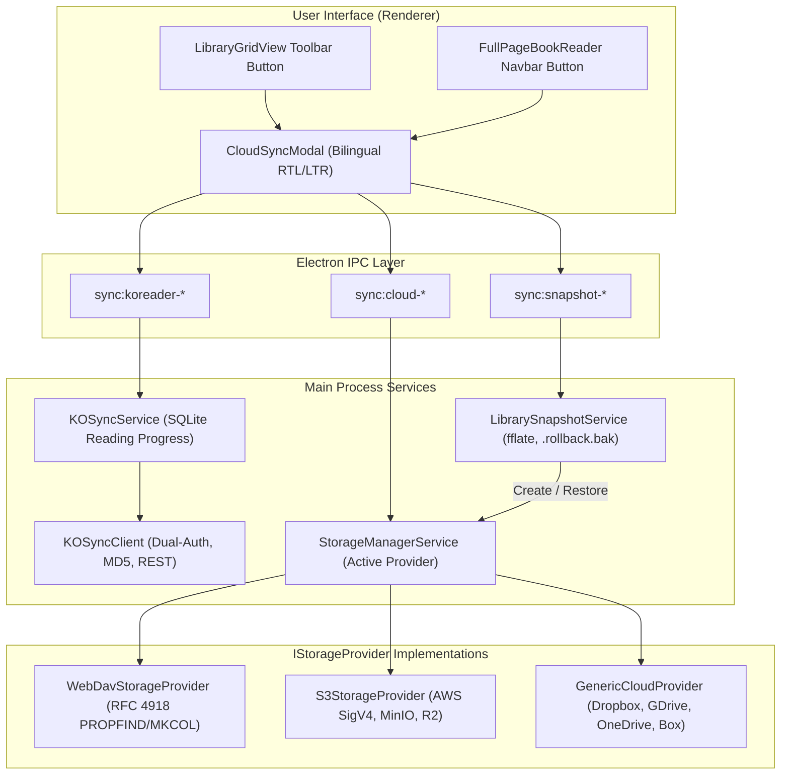

# Feature: Cloud Backup, KOReader Sync, and Version Snapshots

## 1. Overview & Objective
This document outlines Baglib's unified multi-cloud storage connector architecture, KOReader reading progress synchronization protocol, and point-in-time version snapshot and atomic rollback engine (`KEY-147: Task 5.1 — Build Cloud Backup/Import Connectors, KOReader Progress Sync, and Version Snapshots`).

The primary objectives are:
1. **Multi-Cloud Storage Abstraction (`IStorageProvider`)**: Unified interface and concrete implementations for WebDAV/Nextcloud, S3-compatible Object Storage (AWS, MinIO, Cloudflare R2, Wasabi), and generic OAuth/token connectors (Dropbox, Google Drive, OneDrive, Box, SMB, SFTP), supporting both automated backup uploads and remote book/backup browsing and importing.
2. **KOReader Protocol Sync Client (`KOSyncClient` & `KOSyncService`)**: Document digest calculation (MD5), dual-auth headers (`X-Auth-User`, `X-Auth-Key: md5(password)`, HTTP Basic fallback), auto-registration on 401, reading progress pull/push (`/syncs/progress`), and automatic background sync on book load and close.
3. **Version Snapshots & Atomic Safe Rollback Pipeline**: Compressed point-in-time `.zip` archives (`baglib.db`, `settings.json`, `annotations.json`, `manifest.json`) using `fflate.zipSync`, with an atomic restore pipeline that creates `.rollback.bak` before replacing the active database and guarantees automatic rollback on integrity failures.
4. **Bilingual UI & Visual Integration**: A fully localized bilingual (Arabic RTL & English LTR) 3-tab modal (`CloudSyncModal.tsx`) accessible from both the library toolbar and the full-page reader navigation bar.

---

## 2. Comparative Application Analysis

| Feature Dimension | Readest | Koodo Reader | Baglib Unified Architecture |
| :--- | :--- | :--- | :--- |
| **KOReader Progress Sync** | Native `KOSyncClient.ts` with custom headers, MD5 document digests, and SQLite reading statistics. | Embedded Go HTTP server (`httpserver/koreader.go`) acting as local sync server. | Full client implementation (`KOSyncClient`) with dual-auth fallback (headers + Basic Auth), auto-registration on 401, and SQLite sync. |
| **Cloud Storage Providers** | Local storage + Turso / WebDAV syncing for user data. | WebDAV, Dropbox, Google Drive, OneDrive, S3, FTP/SFTP via fragmented utility files. | Unified `IStorageProvider` abstraction with pluggable drivers: WebDAV/Nextcloud, S3/R2/MinIO, and Generic OAuth/Token providers. |
| **Remote File Browsing & Import** | Manual file import. | Remote file listing with format filtering. | Standardized `listFiles` and `downloadFile` across all providers, allowing remote library browsing and direct book importing. |
| **Version Snapshots** | Database export without version retention or safe rollback. | Compressed `.zip` backup (`jszip`), linear restore without pre-flight rollback guard. | High-performance synchronous compression (`fflate.zipSync`), retention auto-pruning (max 30), atomic `.rollback.bak` protection, and `PRAGMA integrity_check` validation. |
| **Bilingual UI / Layout** | Partial LTR/RTL support. | UI localized to Chinese/English with hardcoded physical CSS properties. | Full first-class Arabic (RTL) and English (LTR) layout with CSS logical properties, bidirectional badges, and localized alerts. |

---

## 3. System Architecture & Call Flows



---

## 4. Key Implementation Modules

### 4.1 KOReader Protocol Client (`src/main/services/sync/ko-sync-client.ts`)
- **Document Digest**: Computes standard MD5 hashes over buffer, file path, or string to match KOReader's canonical identifier algorithm.
- **Dual-Auth Negotiation**:
  ```typescript
  // Primary kosync header format
  headers['X-Auth-User'] = this.config.username;
  headers['X-Auth-Key'] = crypto.createHash('md5').update(this.config.password).digest('hex');

  // Fallback to HTTP Basic Auth when reverse proxies strip custom headers
  if (this.useBasicAuthFallback) {
    const creds = Buffer.from(`${this.config.username}:${headers['X-Auth-Key']}`).toString('base64');
    headers['Authorization'] = `Basic ${creds}`;
  }
  ```
- **Auto-Registration Handshake**: When `testConnection()` encounters HTTP 401, it automatically sends `POST /users/create` to provision the user account on kosher servers.

### 4.2 Multi-Cloud Storage Abstraction (`src/main/services/sync/`)
- **`IStorageProvider`**:
  - `testConnection(): Promise<SyncOperationResult>`
  - `listFiles(remotePath?: string): Promise<RemoteFileInfo[]>`
  - `uploadFile(remotePath: string, content: Buffer | Uint8Array): Promise<SyncOperationResult>`
  - `downloadFile(remotePath: string): Promise<Buffer>`
  - `readFile(remotePath: string): Promise<Buffer>`
  - `deleteFile(remotePath: string): Promise<boolean>`
- **`WebDavStorageProvider`**: Parses RFC 4918 PROPFIND XML responses (`D:multistatus`), handles recursive `MKCOL` collection directory creation, and executes streaming uploads/downloads.
- **`S3StorageProvider`**: Pure Node.js AWS Signature Version 4 (SigV4) HMAC-SHA256 implementation supporting standard AWS, MinIO, Wasabi, and Cloudflare R2 endpoints with ListObjectsV2 XML response parsing.
- **`GenericCloudProvider`**: Standardized token-based REST connector for Dropbox, Google Drive, OneDrive, and Box.

### 4.3 Version Snapshot & Atomic Safe Rollback Engine (`src/main/services/sync/library-snapshot.service.ts`)
- **Point-in-Time Archiving**: Uses `fflate.zipSync` to bundle:
  - Active SQLite database (`baglib.db`)
  - Application configuration (`settings.json`)
  - User annotations and highlights (`annotations.json`)
  - Manifest containing version, file counts, and creation timestamp (`manifest.json`)
- **Auto-Retention Pruning**: Enforces a strict ceiling of 30 snapshots, automatically removing older archives.
- **Atomic Safe Restore Pipeline**:
  1. Creates `.rollback.bak` copy of the active database before taking any destructive action.
  2. Extracts snapshot archive into temporary staging.
  3. Replaces active database file with snapshot contents.
  4. Runs SQLite `PRAGMA integrity_check`.
  5. If integrity check passes, deletes `.rollback.bak` and confirms success.
  6. If integrity check fails, immediately restores active database from `.rollback.bak` and aborts.

### 4.4 Bilingual User Experience (`CloudSyncModal.tsx`)
- Three tabbed views: **Cloud Storage**, **KOReader Sync**, and **Version Snapshots**.
- Responsive layout adhering to `RULE[bilingual-ui-and-ux.md]` using CSS logical properties (`margin-inline-start`, `padding-inline-end`).
- Interactive test connection badges, loading spinners, file browser dialogs, and rollback confirmation dialogs.
- Accessible directly from the library shelf toolbar and the active reading interface.

---

## 5. Verification & Test Evidence

All automated test suites execute cleanly and verify all synchronization and snapshot mechanics:
- **`tests/services/ko-sync.test.ts` (9/9 passed)**:
  - Document digest computation for buffers, files, and strings.
  - Header generation with MD5 password hashing and Basic Auth fallback.
  - User authentication and automatic 401 registration handshake.
  - Progress push and pull formatting.
  - Full integration with SQLite reading progress tables.
- **`tests/services/cloud-storage-provider.test.ts` (6/6 passed)**:
  - WebDAV PROPFIND XML parsing, directory creation, upload, and download.
  - S3 SigV4 signature generation, ListObjectsV2 parsing, and bucket operations.
  - StorageManager active provider switching and remote book discovery.
- **`tests/services/library-snapshot.test.ts` (6/6 passed)**:
  - Point-in-time `.zip` snapshot creation and file verification.
  - Snapshot listing and manifest parsing.
  - Retention limit auto-pruning.
  - Full restore and atomic rollback recovery on corrupted archives.
- **Whole Test Suite**: **601/601 unit tests passing across 67 test suites with 0 failures**.
- **TypeScript Compiler**: `npx tsc --noEmit` exits with **0 errors**.
