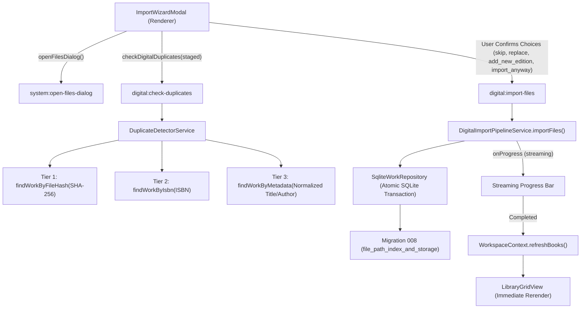

# Feature: Digital Library Import, Deduplication & Storage Health Architecture

## 1. Overview & Objective
This document details Baglib's digital e-book import pipeline, duplicate detection engine, storage verification system, and interactive 3-step Import Wizard (`KEY-6: Story 6 — Digital Library`).

The primary objectives are:
1. **Intelligent Deduplication**: Prevent silent library pollution and redundant physical disk copies by detecting duplicates across content hashes (SHA-256), global identifiers (ISBN-10/13), and normalized bibliographic metadata (Arabic/English titles and authors).
2. **User-Empowered Conflict Resolution**: Present clear side-by-side comparisons of existing library works versus incoming files, offering four deliberate actions: `skip`, `replace`, `add_new_edition`, and `import_anyway`.
3. **Streaming Batch Progress**: Deliver real-time, non-blocking visual feedback for bulk imports via Electron IPC streaming (`digital:import-progress`).
4. **Storage State & Health Tracking**: Monitor external drives, mounted network volumes, and local paths (`available`, `missing`, `unmounted`) with visual card health badges.
5. **Immediate UI Synchronization**: Refresh `WorkspaceContext` without manual reloads upon batch completion.

---

## 2. Comparative Application Analysis (Calibre vs. Baglib)

### 2.1 Calibre
- **Import Architecture**:
  - `calibre.gui2.add.AddBooks`: Scans directory recursively on background worker threads.
  - Checks duplicate by exact title/author match or existing internal file name in `metadata.db`.
  - Prompts modal asking: *"A book with this title already exists. Do you want to add this file as a new format, create a new book, or skip?"*
- **Strengths**: Robust multi-format support; powerful command-line tools (`calibredb add`).
- **Weaknesses**:
  - Tightly couples file storage to its own managed directory structure (`Author/Title (id)/Title - Author.fmt`), duplicating user files on disk.
  - Title matching is ASCII-biased; fails on Arabic definite articles (`ال`), normalization of diacritics (`تنوين/تشكيل`), and orthographic variants (`أ/إ/آ/ا`, `ة/ه`, `ى/ي`).
  - No streaming progress bar with per-file status badges for modern reactive Web/Electron UIs.

### 2.2 Baglib Design Innovations
- **Preserves In-Place Storage (Zero Duplication)**: Files remain at their canonical user locations (`is_managed: 0`).
- **3-Tier Deduplication Engine**:
  - **Tier 1 (SHA-256 Hash)**: Confidence `1.0`. Exact byte-for-byte duplicate.
  - **Tier 2 (ISBN-10 / ISBN-13)**: Confidence `0.95`. Normalizes hyphens and check digits; identifies alternate formats or re-issued editions.
  - **Tier 3 (Arabic/English Metadata Heuristic)**: Confidence `0.75 - 0.90`. Normalizes Arabic strings, strips prefixes (`ال`), removes tashkeel, and computes Levenshtein/token distance.
- **Bilingual Step-by-Step Import Wizard**:
  - Step 1: Drag-and-drop zone with format chips and native multi-file picker.
  - Step 2: Conflict resolution review with side-by-side cards.
  - Step 3: Real-time progress bar (0% - 100%) and batch metrics summary.
- **Physical Drive & Mount Awareness**: Distinguishes between moved/deleted files (`status: 'missing'`) and unmounted external USB or network drives (`status: 'unmounted'`).

---

## 3. System Architecture & Call Flows



---

## 4. Conflict Resolution Strategy

| Action | Technical Mechanism | Primary Use Case |
| :--- | :--- | :--- |
| **`skip`** | File ingestion skipped; recorded in `skippedImports` metric. | Recommended default when Tier 1 exact SHA-256 hash matches an existing file. |
| **`add_new_edition`** | Adds a new `edition` + `source` + `file_source_detail` under the existing `work_id`. | Recommended when ISBN or title matches, but file content is an alternate edition, translation, or format. |
| **`replace`** | Updates existing `file_source_detail(file_path, file_hash, file_format)` and refreshes cover and metadata. | Used when user replaces a low-quality or corrupt scan with a high-resolution version. |
| **`import_anyway`** | Creates an independent `work` with its own author, edition, and source. | Used when books share a common title (e.g. `المقدمة`, `التاريخ`) by different authors. |

---

## 5. Storage Verification & Drive Health Monitoring

Migration 008 added `storage_state` and `last_verified_at` columns to `file_source_detail`, along with covering indexes:
- `idx_file_source_detail_path` on `(file_path)`
- `idx_file_source_detail_hash` on `(file_hash)`
- `idx_edition_isbn` on `(isbn)`

The verification engine tests physical disk availability:
```typescript
if (fs.existsSync(filePath)) {
  status = 'available';
} else {
  const parsed = path.parse(filePath);
  const driveExists = parsed.root ? fs.existsSync(parsed.root) : true;
  status = driveExists ? 'missing' : 'unmounted';
}
```
In [`LibraryGridView.tsx`](file:///D:/Ammar's/Projects/Baglib/repo/Baglib/src/renderer/components/library/LibraryGridView.tsx), digital cards and list entries display red `storageHealthMissingBadge` ("ملف مفقود") or amber `storageHealthUnmountedBadge` ("قرص غير متصل") when storage anomalies are flagged.

---

## 6. Implementation References

- Migration 008: [`008_file_path_index_and_storage.ts`](file:///D:/Ammar's/Projects/Baglib/repo/Baglib/src/main/database/migrations/008_file_path_index_and_storage.ts)
- Duplicate Detector: [`duplicate-detector.service.ts`](file:///D:/Ammar's/Projects/Baglib/repo/Baglib/src/main/services/digital/duplicate-detector.service.ts)
- Import Pipeline: [`digital-import-pipeline.service.ts`](file:///D:/Ammar's/Projects/Baglib/repo/Baglib/src/main/services/digital/digital-import-pipeline.service.ts)
- Work Repository: [`work.repository.ts`](file:///D:/Ammar's/Projects/Baglib/repo/Baglib/src/main/database/repositories/work.repository.ts)
- Import Wizard Modal: [`ImportWizardModal.tsx`](file:///D:/Ammar's/Projects/Baglib/repo/Baglib/src/renderer/components/library/ImportWizardModal.tsx)
- Library Grid View: [`LibraryGridView.tsx`](file:///D:/Ammar's/Projects/Baglib/repo/Baglib/src/renderer/components/library/LibraryGridView.tsx)
- Workspace Context: [`WorkspaceContext.tsx`](file:///D:/Ammar's/Projects/Baglib/repo/Baglib/src/renderer/components/context/WorkspaceContext.tsx)
- Unit Tests:
  - [`file-path-indexing-and-storage.test.ts`](file:///D:/Ammar's/Projects/Baglib/repo/Baglib/tests/services/digital/file-path-indexing-and-storage.test.ts)
  - [`duplicate-detector.test.ts`](file:///D:/Ammar's/Projects/Baglib/repo/Baglib/tests/services/digital/duplicate-detector.test.ts)
  - [`import-wizard-and-duplicate-flow.test.ts`](file:///D:/Ammar's/Projects/Baglib/repo/Baglib/tests/services/digital/import-wizard-and-duplicate-flow.test.ts)

## 7. Bulk-import responsiveness hardening — 2026-10-24

### Verified causes in Baglib's source

- Wizard extraction and duplicate scanning invoked the PDF/EPUB parsers in Electron's main process. Hashing allocated complete book buffers, with additional full reads during metadata extraction.
- Duplicate similarity checks repeatedly hydrated the complete library, including covers, metadata and lending history. Duplicate previews could repeat the same cover blob hundreds of times.
- Library drops used a separate ingestion path, including PDF cover rendering and per-book state/database updates. Drops inside the wizard bubbled to the library drop handler, potentially processing the same selection twice.
- The wizard rendered every selected, conflicting and completed file; completion also refreshed the library twice through the parent callback.
- The first isolated Electron bulk run exposed an additional correctness issue: files with no reviewed conflict defaulted to unrestricted `skip`, so later, genuinely different books with similar titles were silently skipped. The live assertion detected that fewer than 300 books were retained; the corrected run retained all 300.

This section records source debugging and local tests, not a new reverse-engineering investigation of Calibre or another external application. Historical comparison claims above were not independently revalidated during this task.

### Implementation and resource bounds

- `src/main/services/digital/background-metadata.service.ts` serializes parser work in one Node worker. `src/main/metadata-worker.ts` is emitted alongside the main bundle by `tsup.config.ts` and included by the existing `dist/**/*` packaging rule. SQLite writes remain in the main process and preserve Work → Edition → Source transactions; no database migration or dependency was added.
- A parser gets a 30-second deadline and a 192 MiB V8 old-generation limit. The worker is restarted after failure, terminated on application shutdown, and recycled every 25 completed tasks. This V8 limit is **not** a hard cap on total process RSS or external buffers.
- Books over 64 MiB use filename-derived metadata without deep parsing. Covers exceeding 512 KiB as a data URL are not transferred/stored by this bulk path; the reader can still open the original file. Large or pathological books may therefore lack embedded fields or covers initially. Four small metadata results are cached, invalidated by path, size, mtime and format. No full-book buffers are retained in this cache.
- This change does not schedule automatic backfilling of omitted metadata or covers. Existing metadata-editing/discovery tools remain available; the original book file is not modified.
- `import-files.ts` hashes via 256 KiB streams and discovers supported files recursively with asynchronous directory iteration. Paths are deduplicated, symlinks/junctions are not traversed, unsupported extensions are ignored and inaccessible paths are returned as errors. Canonical Arabic/English names are preserved.
- Validation opens at most four files concurrently. Import and duplicate-scan IPC jobs share a serialized queue; individual validation/import failures still produce per-file results. Unexpected batch/scan failures now reject instead of masquerading as empty successes.
- Duplicate scans fetch lightweight title/author candidates once per scan, yield during similarity comparisons and return compact existing-book previews without cover/provenance blobs. Batch import summaries likewise omit embedded cover data; saved book records retain accepted covers.
- Library drops now open the import wizard with their paths instead of rendering/importing each book independently. Wizard drop propagation is stopped. The wizard adds a localized **Choose a book folder** control, discovery status/errors, and **Show 100 more files** paging for selection, conflicts and results. It refreshes the library once after completion. File rows remain removable and all staged files, not just the visible page, are imported.
- For files without a reviewed duplicate decision, the existing `skip` action is combined with the DTO-only `skipExactDuplicatesOnly` flag: identical content discovered during the batch is skipped, but fuzzy metadata matches are not silently discarded. Explicit user conflict decisions retain their prior behavior.
- Arabic/English labels, resource-deferral guidance and errors use centralized translations, with RTL/LTR and mixed-script paths retained. DJVU was removed from the wizard's claimed support because the existing digital validator does not accept it.

### Verification and limits

- `tests/services/bulk-import.test.ts`: nested-folder discovery and path deduplication; streaming hash equivalence; at most four concurrent probes; a **300-book mixed batch (100 PDF, 100 EPUB, 100 TXT)** using actual SQLite and the real background extractor; monotonic progress; duplicate detection; stalled/crashed worker recovery; oversized-file fallback; compact repeated duplicate previews; exact-only skipping for similar titles.
- A mixed-batch run recorded 869 main-thread heartbeat ticks and a largest measured gap of **25 ms**, with all 300 imports succeeding. These are local test observations, not a guaranteed latency bound. The PDFs were copies of the repository's existing 1.76 MB sample; EPUBs were generated metadata fixtures, not 300 distinct production books.
- `tests/ui/bulk-import-wizard.test.ts`: 300-file staging, 100-row initial rendering, progressive disclosure, no duplicate drop propagation, importing every staged file and one completion refresh, in both Arabic and English.
- `node scripts/import-live/run.mjs`: hidden Electron with the actual preload, digital IPC handlers, background worker and isolated database/profile. Imported 300 generated Arabic/English text files through duplicate review and confirmation; observed one completion refresh, zero renderer errors and zero external network requests. Checked 480/1100-pixel RTL/LTR layouts for horizontal overflow and visually inspected Arabic narrow and English desktop screenshots.
- Generated profiles, fixtures, logs and screenshots are kept under ignored `.baglib-data/`. The harness uses an isolated profile and never imports into the user's library. The tests do not constitute validation of every real PDF/EPUB, the OS folder-picker dialog, drag-and-drop from every Windows file manager, or a packaged installer.
- New-source lint is checked separately from existing modified files, which contain pre-existing explicit-`any` violations. No full renderer production build or full repository test-suite pass is claimed.

Final checks passed: **46 focused tests**, TypeScript, the main/preload/worker build, new-source ESLint, and whitespace/diff checks. A later mixed-batch run measured a 34 ms largest heartbeat gap, illustrating normal run-to-run variation. The Electron live harness also executed the metadata worker directly from a generated ASAR archive and received real metadata; this is an archive-loading smoke test, not a packaged-installer certification. Electron's [multithreading guidance](https://www.electronjs.org/docs/latest/tutorial/multithreading/) and [ASAR documentation](https://www.electronjs.org/docs/latest/tutorial/asar-archives) were consulted when checking those runtime boundaries; no Electron renderer Node integration was enabled or loosened by this change.
