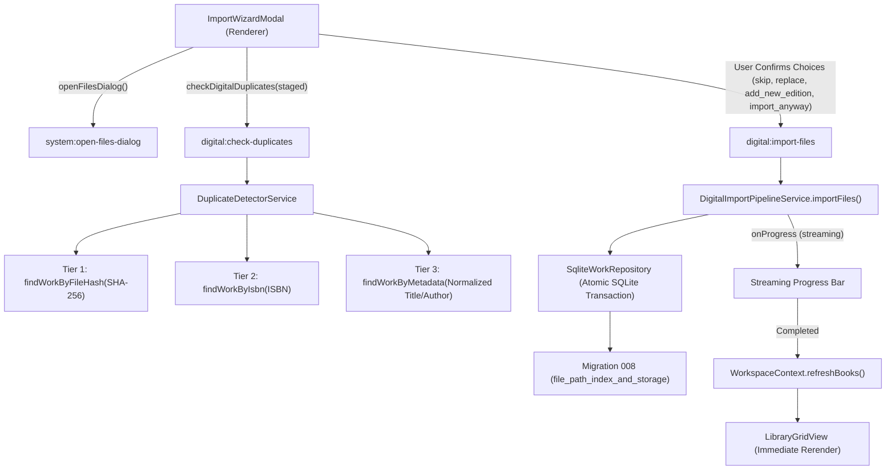

# Feature: Digital Library Import, Deduplication & Storage Health Architecture

## 1. Overview & Objective
This document details Baglib's digital e-book import pipeline, duplicate detection engine, storage verification system, and interactive 3-step Import Wizard (`KEY-6: Story 6 — Digital Library`).

The primary objectives are:
1. **Intelligent Deduplication**: Prevent silent library pollution and redundant physical disk copies by detecting duplicates across content hashes (SHA-256), global identifiers (ISBN-10/13), and normalized bibliographic metadata (Arabic/English titles and authors).
2. **User-Empowered Conflict Resolution**: Present clear side-by-side comparisons of existing library works versus incoming files, offering four deliberate actions: `skip`, `replace`, `add_new_edition`, and `import_anyway`.
3. **Streaming Batch Progress**: Deliver real-time, non-blocking visual feedback for bulk imports via Electron IPC streaming (`digital:import-progress`).
4. **Storage State & Health Tracking**: Monitor external drives, mounted network volumes, and local paths (`available`, `missing`, `unmounted`) with visual card health badges.
5. **Immediate UI Synchronization**: Refresh `WorkspaceContext` without manual reloads upon batch completion.

---

## 2. Comparative Application Analysis (Calibre vs. Baglib)

### 2.1 Calibre
- **Import Architecture**:
  - `calibre.gui2.add.AddBooks`: Scans directory recursively on background worker threads.
  - Checks duplicate by exact title/author match or existing internal file name in `metadata.db`.
  - Prompts modal asking: *"A book with this title already exists. Do you want to add this file as a new format, create a new book, or skip?"*
- **Strengths**: Robust multi-format support; powerful command-line tools (`calibredb add`).
- **Weaknesses**:
  - Tightly couples file storage to its own managed directory structure (`Author/Title (id)/Title - Author.fmt`), duplicating user files on disk.
  - Title matching is ASCII-biased; fails on Arabic definite articles (`ال`), normalization of diacritics (`تنوين/تشكيل`), and orthographic variants (`أ/إ/آ/ا`, `ة/ه`, `ى/ي`).
  - No streaming progress bar with per-file status badges for modern reactive Web/Electron UIs.

### 2.2 Baglib Design Innovations
- **Preserves In-Place Storage (Zero Duplication)**: Files remain at their canonical user locations (`is_managed: 0`).
- **3-Tier Deduplication Engine**:
  - **Tier 1 (SHA-256 Hash)**: Confidence `1.0`. Exact byte-for-byte duplicate.
  - **Tier 2 (ISBN-10 / ISBN-13)**: Confidence `0.95`. Normalizes hyphens and check digits; identifies alternate formats or re-issued editions.
  - **Tier 3 (Arabic/English Metadata Heuristic)**: Confidence `0.75 - 0.90`. Normalizes Arabic strings, strips prefixes (`ال`), removes tashkeel, and computes Levenshtein/token distance.
- **Bilingual Step-by-Step Import Wizard**:
  - Step 1: Drag-and-drop zone with format chips and native multi-file picker.
  - Step 2: Conflict resolution review with side-by-side cards.
  - Step 3: Real-time progress bar (0% - 100%) and batch metrics summary.
- **Physical Drive & Mount Awareness**: Distinguishes between moved/deleted files (`status: 'missing'`) and unmounted external USB or network drives (`status: 'unmounted'`).

---

## 3. System Architecture & Call Flows



---

## 4. Conflict Resolution Strategy

| Action | Technical Mechanism | Primary Use Case |
| :--- | :--- | :--- |
| **`skip`** | File ingestion skipped; recorded in `skippedImports` metric. | Recommended default when Tier 1 exact SHA-256 hash matches an existing file. |
| **`add_new_edition`** | Adds a new `edition` + `source` + `file_source_detail` under the existing `work_id`. | Recommended when ISBN or title matches, but file content is an alternate edition, translation, or format. |
| **`replace`** | Updates existing `file_source_detail(file_path, file_hash, file_format)` and refreshes cover and metadata. | Used when user replaces a low-quality or corrupt scan with a high-resolution version. |
| **`import_anyway`** | Creates an independent `work` with its own author, edition, and source. | Used when books share a common title (e.g. `المقدمة`, `التاريخ`) by different authors. |

---

## 5. Storage Verification & Drive Health Monitoring

Migration 008 added `storage_state` and `last_verified_at` columns to `file_source_detail`, along with covering indexes:
- `idx_file_source_detail_path` on `(file_path)`
- `idx_file_source_detail_hash` on `(file_hash)`
- `idx_edition_isbn` on `(isbn)`

The verification engine tests physical disk availability:
```typescript
if (fs.existsSync(filePath)) {
  status = 'available';
} else {
  const parsed = path.parse(filePath);
  const driveExists = parsed.root ? fs.existsSync(parsed.root) : true;
  status = driveExists ? 'missing' : 'unmounted';
}
```
In [`LibraryGridView.tsx`](file:///D:/Ammar's/Projects/Baglib/repo/Baglib/src/renderer/components/library/LibraryGridView.tsx), digital cards and list entries display red `storageHealthMissingBadge` ("ملف مفقود") or amber `storageHealthUnmountedBadge` ("قرص غير متصل") when storage anomalies are flagged.

---

## 6. Implementation References

- Migration 008: [`008_file_path_index_and_storage.ts`](file:///D:/Ammar's/Projects/Baglib/repo/Baglib/src/main/database/migrations/008_file_path_index_and_storage.ts)
- Duplicate Detector: [`duplicate-detector.service.ts`](file:///D:/Ammar's/Projects/Baglib/repo/Baglib/src/main/services/digital/duplicate-detector.service.ts)
- Import Pipeline: [`digital-import-pipeline.service.ts`](file:///D:/Ammar's/Projects/Baglib/repo/Baglib/src/main/services/digital/digital-import-pipeline.service.ts)
- Work Repository: [`work.repository.ts`](file:///D:/Ammar's/Projects/Baglib/repo/Baglib/src/main/database/repositories/work.repository.ts)
- Import Wizard Modal: [`ImportWizardModal.tsx`](file:///D:/Ammar's/Projects/Baglib/repo/Baglib/src/renderer/components/library/ImportWizardModal.tsx)
- Library Grid View: [`LibraryGridView.tsx`](file:///D:/Ammar's/Projects/Baglib/repo/Baglib/src/renderer/components/library/LibraryGridView.tsx)
- Workspace Context: [`WorkspaceContext.tsx`](file:///D:/Ammar's/Projects/Baglib/repo/Baglib/src/renderer/components/context/WorkspaceContext.tsx)
- Unit Tests:
  - [`file-path-indexing-and-storage.test.ts`](file:///D:/Ammar's/Projects/Baglib/repo/Baglib/tests/services/digital/file-path-indexing-and-storage.test.ts)
  - [`duplicate-detector.test.ts`](file:///D:/Ammar's/Projects/Baglib/repo/Baglib/tests/services/digital/duplicate-detector.test.ts)
  - [`import-wizard-and-duplicate-flow.test.ts`](file:///D:/Ammar's/Projects/Baglib/repo/Baglib/tests/services/digital/import-wizard-and-duplicate-flow.test.ts)
