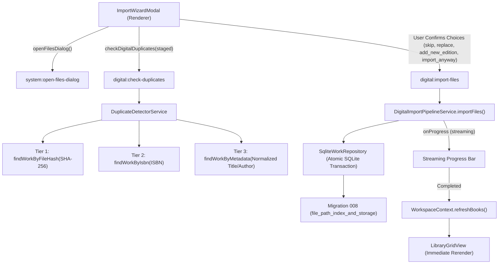

# Feature: Digital Library Import, Deduplication & Storage Health Architecture

## 1. Overview & Objective

### KEY-300 part 1 follow-up - 2026-11-11, Codex

This follow-up supersedes the earlier cancellation limit for the wizard's import phase. The shared batch pipeline accepts an optional AbortSignal. The IPC handler owns an AbortController keyed by the sending webContents and a request identifier. Cancellation bypasses the serialized import queue, so it can mark a queued or active batch while the queue is busy. The pipeline checks the signal before each file and lets any already-started importFile finish. Completed works stay in the existing Work → Edition → Source storage. Unstarted files receive skipped/cancelled result flags, with no file access or database insert. These are transient API fields.

Minimize, active Escape and active Close release modal focus. A Resume item lives in StatusBar while the app runs, with the existing floating fallback when a footer is absent. Reopening retains the same batch. The summary separates imported files, duplicates, failures and unprocessed files, with library navigation or a retry action. Retry stages only failed and unprocessed paths. A completed import stays in its summary if the library refresh fails. Background completion uses the shared KEY-301 toast service, and resuming clears that toast so summary actions stay visible at 480 px. Cancelled results explicitly say that import stopped safely.

Duplicate scanning can be hidden while it finishes. Cancellation applies to the import phase at file boundaries. Running-app sessions retain their state across workspace navigation. Restart recovery remains a future requirement.

Final verification passes 27 focused tests and 1862 full tests at concurrency two. The real-file matrix passes all eight ar/en, light/dark, 1280/480 configurations with 18 batches and zero renderer errors. Six of 42 final screenshots were inspected. The final run is .baglib-data/KEY-300-evidence/2026-11-11T16-18-03-810Z/. Profiles and three earlier evidence runs were removed.

Verification boundaries are recorded in the local KEY-300 report. The native harness uses the production renderer/preload and registers the current source digital IPC handlers in the isolated app. It runs the actual validator, background metadata worker, hashing and SQLite writes on all five available real text-layer PDF/EPUB files. The cover renderer is replaced with an empty-cover result to keep one Electron window. A 1.2-second per-file pacing delay makes UI cancellation deterministic. The source metadata service is pointed at the built worker. The scanned PDF is excluded and OCR is never invoked. Native PDF cover extraction is outside this run's verification boundary.


### Confirmed shutdown drain — 2026-11-07, Codex

**Native follow-up:** `scripts/import-shutdown-live` uses the real built Electron app/preload/metadata workers with disposable English- and Arabic-configured profiles. Each submits120unique TXT files and2generated one-page PDFs, requests Quit on the first validating progress event, waits for process exit, then reads SQLite with the existing local Python runtime. Final en-cu8G61/ar-EVEgmV each contain122imported works,122file sources, both PDF cover records/pagecounts and integrity_check=ok; no renderer errors or closed-database failures. Harnesslint/diff-check pass. This supersedes the native-import-during-Quit coverage gap below for this generated corpus, not for hundreds of large PDFs. It tests backend IPC, not wizard/dragdrop interactions or visualRTL. No production change in this follow-up; prior suite/build results were not rerun. Test server stopped/3000free.

Source inspection found `ipc/digital.ts` serialized imports and duplicate checks but disposed the metadata extractor without awaiting that queue at exit. New `services/digital/import-queue.ts` preserves serial admission while running; confirmed shutdown closes admission, waits for accepted work (including queued work) and only then disposes the extractor. Failed jobs do not prevent later jobs or cleanup. `services/quit-cleanup.ts` drains these jobs before shared-service cleanup, retaining cover workers until imports finish; main awaits it before SQLite closes. Cancelled Quit does not start this phase. Large accepted batches may delay exit; this change neither cancels them nor defers extraction.

Verified: delayed real-SQLite test checks exact mixed Arabic/Latin title preservation, ordering, late rejection, one disposal and shared-cleanup ordering; failure recovery test passes. Full1413/1413 tests, finaltsc/mainbuild and scopedlint0errors/0warnings. Native disposable `save-live-FTD21X` passes English Cancel-Quit/Arabic Save-Quit with2marks, foreign annotation and one previous-file-hash emergency copy. That native fixture does not import books: hundreds-file native import during Quit is not certified. No schema/dependency changes, downloads or real-library access.
This document details Baglib's digital e-book import pipeline, duplicate detection engine, storage verification system, and interactive 3-step Import Wizard (`KEY-6: Story 6 — Digital Library`).

The primary objectives are:
1. **Intelligent Deduplication**: Prevent silent library pollution and redundant physical disk copies by detecting duplicates across content hashes (SHA-256), global identifiers (ISBN-10/13), and normalized bibliographic metadata (Arabic/English titles and authors).
2. **User-Empowered Conflict Resolution**: Present clear side-by-side comparisons of existing library works versus incoming files, offering four deliberate actions: `skip`, `replace`, `add_new_edition`, and `import_anyway`.
3. **Streaming Batch Progress**: Deliver real-time, non-blocking visual feedback for bulk imports via Electron IPC streaming (`digital:import-progress`).
4. **Storage State & Health Tracking**: Monitor external drives, mounted network volumes, and local paths (`available`, `missing`, `unmounted`) with visual card health badges.
5. **Immediate UI Synchronization**: Refresh `WorkspaceContext` without manual reloads upon batch completion.

---

## 2. Comparative Application Analysis (Calibre vs. Baglib)

### 2.1 Calibre
- **Import Architecture**:
  - `calibre.gui2.add.AddBooks`: Scans directory recursively on background worker threads.
  - Checks duplicate by exact title/author match or existing internal file name in `metadata.db`.
  - Prompts modal asking: *"A book with this title already exists. Do you want to add this file as a new format, create a new book, or skip?"*
- **Strengths**: Robust multi-format support; powerful command-line tools (`calibredb add`).
- **Weaknesses**:
  - Tightly couples file storage to its own managed directory structure (`Author/Title (id)/Title - Author.fmt`), duplicating user files on disk.
  - Title matching is ASCII-biased; fails on Arabic definite articles (`ال`), normalization of diacritics (`تنوين/تشكيل`), and orthographic variants (`أ/إ/آ/ا`, `ة/ه`, `ى/ي`).
  - No streaming progress bar with per-file status badges for modern reactive Web/Electron UIs.

### 2.2 Baglib Design Innovations
- **Preserves In-Place Storage (Zero Duplication)**: Files remain at their canonical user locations (`is_managed: 0`).
- **3-Tier Deduplication Engine**:
  - **Tier 1 (SHA-256 Hash)**: Confidence `1.0`. Exact byte-for-byte duplicate.
  - **Tier 2 (ISBN-10 / ISBN-13)**: Confidence `0.95`. Normalizes hyphens and check digits; identifies alternate formats or re-issued editions.
  - **Tier 3 (Arabic/English Metadata Heuristic)**: Confidence `0.75 - 0.90`. Normalizes Arabic strings, strips prefixes (`ال`), removes tashkeel, and computes Levenshtein/token distance.
- **Bilingual Step-by-Step Import Wizard**:
  - Step 1: Drag-and-drop zone with format chips and native multi-file picker.
  - Step 2: Conflict resolution review with side-by-side cards.
  - Step 3: Real-time progress bar (0% - 100%) and batch metrics summary.
- **Physical Drive & Mount Awareness**: Distinguishes between moved/deleted files (`status: 'missing'`) and unmounted external USB or network drives (`status: 'unmounted'`).

---

## 3. System Architecture & Call Flows



---

## 4. Conflict Resolution Strategy

| Action | Technical Mechanism | Primary Use Case |
| :--- | :--- | :--- |
| **`skip`** | File ingestion skipped; recorded in `skippedImports` metric. | Recommended default when Tier 1 exact SHA-256 hash matches an existing file. |
| **`add_new_edition`** | Adds a new `edition` + `source` + `file_source_detail` under the existing `work_id`. | Recommended when ISBN or title matches, but file content is an alternate edition, translation, or format. |
| **`replace`** | Updates existing `file_source_detail(file_path, file_hash, file_format)` and refreshes cover and metadata. | Used when user replaces a low-quality or corrupt scan with a high-resolution version. |
| **`import_anyway`** | Creates an independent `work` with its own author, edition, and source. | Used when books share a common title (e.g. `المقدمة`, `التاريخ`) by different authors. |

---

## 5. Storage Verification & Drive Health Monitoring

Migration 008 added `storage_state` and `last_verified_at` columns to `file_source_detail`, along with covering indexes:
- `idx_file_source_detail_path` on `(file_path)`
- `idx_file_source_detail_hash` on `(file_hash)`
- `idx_edition_isbn` on `(isbn)`

The verification engine tests physical disk availability:
```typescript
if (fs.existsSync(filePath)) {
  status = 'available';
} else {
  const parsed = path.parse(filePath);
  const driveExists = parsed.root ? fs.existsSync(parsed.root) : true;
  status = driveExists ? 'missing' : 'unmounted';
}
```
In [`LibraryGridView.tsx`](file:///D:/Ammar's/Projects/Baglib/repo/Baglib/src/renderer/components/library/LibraryGridView.tsx), digital cards and list entries display red `storageHealthMissingBadge` ("ملف مفقود") or amber `storageHealthUnmountedBadge` ("قرص غير متصل") when storage anomalies are flagged.

---

## 6. Implementation References

- Migration 008: [`008_file_path_index_and_storage.ts`](file:///D:/Ammar's/Projects/Baglib/repo/Baglib/src/main/database/migrations/008_file_path_index_and_storage.ts)
- Duplicate Detector: [`duplicate-detector.service.ts`](file:///D:/Ammar's/Projects/Baglib/repo/Baglib/src/main/services/digital/duplicate-detector.service.ts)
- Import Pipeline: [`digital-import-pipeline.service.ts`](file:///D:/Ammar's/Projects/Baglib/repo/Baglib/src/main/services/digital/digital-import-pipeline.service.ts)
- Work Repository: [`work.repository.ts`](file:///D:/Ammar's/Projects/Baglib/repo/Baglib/src/main/database/repositories/work.repository.ts)
- Import Wizard Modal: [`ImportWizardModal.tsx`](file:///D:/Ammar's/Projects/Baglib/repo/Baglib/src/renderer/components/library/ImportWizardModal.tsx)
- Library Grid View: [`LibraryGridView.tsx`](file:///D:/Ammar's/Projects/Baglib/repo/Baglib/src/renderer/components/library/LibraryGridView.tsx)
- Workspace Context: [`WorkspaceContext.tsx`](file:///D:/Ammar's/Projects/Baglib/repo/Baglib/src/renderer/components/context/WorkspaceContext.tsx)
- Unit Tests:
  - [`file-path-indexing-and-storage.test.ts`](file:///D:/Ammar's/Projects/Baglib/repo/Baglib/tests/services/digital/file-path-indexing-and-storage.test.ts)
  - [`duplicate-detector.test.ts`](file:///D:/Ammar's/Projects/Baglib/repo/Baglib/tests/services/digital/duplicate-detector.test.ts)
  - [`import-wizard-and-duplicate-flow.test.ts`](file:///D:/Ammar's/Projects/Baglib/repo/Baglib/tests/services/digital/import-wizard-and-duplicate-flow.test.ts)

## 7. Bulk-import responsiveness hardening — 2026-10-24

### Verified causes in Baglib's source

- Wizard extraction and duplicate scanning invoked the PDF/EPUB parsers in Electron's main process. Hashing allocated complete book buffers, with additional full reads during metadata extraction.
- Duplicate similarity checks repeatedly hydrated the complete library, including covers, metadata and lending history. Duplicate previews could repeat the same cover blob hundreds of times.
- Library drops used a separate ingestion path, including PDF cover rendering and per-book state/database updates. Drops inside the wizard bubbled to the library drop handler, potentially processing the same selection twice.
- The wizard rendered every selected, conflicting and completed file; completion also refreshed the library twice through the parent callback.
- The first isolated Electron bulk run exposed an additional correctness issue: files with no reviewed conflict defaulted to unrestricted `skip`, so later, genuinely different books with similar titles were silently skipped. The live assertion detected that fewer than 300 books were retained; the corrected run retained all 300.

This section records source debugging and local tests, not a new reverse-engineering investigation of Calibre or another external application. Historical comparison claims above were not independently revalidated during this task.

### Implementation and resource bounds

- `src/main/services/digital/background-metadata.service.ts` serializes extraction in one **separate Electron utility process** through `metadata-process.ts`. The same extraction entry also supports Node workers for isolated service tests. `src/main/metadata-worker.ts` is emitted alongside the main bundle by `tsup.config.ts` and included by the existing `dist/**/*` packaging rule. SQLite writes remain in the main process and preserve Work → Edition → Source transactions; no database migration or dependency was added.
- A parser gets a 120-second safety deadline and a 768 MiB V8 old-generation limit. Its host is restarted after failure, terminated on application shutdown, and recycled every 25 completed tasks. A killed/crashed/timed-out host rejects its job; it is not converted into a successful filename-only import. The V8 limit is **not** a hard cap on total process RSS or external buffers. Serial execution and process isolation protect responsiveness and contain parser exits, but cannot guarantee success for every malformed or resource-exhausting file.
- **The earlier 64 MiB filename-only shortcut and 512 KiB cover-dropping policy were removed at the user's request.** Every file reaches the extraction attempt, regardless of size. Full extracted cover bytes are atomically persisted in the existing userData/covers storage using a content hash; `ExtractedEbookMetadata.coverPath` is a transport-only field consumed as the existing book coverImage, not a new database column. Only a path crosses the process boundary, avoiding repeated large base64 payloads. Four small metadata results are cached by path, size, mtime and format; refusing to cache a large result does not omit its content.
- There is no delayed extraction/backfill queue. Available embedded metadata and covers are processed during the import itself. Missing source metadata still uses the extractor's normal filename reconciliation, while fatal extractor-host failures appear as failed files. Original book files are not modified.
- `import-files.ts` hashes via 256 KiB streams and discovers supported files recursively with asynchronous directory iteration. Paths are deduplicated, symlinks/junctions are not traversed, unsupported extensions are ignored and inaccessible paths are returned as errors. Canonical Arabic/English names are preserved.
- Validation opens at most four files concurrently. Import and duplicate-scan IPC jobs share a serialized queue; individual validation/import failures still produce per-file results. Unexpected batch/scan failures now reject instead of masquerading as empty successes.
- Duplicate scans fetch lightweight title/author candidates once per scan, yield during similarity comparisons and return compact existing-book previews without cover/provenance blobs. Batch import summaries likewise omit embedded cover data; saved book records retain accepted covers.
- Multiple-file and folder drops open the import wizard instead of rendering/importing each book in the renderer. A single actual file takes the same isolated backend import path directly, with a small progress indicator and success/duplicate/failure notification, without opening the wizard. A directory containing one book still takes the folder wizard path. Wizard drop propagation is stopped. Localized **Choose a book folder**, discovery status/errors and **Show 100 more files** controls remain available. Completion refreshes the library once; all staged files, not just the visible page, are imported.
- After the user confirms selection, validation and duplicate review run automatically. A complete, error-free review with no duplicate matches proceeds straight to import/results, without another click. Invalid files, extraction failures, incomplete responses, discovery failures or duplicates stop for explicit review. Scan/import refs prevent duplicate submission; review snapshots are passed directly into import rather than relying on stale React state.
- For files without a reviewed duplicate decision, the existing `skip` action is combined with the DTO-only `skipExactDuplicatesOnly` flag: identical content discovered during the batch is skipped, but fuzzy metadata matches are not silently discarded. Explicit user conflict decisions retain their prior behavior.
- Arabic/English labels, immediate-extraction guidance and errors use centralized translations, with RTL/LTR and mixed-script paths retained. DJVU was removed from the wizard's claimed support because the existing digital validator does not accept it.

### Verification and limits

- `tests/services/bulk-import.test.ts`: nested-folder discovery and path deduplication; streaming hash equivalence; at most four concurrent probes; a **300-book mixed batch (100 PDF, 100 EPUB, 100 TXT)** using actual SQLite and the real background extractor; monotonic progress; duplicate detection; explicit stalled/crashed-host failure and recovery; oversized files reaching the extraction host; compact duplicate previews; exact-only skipping for similar titles.
- A mixed-batch run recorded 869 main-thread heartbeat ticks and a largest measured gap of **25 ms**, with all 300 imports succeeding. These are local test observations, not a guaranteed latency bound. The PDFs were copies of the repository's existing 1.76 MB sample; EPUBs were generated metadata fixtures, not 300 distinct production books.
- `tests/ui/bulk-import-wizard.test.ts`: 300-file staging, paged rows, contained drops, automatic import after a clean review and one completion refresh in Arabic and English. Negative cases require review for duplicates, invalid files, metadata failures and incomplete review responses. `tests/ui/book-drop.test.ts` verifies direct single-file importing, exact-duplicate protection, folder/multiple-file routing and inaccessible single drops.
- `node scripts/import-live/run.mjs`: hidden Electron with the actual preload, IPC, utility process and isolated database/profile. The latest run imported **301 books**, including a **65+ MiB EPUB** whose embedded title was retained and whose **921,667-byte cover was verified byte-for-byte** after persistence. It also deliberately terminated a utility parser with exit code 23, verified the main app survived and that a replacement process handled the next job with a distinct PID. Both Node-worker and utility-process ASAR entry loading were exercised. Clean duplicate review advanced without clicking Start Import. Completion caused one refresh, zero renderer errors and zero external requests. Checked 480/1100-pixel RTL/LTR overflow; prior Arabic narrow and English desktop screenshots were inspected.
- Generated profiles, fixtures, logs and screenshots are kept under ignored `.baglib-data/`. The harness uses an isolated profile and never imports into the user's library. The tests do not constitute validation of every real PDF/EPUB, the OS folder-picker dialog, drag-and-drop from every Windows file manager, or a packaged installer.
- New-source lint is checked separately from existing modified files, which contain pre-existing explicit-`any` violations. No full renderer production build or full repository test-suite pass is claimed.

The initial hardening passed 46 focused tests, TypeScript and the main/preload/worker build. Later service runs measured 30–34 ms largest heartbeat gaps, illustrating normal variation. These measurements are test observations, not universal performance guarantees. The installed Electron 32 type definitions (`UtilityProcess`, `ForkOptions`, `process.parentPort`) and the local runtime were checked for the new process host; renderer Node integration was not enabled or loosened. ASAR smoke tests are not packaged-installer certification.

After removing deferral and revising the workflow, the combined focused regression run passed **87 tests**, including existing edition, Sunnah and reader coverage. TypeScript, main/preload/extraction-entry build, focused new-source lint and diff checks passed. The 301-book Electron run verified current process isolation and cover persistence; direct single-drop routing was covered by focused tests, not automation of every OS drag source.

### PDF page-cover refinement — 2026-10-24

PDF ingestion now renders the actual first page before success, through a serial sandboxed renderer, instead of saving the first extracted image. References above to retaining original embedded cover bytes apply to EPUB/other embedded-artwork formats; PDF covers are full-page JPEG rasters with bounded resolution. No PDF cover work is deferred. Manual page selection and explicit overrides are preserved. See [Cover Retrieval](feature%20-%20Cover%20Retrieval.md) and [PDF.js](PDF.js.md). The updated combined targeted suite passed 109 tests, and real Electron IPC/import tests verified page-1 persistence. The earlier 301-book throughput measurements predate this rendering change; no new hundreds-of-PDF raster benchmark or installer certification is claimed.
