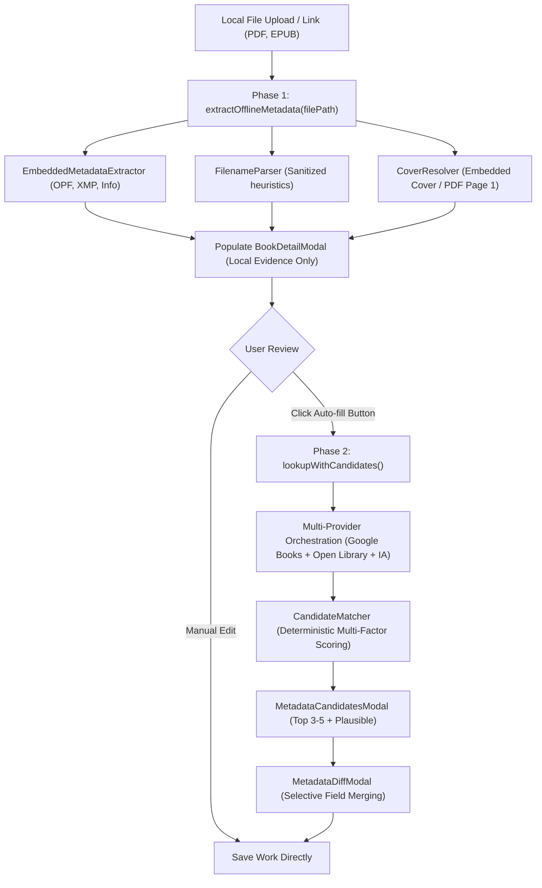

# Feature: Two-Phase Metadata Discovery & Acquisition Architecture

## 1. Overview & Objective
This document outlines the comparative research, architecture, and implementation of Baglib's **Two-Phase Metadata Discovery & Acquisition Pipeline**.

The core objective is to eliminate premature or unwanted online metadata overwrites when users upload local files, while providing a powerful, user-guided online auto-fill pipeline when explicitly requested.

---

## 2. Comparative Application Analysis

### 2.1 Calibre
- **Architecture**:
  - **Phase 1 (Addition)**: Local file inspection via `calibre.ebooks.metadata.meta.get_metadata`. Strictly offline. Extracts EPUB OPF, PDF Info/XMP, MOBI headers, and embedded raster covers.
  - **Phase 2 (Enrichment)**: Initiated on-demand via `identify.py` / "Download metadata" (`Ctrl+D`). Multi-threaded worker pool queries Google Books, Amazon, and Open Library. Merges heterogeneous fields using `InternalMetadataCompareKeyGen` and displays candidate covers and fields.
- **Strengths**: High performance on ingestion, complete offline privacy, zero API quota waste.
- **Weaknesses**: Desktop-only Python/PyQt code with legacy blocking workers.

### 2.2 Bookcover-API & Open Library / Google Books Catalogs
- **Architecture**:
  - Direct REST APIs (Google Books `volumes?q=...`, Open Library `search.json`, Internet Archive `advancedsearch.php`).
  - High availability of rich bibliographic data (ISBNs, publishers, high-resolution covers, page counts, subject tags).
- **Trade-offs**: Susceptible to HTTP 429 / 503 transient failures, daily quota caps (e.g., Google Books 1,000 queries/day), and discrepancies in naming conventions.

---

## 3. Baglib Architecture: The Two-Phase Pipeline

### 3.1 Phase 1: Offline Local Acquisition
1. **Trigger**: When a user selects a file (`handlePickFile`) or drops an e-book in [`LibraryGridView`](file:///D:/Ammar's/Projects/Baglib/repo/Baglib/src/renderer/components/library/LibraryGridView.tsx).
2. **Execution**:
   - Calls `extractOfflineMetadata` (`offlineOnly: true`) via IPC `library:extract-offline-metadata`.
   - Reads internal EPUB OPF Dublin Core (`dc:title`, `dc:creator`, `dc:publisher`, `dc:date`, `dc:identifier`, `dc:description`, `dc:language`).
   - Reads internal PDF Info / Adobe XMP dictionaries and extracts page 1 raster.
   - If internal tags are blank or placeholders, falls back to [`FilenameParser`](file:///D:/Ammar's/Projects/Baglib/repo/Baglib/src/main/services/metadata/filename-parser.ts).
3. **Safety Guarantee**: **Zero external network requests**. No calls to Google Books, Open Library, or Internet Archive. Daily quotas are completely untouched.

### 3.2 Phase 2: Explicit User-Initiated Auto-Fill
1. **Trigger**: User clicks the "Auto-Fill" (`جلب تلقائي`) button in [`BookDetailModal`](file:///D:/Ammar's/Projects/Baglib/repo/Baglib/src/renderer/components/library/BookDetailModal.tsx).
2. **Execution**:
   - Calls `lookupWithCandidates` via `library:lookup-metadata`.
   - Queries enabled providers in user-configured priority order (managed via [`ProviderConfigService`](file:///D:/Ammar's/Projects/Baglib/repo/Baglib/src/main/services/metadata/provider-config.service.ts)).
   - Respects Quota-Saver mode with pacing delays without dropping Google Books.
   - Merges and ranks results deterministically using [`CandidateMatcher`](file:///D:/Ammar's/Projects/Baglib/repo/Baglib/src/main/services/metadata/candidate-matcher.ts):
     - 40% ISBN / Unique Identifier Match
     - 35% Arabic-normalized Title Similarity
     - 15% Author Match
     - 10% Metadata Completeness
3. **Presentation & Application**:
   - Multiple matches trigger [`MetadataCandidatesModal`](file:///D:/Ammar's/Projects/Baglib/repo/Baglib/src/renderer/components/library/MetadataCandidatesModal.tsx).
   - Selected candidates open [`MetadataDiffModal`](file:///D:/Ammar's/Projects/Baglib/repo/Baglib/src/renderer/components/library/MetadataDiffModal.tsx).
   - Changes are merged into the work record only upon user confirmation.

---

## 4. Preservation of Baglib Architecture
- Adheres strictly to the **Work → Edition → Source** polymorphic data model.
- No unapproved schema alterations or direct network side-effects during file ingestion.
- Maintains bilingual RTL/LTR layout consistency using CSS logical properties and centralized translation keys.
