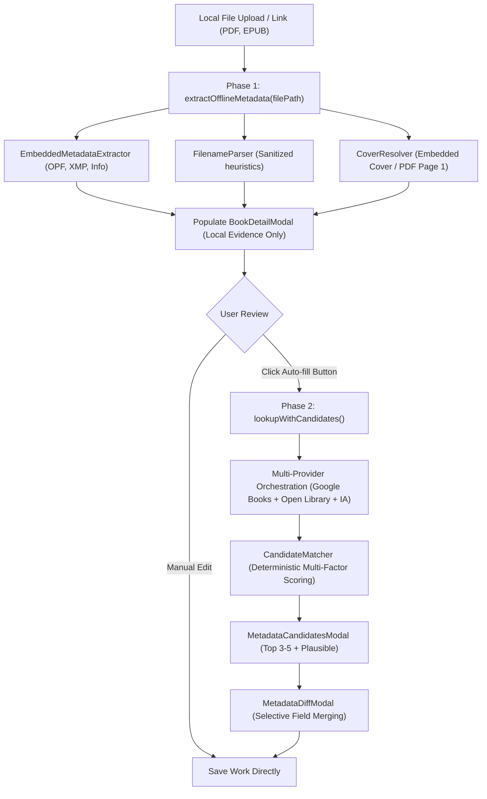

# Feature: Two-Phase Metadata Discovery & Acquisition Architecture

## 1. Overview & Objective
This document outlines the comparative research, architecture, and implementation of Baglib's **Two-Phase Metadata Discovery & Acquisition Pipeline**.

The core objective is to eliminate premature or unwanted online metadata overwrites when users upload local files, while providing a powerful, user-guided online auto-fill pipeline when explicitly requested.

---

## 2. Comparative Application Analysis

### 2.1 Calibre
- **Architecture**:
  - **Phase 1 (Addition)**: Local file inspection via `calibre.ebooks.metadata.meta.get_metadata`. Strictly offline. Extracts EPUB OPF, PDF Info/XMP, MOBI headers, and embedded raster covers.
  - **Phase 2 (Enrichment)**: Initiated on-demand via `identify.py` / "Download metadata" (`Ctrl+D`). Multi-threaded worker pool queries Google Books, Amazon, and Open Library. Merges heterogeneous fields using `InternalMetadataCompareKeyGen` and displays candidate covers and fields.
- **Strengths**: High performance on ingestion, complete offline privacy, zero API quota waste.
- **Weaknesses**: Desktop-only Python/PyQt code with legacy blocking workers.

### 2.2 Bookcover-API & Open Library / Google Books Catalogs
- **Architecture**:
  - Direct REST APIs (Google Books `volumes?q=...`, Open Library `search.json`, Internet Archive `advancedsearch.php`).
  - High availability of rich bibliographic data (ISBNs, publishers, high-resolution covers, page counts, subject tags).
- **Trade-offs**: Susceptible to HTTP 429 / 503 transient failures, daily quota caps (e.g., Google Books 1,000 queries/day), and discrepancies in naming conventions.

### 2.3 Readest (Metadata Auto-Retrieve & Rate-Limiting Sliding Windows)
- **Architecture**:
  - Readest exposes an on-demand "Refresh Metadata" feature. When invoked, it searches online providers using title, author, and ISBN clues.
  - Rate limiting is handled via sliding token delays between requests to keep the client within provider quotas (especially Google Books' strict limits).
  - Merging is strictly non-destructive: updates populate missing fields without clobbering existing custom values.
- **Strengths**: Clean UX, safe non-destructive updates, high resilience against HTTP 429 rate limit bans.
- **Baglib Adaptation**: Formalized provider-aware `RateLimitGate` and safe refresh workflow for single books and bulk library selections.

---

## 3. Baglib Architecture: The Two-Phase Pipeline

### 3.1 Phase 1: Offline Local Acquisition
1. **Trigger**: When a user selects a file (`handlePickFile`) or drops an e-book in [`LibraryGridView`](file:///D:/Ammar's/Projects/Baglib/repo/Baglib/src/renderer/components/library/LibraryGridView.tsx).
2. **Execution**:
   - Calls `extractOfflineMetadata` (`offlineOnly: true`) via IPC `library:extract-offline-metadata`.
   - Reads internal EPUB OPF Dublin Core (`dc:title`, `dc:creator`, `dc:publisher`, `dc:date`, `dc:identifier`, `dc:description`, `dc:language`).
   - Reads internal PDF Info / Adobe XMP dictionaries and extracts page 1 raster.
   - **Calibre `smart_update` Priority Fallback**:
     - `validUserAuthors > validEmbeddedAuthors > validFilenameAuthors > ['Unknown Author']`.
     - Validates embedded authors against an expanded placeholder dictionary: multilingual placeholders (`Unknown`, `مؤلف مجهول`, `مؤلف جديد`, `غير معروف`, `بدون مؤلف`, `Anonymous`, `Various`), system usernames (`Admin`, `User`, `Owner`), and PDF generation software (`Adobe InDesign`, `ScanSnap`, `ABBYY FineReader`, `PDFCreator`, etc.).
     - If internal author metadata is missing or matches a placeholder, Baglib preserves the author identified from the filename.
   - **Calibre-Inspired Filename Parsing ([`FilenameParser`](file:///D:/Ammar's/Projects/Baglib/repo/Baglib/src/main/services/metadata/filename-parser.ts))**:
     - Underscore normalization (`_` to space), stripping of leading track/volume indices (`01 - `, `Vol. 1 - `), bracketed author extraction (`[Author] Title`), explicit connector parsing (`Title by Author` and Arabic `العنوان بقلم الكاتب`), and inverted name normalization (`Last, First` -> `First Last`).
   - **Node.js Buffer Isolation**:
     - File buffers passed to `pdf-parse` are wrapped in `new Uint8Array(dataBuffer)` to avoid Node's shared 8 KB slab pool contamination.
3. **Safety Guarantee**: **Zero external network requests**. No calls to Google Books, Open Library, or Internet Archive. Daily quotas are completely untouched.

### 3.2 Phase 2: Explicit User-Initiated Auto-Fill
1. **Trigger**: User clicks the "Auto-Fill" (`جلب تلقائي`) button in [`BookDetailModal`](file:///D:/Ammar's/Projects/Baglib/repo/Baglib/src/renderer/components/library/BookDetailModal.tsx).
2. **Execution**:
   - Calls `lookupWithCandidates` via `library:lookup-metadata`.
   - Queries enabled providers in user-configured priority order (managed via [`ProviderConfigService`](file:///D:/Ammar's/Projects/Baglib/repo/Baglib/src/main/services/metadata/provider-config.service.ts)).
   - Respects Quota-Saver mode with pacing delays without dropping Google Books.
   - Merges and ranks results deterministically using [`CandidateMatcher`](file:///D:/Ammar's/Projects/Baglib/repo/Baglib/src/main/services/metadata/candidate-matcher.ts):
     - 40% ISBN / Unique Identifier Match
     - 35% Arabic-normalized Title Similarity
     - 15% Author Match
     - 10% Metadata Completeness
3. **Presentation & Application**:
   - Multiple matches trigger [`MetadataCandidatesModal`](file:///D:/Ammar's/Projects/Baglib/repo/Baglib/src/renderer/components/library/MetadataCandidatesModal.tsx).
   - Selected candidates open [`MetadataDiffModal`](file:///D:/Ammar's/Projects/Baglib/repo/Baglib/src/renderer/components/library/MetadataDiffModal.tsx).
   - Changes are merged into the work record only upon user confirmation.

### 3.3 Author Biography & Description Enrichment
When auto-filling metadata from online providers:
1. **Book Description**:
   - Retrieved from online providers (Google Books synopsis, Open Library works description, or embedded EPUB/PDF metadata).
   - Displayed in a dedicated readable Description textarea in `BookDetailModal` under the primary information section.
2. **Author Brief ("نبذة عن المؤلف")**:
   - Resolved via [`AuthorBioService`](file:///D:/Ammar's/Projects/Baglib/repo/Baglib/src/main/services/metadata/author-bio.service.ts).
   - Queries Wikipedia Summary REST API (`ar.wikipedia.org` for Arabic authors and `en.wikipedia.org` for English/Latin authors, with bidirectional fallback).
   - Secondary fallback queries Open Library Authors Search & Author details API.
   - In-memory cache prevents redundant external lookups.
   - Displayed in a dedicated Author Bio textarea and persisted to the `author` table (`bio` column) and work metadata.

### 3.4 Card Header 'Info' Navigation
- The book details modal trigger is moved from the card bottom action bar to a prominent, subtle Info `i` button on top of each card next to the reading status dropdown.
- This creates an intuitive status-and-details metadata group on the card header while keeping the primary action bar focused on reading and deletion.

### 3.5 Automatic Material Language Detection Architecture
1. **Multi-Tier Cascade**:
   - **Tier 1 (Material Content)**: Directly inspects text parsed from PDF (`pdf-parse`), the first chapter XHTML/HTML from EPUB archives (`yauzl`), plain text buffers (`.txt`), or HTML documents (`.html`).
   - **Tier 2 (Embedded Tags)**: Normalizes ISO-639-1 / ISO-639-2 codes from EPUB OPF (`dc:language`), Adobe XMP (`dc:language`), and HTML header attributes (`lang`, `content-language`).
   - **Tier 3 (Bibliographic Metadata Heuristics)**: Aggregates cleaned title, description, and author strings.
2. **Statistical Script & Stopword Engine ([`LanguageDetectorService`](file:///D:/Ammar's/Projects/Baglib/repo/Baglib/src/main/services/metadata/language-detector.service.ts))**:
   - Counts Unicode script distributions (Arabic script `0x0600-0x08FF`, Latin script `0x0041-0x024F`, Cyrillic script `0x0400-0x04FF`).
   - Disambiguates within Arabic script using distinctive exclusive graphemes (Urdu: ٹ, ڈ, ڑ, ں, ہ, ے; Persian: گ, چ, پ, ژ) and high-frequency stopword density scoring (Arabic vs. Farsi vs. Urdu).
   - Disambiguates within Latin script using distinctive orthography (German umlauts, Turkish dotless/dotted i and cedillas, Spanish inverted marks/tildes, French accents) and stopword vectors across English, French, German, Spanish, Turkish, and Italian.
3. **Graceful Handling of Uncertain Cases**:
   - Enforces strict reliability criteria (`RELIABILITY_THRESHOLD = 0.65`, minimum character length, candidate separation margins).
   - **Never assigns arbitrary defaults**: If evidence is absent, ambiguous, or unsupported, the language field remains `undefined`.
   - In the user interface, displays an explicit placeholder option (`— غير محددة (اختر لغة العمل) —` / `— Unspecified (Choose Language) —`) and renders a subtle "Auto-detected" (`تم التعرف تلقائياً`) badge when a reliable match is found.

### 3.6 Automated In-File Text ISBN Acquisition (Reverse-Engineered from Calibre Extract ISBN)
1. **Background & Motivation**:
   - In many digitized e-books and PDFs, metadata header tags (`/Info`, XMP, `dc:identifier`) are missing, generic, or stripped. However, the ISBN is clearly printed on the copyright/title verso page (typically pages 2–4) or in the colophon back matter.
2. **Reverse-Engineered Calibre Patterns**:
   - Adapted from KiwiDude's Calibre plugin `repos/extract_isbn` (`scan.py`, `pdf.py`, `nonpdf.py`).
   - Implemented in [`TextIsbnScannerService`](file:///D:/Ammar's/Projects/Baglib/repo/Baglib/src/main/services/metadata/text-isbn-scanner.service.ts).
   - **Regex & Normalization Engine**: Replaces HTML tags with `!` boundary markers (preventing cross-tag digit concatenation), normalizes Unicode dashes/soft hyphens, unwraps line-broken numbers (`978-\n0-13-235088-4` and `978\n0132350884`), and rejects dummy repeating digits (`0000000000`, `1111111111111`).
   - **Bilingual Arabic Normalization**: Detects both English labels (`ISBN`, `ISBN-10`, `ISBN-13`) and Arabic labels (`ردمك`, `الترقيم الدولي`, `الرقم الدولي المعياري`). Normalizes Eastern Arabic digits (`٠١٢٣٤٥٦٧٨٩`) to standard digits (`0-9`).
   - **Page Budgeting**: For PDFs, performs a fast pass across front matter (first 10 pages) where copyright pages reside, followed by a reverse pass across back matter (last 5 pages), bypassing unnecessary middle pages. For EPUBs, prioritizes front spine items (title/copyright), then rear spine (colophon), then middle documents.
3. **Seamless Integration**:
   - Wired as a fallback into [`EmbeddedMetadataExtractor`](file:///D:/Ammar's/Projects/Baglib/repo/Baglib/src/main/services/metadata/embedded-metadata.extractor.ts), [`EbookMetadataExtractorService`](file:///D:/Ammar's/Projects/Baglib/repo/Baglib/src/main/services/digital/ebook-metadata-extractor.service.ts), and [`BibliographicMetadataService.discoverBook`](file:///D:/Ammar's/Projects/Baglib/repo/Baglib/src/main/services/metadata/bibliographic-metadata.service.ts).
   - In **Phase 1 (Offline)**: Automatically populates `formData.isbn` with validated ISBN-10/ISBN-13 and sets `provenance.isbnDiscovered = true`.
   - In **Phase 2 (Auto-fill)**: The discovered ISBN immediately powers exact-match provider lookups (`searchByIsbn`), achieving verified matches with zero ambiguity.

### 3.7 Unified Multi-Provider Search & Discovery Hub (Story 11)
1. **Background & Architecture**:
   - Implements simultaneous multi-source book discovery across the local catalog and online public databases.
   - Built on a modular provider contract ([`ISearchProvider`](file:///D:/Ammar's/Projects/Baglib/repo/Baglib/src/shared/types/search.ts)) coordinated by [`SearchOrchestratorService`](file:///D:/Ammar's/Projects/Baglib/repo/Baglib/src/main/services/search/search-orchestrator.service.ts).
   - Core Providers:
     - **Local Catalog ([`LocalSearchProvider`](file:///D:/Ammar's/Projects/Baglib/repo/Baglib/src/main/services/search/providers/local-search.provider.ts))**: Searches SQLite works, physical shelf locations, and categories with diacritic and alef invariance.
     - **Open Library ([`OpenLibrarySearchProvider`](file:///D:/Ammar's/Projects/Baglib/repo/Baglib/src/main/services/search/providers/open-library-search.provider.ts))**: World open catalog of public book records and cover art.
     - **Google Books ([`GoogleBooksSearchProvider`](file:///D:/Ammar's/Projects/Baglib/repo/Baglib/src/main/services/search/providers/google-books-search.provider.ts))**: Rich volumes, industry identifiers, and publication metadata respecting daily quota ceilings.
     - **Internet Archive ([`InternetArchiveSearchProvider`](file:///D:/Ammar's/Projects/Baglib/repo/Baglib/src/main/services/search/providers/internet-archive-search.provider.ts))**: Free public texts, historical codices, and direct EPUB/PDF download links.
     - **Project Gutenberg ([`GutenbergSearchProvider`](file:///D:/Ammar's/Projects/Baglib/repo/Baglib/src/main/services/search/providers/gutenberg-search.provider.ts))**: Over 70,000 public domain classics with guaranteed direct EPUB/PDF downloads.
2. **Duplicate Detection & Enrichment ([`DuplicateDetector`](file:///D:/Ammar's/Projects/Baglib/repo/Baglib/src/main/services/search/duplicate-detector.ts))**:
   - Performs dual-layer verification:
     - **Strict ISBN**: Canonical ISBN-10 to ISBN-13 conversion.
     - **Fuzzy Title & Author**: Strips parenthetical edition notes (e.g. `(طبعة دار الفكر)`), tests prefix containment, normalizes Arabic patronymic variants (`\bبن\b` vs `ابن`), and compares distinctive surnames.
   - Automatically annotates online results with `inLibrary: true` and links to the local `workId`.
3. **One-Click Ingestion & Content Shield Streaming**:
   - Direct download and ingestion via [`search:import-result`](file:///D:/Ammar's/Projects/Baglib/repo/Baglib/src/main/ipc/search.ts) and [`ContentShieldService`](file:///D:/Ammar's/Projects/Baglib/repo/Baglib/src/main/services/shield/content-shield.service.ts).
   - Automatically generates Work, Edition, Author, and Source in SQLite and broadcasts real-time updates to the UI.

### 3.8 Online Metadata Enrichment & Non-Destructive Field Merging (Story 12 / KEY-3)
1. **Context & Motivation**:
   - In cataloging workflows, books often start with sparse or incomplete metadata (e.g. imported from a filename or a bare PDF).
   - Users need a dependable, non-destructive way to discover alternative online editions and selectively merge high-quality metadata fields (publishers, publication dates, descriptions, categories, page counts) without accidentally overwriting their own manual corrections.
2. **Online Metadata Enrichment Service ([`MetadataEnrichmentService`](file:///D:/Ammar's/Projects/Baglib/repo/Baglib/src/main/services/metadata/metadata-enrichment.service.ts))**:
   - **Candidate Discovery**: Automatically queries registered open providers (Open Library, Google Books, Internet Archive, Gutenberg) using verified ISBNs or title/author combinations.
   - **Match Confidence Scoring**:
     - `1.0 (100%)`: Exact normalized ISBN match.
     - `0.95 (95%)`: Combined title and author match.
     - `0.75 (75%)`: Title match with differing or unverified author.
     - `0.50 (50%)`: Distinct author match with divergent title.
   - **Candidate Deduplication**: Unifies duplicate editions across providers using canonical ISBN-10/13 normalization and title/author hashing.
3. **Non-Destructive Merge Engine & Overwrite Protection**:
   - **Field-by-Field Diffing (`computeFieldDiffs`)**: Compares existing library attributes against candidate edition fields across `title`, `author`, `publisher`, `publicationYear`, `isbn`, `language`, `description`, `coverImage`, `categories`, and `pagesCount`.
   - **Status Classification**: Categorizes each field as:
     - `new`: Current value is blank/empty and candidate provides data.
     - `overwrite`: Current value is populated and candidate provides a different value.
     - `identical`: Current and incoming values match.
   - **Selective User Control**: The user selects exactly which fields to accept via individual checkboxes, with quick actions for "Select All New Fields" and "Select All Fields".
   - **Overwrite Guard (`overwritePopulatedFields`)**: Prevents overwriting already populated user fields unless the user explicitly checks the overwrite protection override toggle.
4. **High-Resolution Cover Fetcher & Local Cache ([`CoverFetchService`](file:///D:/Ammar's/Projects/Baglib/repo/Baglib/src/main/services/metadata/cover-fetch.service.ts))**:
   - **Local Disk Cache**: Downloads and caches cover images into the user data directory (`userData/covers/{workId}-{hash}.{ext}`) to enable instantaneous offline display and eliminate broken external CDN links.
   - **Artifact & Placeholder Defense**: Rejects tracking pixels and blank placeholder images by enforcing a minimum size threshold (`>= 250 bytes`).
   - **Inline Base64 Optimization**: Automatically decodes base64 data URLs directly to disk without superfluous HTTP requests.
5. **Interactive UI Modals & Digital Source Attachment**:
   - **Header Action**: A "Find Online" (`البحث عبر الإنترنت`) button in [`BookDetailModal`](file:///D:/Ammar's/Projects/Baglib/repo/Baglib/src/renderer/components/library/BookDetailModal.tsx) opens the side-by-side [`EditionComparisonModal`](file:///D:/Ammar's/Projects/Baglib/repo/Baglib/src/renderer/components/library/EditionComparisonModal.tsx).
   - **Cover Section Action**: A dedicated "Fetch Cover" (`جلب الغلاف`) button in the cover thumbnail section initiates high-resolution image discovery.
   - **Digital Attachment**: Users can attach free digital copies (EPUB/PDF) directly from public archives via [`ContentShieldService.downloadFileDirectly`](file:///D:/Ammar's/Projects/Baglib/repo/Baglib/src/main/services/shield/content-shield.service.ts), transitioning physical books to hybrid works.
6. **Provider-Aware Rate Limiting Gate ([`RateLimitGate`](file:///D:/Ammar's/Projects/Baglib/repo/Baglib/src/main/services/metadata/rate-limit-gate.ts))**:
   - **Sliding Interval Throttling**: Enforces domain-specific minimum pacing:
     - Google Books (`googleapis.com`): 1,500ms spacing between requests.
     - Open Library (`openlibrary.org`): 1,000ms spacing between requests.
     - Internet Archive (`archive.org`): 800ms spacing between requests.
   - **Exponential Backoff with Jitter**: Intercepts HTTP 429 Too Many Requests and automatically backs off (3s, 6s, 12s) with randomized jitter before retry.
   - **Central Integration**: Integrated at the lowest transport level into [`HttpClient`](file:///D:/Ammar's/Projects/Baglib/repo/Baglib/src/main/services/metadata/http-client.ts) so every provider query seamlessly obeys rate limits.
7. **Bulk Online Metadata Download & Safe Refresh ([`enrichment.ts`](file:///D:/Ammar's/Projects/Baglib/repo/Baglib/src/main/ipc/enrichment.ts))**:
   - **Bulk Download Toolbar**: [`BulkActionsToolbar`](file:///D:/Ammar's/Projects/Baglib/repo/Baglib/src/renderer/components/library/BulkActionsToolbar.tsx) provides a "Download Online Metadata" (`جلب البيانات أونلاين`) button for batch selections, reporting live progress via `enrichment:bulk-progress`.
   - **One-Click Refresh**: Single-book "Refresh Metadata" (`تحديث البيانات`) button in [`BookDetailModal`](file:///D:/Ammar's/Projects/Baglib/repo/Baglib/src/renderer/components/library/BookDetailModal.tsx) header retrieves candidate editions and computes field diffs.
   - **Non-Destructive Merge Policy**: Populates missing or placeholder fields (`Unknown Author`, `New Library Material`) without clobbering user notes or custom edits.

8. **Robust Drag-and-Drop Path Resolution ([`file-path-helper.ts`](file:///D:/Ammar's/Projects/Baglib/repo/Baglib/src/renderer/utils/file-path-helper.ts))**:
   - **Modern Electron `webUtils` Bridge**: In Chromium 128+ (Electron 32), accessing `(file as any).path` from HTML5 drag events returns an empty string. The solution bridges `webUtils.getPathForFile(file)` through preload to resolve the true host filesystem path.
   - **Four-Tier Resolution & Buffer Fallback**:
     1. Preload `webUtils.getPathForFile(file)`.
     2. Direct `file.path` property for older runtimes.
     3. Path segment validation (presence of `/` or `\`).
     4. Guaranteed persistence fallback: streams the file's raw `ArrayBuffer` to `userData/imports` via `system:save-file-buffer`, ensuring an authentic absolute path is always provided to backend offline extractors.
9. **Standardized EPUB Page Count Estimation**:
   - **Adobe Digital Editions (ADE) & Calibre Compatibility**: Most commercial EPUBs omit `schema:numberOfPages` and `dc:extent`. Baglib now accumulates uncompressed text byte sizes across all `.xhtml`/`.html` content files in the EPUB ZIP archive during indexing.
   - **1024-Byte Page Formula**: Calculates `pagesCount = Math.max(1, Math.round(totalTextBytes / 1024))` (standard 1 page ~= 1024 bytes / ~250 words), with fallback to spine item length multiplied by 15.

10. **Library Metadata Audit & Refresh Workflow ([`MetadataAuditModal.tsx`](file:///D:/Ammar's/Projects/Baglib/repo/Baglib/src/renderer/components/library/MetadataAuditModal.tsx))**:
   - **Centralized Header Placement**: Removed the legacy single-book refresh button from `BookDetailModal` header. Replaced with a prominent "Audit & Refresh Metadata" (`تدقيق وتحديث البيانات`) button in the main library header toolbar in [`LibraryGridView`](file:///D:/Ammar's/Projects/Baglib/repo/Baglib/src/renderer/components/library/LibraryGridView.tsx) and selection action bar.
   - **Smart Scope Resolution**:
     - When books are selected (`selectedBookIds.size > 0`): audits and processes only the selected items.
     - When no books are selected: audits the entire library catalog.
   - **Missing Metadata Audit Scanner**:
     - Scans for essential missing fields: Author (empty or placeholder `Unknown Author` / `غير معروف`), Publication Year, Cover image, Description/Abstract, and Identifiers/Category/Language (ISBN, Category, Language).
     - Breakdown statistics, interactive issue chips, search filter, and clean book indicators.
   - **Two-Tier Action Workflow**:
     1. **"Re-scan Files First" (`إعادة فحص الملفات أولاً`)**:
        - Prioritizes offline data resolution by re-running local container parsers (EPUB OPF, PDF XMP/Info) and PDF first-page raster thumbnail generation.
        - Updates the audit list live and saves changes to SQLite without consuming any online API quotas.
     2. **Online Resolution Options**:
        - **"Auto-Enrich All" (`تحديث تلقائي شامل`)**: Background worker queries open catalogs sequentially, strictly enforcing a 1,000ms delay between API queries (`RateLimitGate` pacing) and applying high-confidence matches (`confidence >= 0.75` or `isVerifiedMatch`). Shows a live progress bar with item counts and stop control.
        - **"Review One by One" (`مراجعة كتاباً بكتاب`)**: Sequential guided stepper walking through flagged books one at a time. Queries candidate editions and lets the user inspect scores, match types, and choose to approve or skip.
   - **Strict Data Preservation**: User custom notes, tags (`tags`), reading status (`readingStatus`, `readingProgress`), and lending records (`lendingHistory`) are guaranteed to never be overwritten.

11. **Intelligent PDF Metadata Reconciliation & Prepress Garbage Detection ([`pdf-metadata-reconciler.ts`](file:///D:/Ammar's/Projects/Baglib/repo/Baglib/src/main/services/metadata/pdf-metadata-reconciler.ts))**:
   - **Real-World Problem**: Internal PDF metadata (DocInfo/XMP) generated by desktop publishing software (Adobe InDesign, QuarkXPress, Acrobat Distiller) frequently contains prepress job codes, printer queue identifiers, or typesetter operating system usernames rather than true bibliographic information. For example, `Barbra Teater - An introduction to applying social work theories and methods (2010, McGraw-Hill_Open University Press) - libgen.li.pdf` embeds `mcgrawh 19768` as Title and `jharding` as Author.
   - **Prepress & Job Code Detector (`isGarbageTitle`)**:
     - Flags publisher internal production codes (e.g., `mcgrawh \d+`, `job_\d+`, `wiley_\d+`, `springer_\d+`, `cup_\d+`, `elsevier_\d+`).
     - Flags generic document strings (e.g., `untitled`, `document\d*`, `scan\d*`, `export`, `chapter\s*\d+`).
     - Flags desktop publishing software names (e.g., `InDesign`, `Adobe PDF Library`, `Acrobat Distiller`, `Microsoft Word`).
     - Flags degenerate values: purely numeric strings, hex/MD5/UUID hashes, or strings shorter than 3 characters.
   - **Typesetter & OS Username Detector (`isGarbageAuthor`)**:
     - Flags single-token lowercase handles and system accounts (e.g., `jharding`, `admin`, `user`, `desktop`, `scanner`, `root`).
     - Flags DTP generator software names in author fields.
   - **Token Discrepancy & Jaccard Overlap**:
     - When the filename contains $\ge 4$ distinct words and the embedded PDF Title shares 0% token overlap with the filename, the embedded title is flagged as untrusted prepress garbage.
   - **Filename Sanitization & Strip Rules**:
     - Strips repository and shadow library tags (e.g., `- libgen.li`, `_libgen.rs`, `(z-lib.org)`, `[vdoc.pub]`, `_1lib.domains`).
     - Normalizes publisher separators within parentheticals (e.g., `McGraw-Hill_Open University Press` $\rightarrow$ `McGraw-Hill / Open University Press`).
     - Preserves edition and volume identifiers while eliminating random download hashes.
   - **Structured Pattern Parsing**:
     - Academic multi-part format: `^{Author}\s*-\s*{Title}\s*\((?:{Year})?,?\s*(?:{Publisher})?\)`
     - Standard delimited format: `^{Author}\s*-\s*{Title}$` or `^{Title}\s*-\s*{Author}$`
     - Bracketed author format: `^\[{Author}\]\s*{Title}\s*\({Year}\)`
     - Arabic standard format: `^{Title}\s*-\s*{Author}$` (with Arabic patronymic and syntactic title/author disambiguation).
   - **Multi-Factor Scoring & Reconciliation**:
     - Evaluates confidence scores across candidate sources (`embedded_pdf`, `filename`, `merged`).
     - Merges valid components (e.g., authentic embedded publisher with filename title/author when embedded title/author are bogus).
     - Tracks all discarded artifacts and reasons for auditability and diagnostic visibility.

---

## 4. Preservation of Baglib Architecture
- Adheres strictly to the **Work → Edition → Source** polymorphic data model.
- No unapproved schema alterations: uses existing `author.bio` and `work.description` columns.
- Maintains bilingual RTL/LTR layout consistency using CSS logical properties and centralized translation keys.

## Publication-year fallback for edition — 2026-10-24

- `EditionInput.tsx` displays a known publication year in the book's Edition field when the actual edition is empty, with a localized explanation that this is temporary. Existing edition labels always take precedence. Numeric years and Arabic/Persian digit strings are supported; missing, invalid, zero, negative and date-string values are not invented into editions.
- The fallback is presentation-only. It does not persist a year as an edition label, alter the publication-year field, backfill database records or create new schema/provenance fields. Saving an unrelated change therefore cannot accidentally turn the year into a verified edition. On focus, the underlying edition remains editable with the year as its placeholder; entering a real label behaves normally.
- `auditBook` now explicitly tracks a missing edition, including books whose other metadata is complete. Such books remain in “Needs attention” and eligible for existing missing-metadata lookup. Both audit and guided-review views identify the missing edition instead of treating a displayed year as complete metadata.
- Existing local/automatic enrichment fills blank or whitespace-only editions when discovery returns a nonempty edition label; a fetched label replaces the temporary display automatically. Populated editions remain protected. Provider availability and whether an online record actually supplies an edition label are unchanged; no new network request or automatic background search was added.
- A metadata-audit toast timer is cleared when replaced or unmounted, addressing asynchronous activity exposed by the new lookup-flow test.
- Verification: 13 focused edition/audit tests passed, including Arabic/English rendering, focus/blur without canonical mutation, replacement by an incoming edition, and a mocked discovery response exercised through the actual audit auto-enrichment handler. TypeScript and new-source ESLint passed. These tests do not claim a live online-provider search or full-application visual acceptance.

