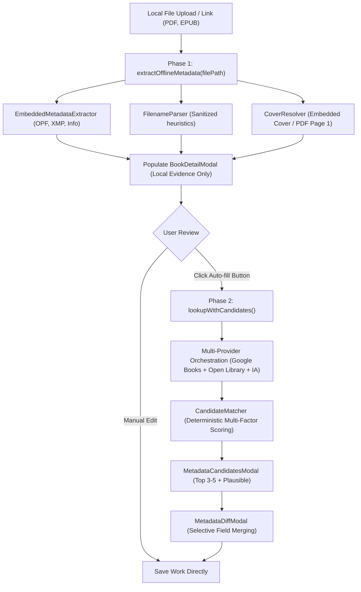

# Feature: Two-Phase Metadata Discovery & Acquisition Architecture

## 1. Overview & Objective
This document outlines the comparative research, architecture, and implementation of Baglib's **Two-Phase Metadata Discovery & Acquisition Pipeline**.

The core objective is to eliminate premature or unwanted online metadata overwrites when users upload local files, while providing a powerful, user-guided online auto-fill pipeline when explicitly requested.

---

## 2. Comparative Application Analysis

### 2.1 Calibre
- **Architecture**:
  - **Phase 1 (Addition)**: Local file inspection via `calibre.ebooks.metadata.meta.get_metadata`. Strictly offline. Extracts EPUB OPF, PDF Info/XMP, MOBI headers, and embedded raster covers.
  - **Phase 2 (Enrichment)**: Initiated on-demand via `identify.py` / "Download metadata" (`Ctrl+D`). Multi-threaded worker pool queries Google Books, Amazon, and Open Library. Merges heterogeneous fields using `InternalMetadataCompareKeyGen` and displays candidate covers and fields.
- **Strengths**: High performance on ingestion, complete offline privacy, zero API quota waste.
- **Weaknesses**: Desktop-only Python/PyQt code with legacy blocking workers.

### 2.2 Bookcover-API & Open Library / Google Books Catalogs
- **Architecture**:
  - Direct REST APIs (Google Books `volumes?q=...`, Open Library `search.json`, Internet Archive `advancedsearch.php`).
  - High availability of rich bibliographic data (ISBNs, publishers, high-resolution covers, page counts, subject tags).
- **Trade-offs**: Susceptible to HTTP 429 / 503 transient failures, daily quota caps (e.g., Google Books 1,000 queries/day), and discrepancies in naming conventions.

---

## 3. Baglib Architecture: The Two-Phase Pipeline

### 3.1 Phase 1: Offline Local Acquisition
1. **Trigger**: When a user selects a file (`handlePickFile`) or drops an e-book in [`LibraryGridView`](file:///D:/Ammar's/Projects/Baglib/repo/Baglib/src/renderer/components/library/LibraryGridView.tsx).
2. **Execution**:
   - Calls `extractOfflineMetadata` (`offlineOnly: true`) via IPC `library:extract-offline-metadata`.
   - Reads internal EPUB OPF Dublin Core (`dc:title`, `dc:creator`, `dc:publisher`, `dc:date`, `dc:identifier`, `dc:description`, `dc:language`).
   - Reads internal PDF Info / Adobe XMP dictionaries and extracts page 1 raster.
   - **Calibre `smart_update` Priority Fallback**:
     - `validUserAuthors > validEmbeddedAuthors > validFilenameAuthors > ['Unknown Author']`.
     - Validates embedded authors against an expanded placeholder dictionary: multilingual placeholders (`Unknown`, `مؤلف مجهول`, `مؤلف جديد`, `غير معروف`, `بدون مؤلف`, `Anonymous`, `Various`), system usernames (`Admin`, `User`, `Owner`), and PDF generation software (`Adobe InDesign`, `ScanSnap`, `ABBYY FineReader`, `PDFCreator`, etc.).
     - If internal author metadata is missing or matches a placeholder, Baglib preserves the author identified from the filename.
   - **Calibre-Inspired Filename Parsing ([`FilenameParser`](file:///D:/Ammar's/Projects/Baglib/repo/Baglib/src/main/services/metadata/filename-parser.ts))**:
     - Underscore normalization (`_` to space), stripping of leading track/volume indices (`01 - `, `Vol. 1 - `), bracketed author extraction (`[Author] Title`), explicit connector parsing (`Title by Author` and Arabic `العنوان بقلم الكاتب`), and inverted name normalization (`Last, First` -> `First Last`).
   - **Node.js Buffer Isolation**:
     - File buffers passed to `pdf-parse` are wrapped in `new Uint8Array(dataBuffer)` to avoid Node's shared 8 KB slab pool contamination.
3. **Safety Guarantee**: **Zero external network requests**. No calls to Google Books, Open Library, or Internet Archive. Daily quotas are completely untouched.

### 3.2 Phase 2: Explicit User-Initiated Auto-Fill
1. **Trigger**: User clicks the "Auto-Fill" (`جلب تلقائي`) button in [`BookDetailModal`](file:///D:/Ammar's/Projects/Baglib/repo/Baglib/src/renderer/components/library/BookDetailModal.tsx).
2. **Execution**:
   - Calls `lookupWithCandidates` via `library:lookup-metadata`.
   - Queries enabled providers in user-configured priority order (managed via [`ProviderConfigService`](file:///D:/Ammar's/Projects/Baglib/repo/Baglib/src/main/services/metadata/provider-config.service.ts)).
   - Respects Quota-Saver mode with pacing delays without dropping Google Books.
   - Merges and ranks results deterministically using [`CandidateMatcher`](file:///D:/Ammar's/Projects/Baglib/repo/Baglib/src/main/services/metadata/candidate-matcher.ts):
     - 40% ISBN / Unique Identifier Match
     - 35% Arabic-normalized Title Similarity
     - 15% Author Match
     - 10% Metadata Completeness
3. **Presentation & Application**:
   - Multiple matches trigger [`MetadataCandidatesModal`](file:///D:/Ammar's/Projects/Baglib/repo/Baglib/src/renderer/components/library/MetadataCandidatesModal.tsx).
   - Selected candidates open [`MetadataDiffModal`](file:///D:/Ammar's/Projects/Baglib/repo/Baglib/src/renderer/components/library/MetadataDiffModal.tsx).
   - Changes are merged into the work record only upon user confirmation.

### 3.3 Author Biography & Description Enrichment
When auto-filling metadata from online providers:
1. **Book Description**:
   - Retrieved from online providers (Google Books synopsis, Open Library works description, or embedded EPUB/PDF metadata).
   - Displayed in a dedicated readable Description textarea in `BookDetailModal` under the primary information section.
2. **Author Brief ("نبذة عن المؤلف")**:
   - Resolved via [`AuthorBioService`](file:///D:/Ammar's/Projects/Baglib/repo/Baglib/src/main/services/metadata/author-bio.service.ts).
   - Queries Wikipedia Summary REST API (`ar.wikipedia.org` for Arabic authors and `en.wikipedia.org` for English/Latin authors, with bidirectional fallback).
   - Secondary fallback queries Open Library Authors Search & Author details API.
   - In-memory cache prevents redundant external lookups.
   - Displayed in a dedicated Author Bio textarea and persisted to the `author` table (`bio` column) and work metadata.

### 3.4 Card Header 'Info' Navigation
- The book details modal trigger is moved from the card bottom action bar to a prominent, subtle Info `i` button on top of each card next to the reading status dropdown.
- This creates an intuitive status-and-details metadata group on the card header while keeping the primary action bar focused on reading and deletion.

### 3.5 Automatic Material Language Detection Architecture
1. **Multi-Tier Cascade**:
   - **Tier 1 (Material Content)**: Directly inspects text parsed from PDF (`pdf-parse`), the first chapter XHTML/HTML from EPUB archives (`yauzl`), plain text buffers (`.txt`), or HTML documents (`.html`).
   - **Tier 2 (Embedded Tags)**: Normalizes ISO-639-1 / ISO-639-2 codes from EPUB OPF (`dc:language`), Adobe XMP (`dc:language`), and HTML header attributes (`lang`, `content-language`).
   - **Tier 3 (Bibliographic Metadata Heuristics)**: Aggregates cleaned title, description, and author strings.
2. **Statistical Script & Stopword Engine ([`LanguageDetectorService`](file:///D:/Ammar's/Projects/Baglib/repo/Baglib/src/main/services/metadata/language-detector.service.ts))**:
   - Counts Unicode script distributions (Arabic script `0x0600-0x08FF`, Latin script `0x0041-0x024F`, Cyrillic script `0x0400-0x04FF`).
   - Disambiguates within Arabic script using distinctive exclusive graphemes (Urdu: ٹ, ڈ, ڑ, ں, ہ, ے; Persian: گ, چ, پ, ژ) and high-frequency stopword density scoring (Arabic vs. Farsi vs. Urdu).
   - Disambiguates within Latin script using distinctive orthography (German umlauts, Turkish dotless/dotted i and cedillas, Spanish inverted marks/tildes, French accents) and stopword vectors across English, French, German, Spanish, Turkish, and Italian.
3. **Graceful Handling of Uncertain Cases**:
   - Enforces strict reliability criteria (`RELIABILITY_THRESHOLD = 0.65`, minimum character length, candidate separation margins).
   - **Never assigns arbitrary defaults**: If evidence is absent, ambiguous, or unsupported, the language field remains `undefined`.
   - In the user interface, displays an explicit placeholder option (`— غير محددة (اختر لغة العمل) —` / `— Unspecified (Choose Language) —`) and renders a subtle "Auto-detected" (`تم التعرف تلقائياً`) badge when a reliable match is found.

### 3.6 Automated In-File Text ISBN Acquisition (Reverse-Engineered from Calibre Extract ISBN)
1. **Background & Motivation**:
   - In many digitized e-books and PDFs, metadata header tags (`/Info`, XMP, `dc:identifier`) are missing, generic, or stripped. However, the ISBN is clearly printed on the copyright/title verso page (typically pages 2–4) or in the colophon back matter.
2. **Reverse-Engineered Calibre Patterns**:
   - Adapted from KiwiDude's Calibre plugin `repos/extract_isbn` (`scan.py`, `pdf.py`, `nonpdf.py`).
   - Implemented in [`TextIsbnScannerService`](file:///D:/Ammar's/Projects/Baglib/repo/Baglib/src/main/services/metadata/text-isbn-scanner.service.ts).
   - **Regex & Normalization Engine**: Replaces HTML tags with `!` boundary markers (preventing cross-tag digit concatenation), normalizes Unicode dashes/soft hyphens, unwraps line-broken numbers (`978-\n0-13-235088-4` and `978\n0132350884`), and rejects dummy repeating digits (`0000000000`, `1111111111111`).
   - **Bilingual Arabic Normalization**: Detects both English labels (`ISBN`, `ISBN-10`, `ISBN-13`) and Arabic labels (`ردمك`, `الترقيم الدولي`, `الرقم الدولي المعياري`). Normalizes Eastern Arabic digits (`٠١٢٣٤٥٦٧٨٩`) to standard digits (`0-9`).
   - **Page Budgeting**: For PDFs, performs a fast pass across front matter (first 10 pages) where copyright pages reside, followed by a reverse pass across back matter (last 5 pages), bypassing unnecessary middle pages. For EPUBs, prioritizes front spine items (title/copyright), then rear spine (colophon), then middle documents.
3. **Seamless Integration**:
   - Wired as a fallback into [`EmbeddedMetadataExtractor`](file:///D:/Ammar's/Projects/Baglib/repo/Baglib/src/main/services/metadata/embedded-metadata.extractor.ts), [`EbookMetadataExtractorService`](file:///D:/Ammar's/Projects/Baglib/repo/Baglib/src/main/services/digital/ebook-metadata-extractor.service.ts), and [`BibliographicMetadataService.discoverBook`](file:///D:/Ammar's/Projects/Baglib/repo/Baglib/src/main/services/metadata/bibliographic-metadata.service.ts).
   - In **Phase 1 (Offline)**: Automatically populates `formData.isbn` with validated ISBN-10/ISBN-13 and sets `provenance.isbnDiscovered = true`.
   - In **Phase 2 (Auto-fill)**: The discovered ISBN immediately powers exact-match provider lookups (`searchByIsbn`), achieving verified matches with zero ambiguity.

---

## 4. Preservation of Baglib Architecture
- Adheres strictly to the **Work → Edition → Source** polymorphic data model.
- No unapproved schema alterations: uses existing `author.bio` and `work.description` columns.
- Maintains bilingual RTL/LTR layout consistency using CSS logical properties and centralized translation keys.

