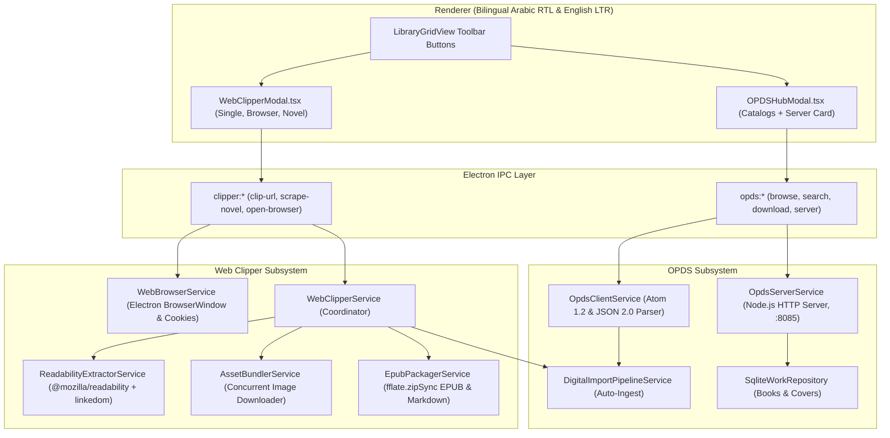

# Feature: OPDS Network Catalogs and Web Article Clipper

## 1. Overview & Objective
This document details Baglib's OPDS protocol integration (remote catalog browsing and local wireless feed server) and the web clipping pipeline for converting articles, essays, and serialized online novels into clean digital books (`KEY-148: Task 5.2 — Implement OPDS Protocol (Client & Local Feed Server) and Web Clipper`).

The primary objectives are:
1. **Remote OPDS Catalog Browsing & Ingestion (`OpdsClientService`)**: Access public domain repositories (Project Gutenberg, Standard Ebooks, ManyBooks, Feedbooks) and self-hosted Calibre Content Servers directly within Baglib, supporting both OPDS 1.2 Atom XML and OPDS 2.0 JSON feeds with HTTP Basic Authentication.
2. **Local OPDS Wi-Fi Feed Server (`OpdsServerService`)**: Embedded lightweight HTTP server in Electron's main process exposing the user's Baglib library as an OPDS 1.2 Atom catalog on the local network (`http://<LAN_IP>:8085/opds`), allowing physical e-ink readers (KOReader, Moon+ Reader, Kindle) to download books wirelessly.
3. **High-Fidelity Readability & Asset Bundling Pipeline (`ReadabilityExtractorService` & `AssetBundlerService`)**: Strip clutter and ads using `@mozilla/readability`, extract rich metadata, resolve high-resolution images from `srcset` and lazy-loading attributes, and package inlined media up to size ceilings.
4. **Spec-Compliant In-Memory EPUB & Markdown Generation (`EpubPackagerService`)**: Purely synchronous zero-disk packaging via `fflate.zipSync` (`mimetype`, `container.xml`, `content.opf`, `toc.ncx`, `chapterX.xhtml`), supporting bidirectional Arabic RTL and English LTR layouts.
5. **Interactive Browser Session & Serialized Novel Scraper**: Embedded browser window controller (`WebBrowserService`) for clipping paywalled/authenticated articles, alongside automated chapter crawling for web serials.
6. **Bilingual UI Modal Hubs**: Interactive, glassmorphic modals ([`OPDSHubModal.tsx`](file:///d:/Ammar's/Projects/Baglib/repo/Baglib/src/renderer/components/opds/OPDSHubModal.tsx) and [`WebClipperModal.tsx`](file:///d:/Ammar's/Projects/Baglib/repo/Baglib/src/renderer/components/clipper/WebClipperModal.tsx)) integrated into the library toolbar.

---

## 2. Comparative Application Analysis

| Dimension | Readest | Koodo Reader | Baglib Unified Architecture |
| :--- | :--- | :--- | :--- |
| **OPDS Client** | Basic OPDS catalog browser with standard Atom XML feed support. | Dedicated OPDS dialog with presets (Gutenberg, ManyBooks) and Basic/Digest Auth. | Full OPDS 1.2 (Atom XML) and OPDS 2.0 (JSON) client with OpenSearch and automated download/import pipeline. |
| **Local OPDS Server** | No embedded OPDS server. | Embedded Go HTTP server binary (`httpserver/opds.go`) exposing local SQLite books. | Pure Node.js embedded HTTP server in Electron main process, zero native binary dependencies, auto LAN IP detection (`os.networkInterfaces`), and optional password protection. |
| **Article Extraction** | `@mozilla/readability` with custom per-site rules and `srcset` parsing. | Basic HTML-to-text conversion without readability scoring. | `@mozilla/readability` + `linkedom` DOM parser, extracting rich metadata, OpenGraph tags, and high-res images. |
| **Asset Inlining & Bundling** | `assetBundler.ts` concurrent image downloader with 5MB/30MB caps. | Does not bundle remote images into clipped articles. | `AssetBundlerService` with concurrent batch downloads, image MIME normalization, and local relative path rewriting. |
| **EPUB Packaging** | WebWorker EPUB generation via `@zip.js/zip.js`. | Export via `jszip` with temporary files. | In-memory synchronous assembly via `fflate.zipSync`, spec-compliant uncompressed `mimetype`, NCX navigation, and Arabic RTL CSS. |
| **Serialized Novel Crawling** | Multi-chapter scraper with concurrency cap and transient retries. | No novel crawler. | Automated TOC link discovery, multi-chapter concurrent extraction, and unified multi-chapter EPUB assembly. |

---

## 3. System Architecture & Call Flows

---

## 4. Key Implementation Details

### 4.1 OPDS Feed Server (`src/main/services/opds/opds-server.service.ts`)
- **HTTP Routing:**
  - `GET /opds` -> Root Navigation Feed (`opdsMimeNav`) linking to All Books, Recent, and Digital Books.
  - `GET /opds/books` -> Acquisition Feed (`opdsMimeAcq`) with book titles, authors, summaries, cover links, and direct download links.
  - `GET /opds/search?q={searchTerms}` -> Acquisition Feed filtering works by query substring.
  - `GET /opds/opensearch.xml` -> OpenSearch 1.1 description XML.
  - `GET /opds/download/:id` -> Streaming file download with appropriate MIME type and `Content-Disposition`.
  - `GET /opds/cover/:id` -> Cover image streaming from local files or data URIs.
- **LAN Discovery & Basic Auth:**
  - Auto-discovers active IPv4 addresses using `os.networkInterfaces()`, presenting copyable links like `http://192.168.1.15:8085/opds`.
  - Optional `WWW-Authenticate: Basic realm="Baglib OPDS Catalog"` challenge.

### 4.2 Web Article Extraction (`src/main/services/clipper/readability-extractor.service.ts`)
- Utilizes `linkedom` for ultra-fast, lightweight DOM parsing in Node.js and `@mozilla/readability` for article scoring.
- Resolves high-resolution images from `srcset` using `pickLargestFromSrcset` to bypass lazy-loading 60px LQIP placeholders.
- Extracts OpenGraph and Twitter card metadata for author, site name, publish date, and cover image.

### 4.3 In-Memory Spec-Compliant EPUB Generation (`src/main/services/clipper/epub-packager.service.ts`)
- Generates valid EPUB archives synchronously with `fflate.zipSync`:
  1. `mimetype` with compression level 0 as first entry.
  2. `META-INF/container.xml`.
  3. `OEBPS/content.opf` with complete manifest, metadata, and spine.
  4. `OEBPS/toc.ncx` with navigation points.
  5. `OEBPS/chapterX.xhtml` with `dir="rtl"` / `dir="ltr"` and Arabic typographic styling.
  6. `OEBPS/style.css` and embedded image binaries.

---

## 5. Test Evidence & Verification

- **`tests/services/opds-client.test.ts` (3/3 passed)**:
  - Validates built-in catalog presets.
  - Validates OPDS 1.2 Atom XML navigation and acquisition feed parsing.
  - Validates OPDS 2.0 JSON publications and navigation items.
- **`tests/services/opds-server.test.ts` (6/6 passed)**:
  - Verifies server startup on dynamic port and LAN URL discovery.
  - Verifies `/opds` navigation feed format.
  - Verifies `/opds/books` acquisition feed.
  - Verifies `/opds/search?q=...` query filtering.
  - Verifies OpenSearch XML descriptor.
  - Verifies HTTP Basic Authentication enforcement (401 without auth, 200 with credentials).
- **`tests/services/web-clipper.test.ts` (3/3 passed)**:
  - Verifies Readability extraction and ad stripping.
  - Verifies `srcset` highest-resolution candidate resolution.
  - Verifies clean Markdown export with YAML frontmatter.
- **`tests/services/epub-packager.test.ts` (2/2 passed)**:
  - Verifies spec-compliant EPUB container structure, uncompressed mimetype, OPF, and NCX.
  - Verifies multi-chapter serialized novel EPUB generation.
- **Full Test Suite:** **615/615 unit tests passing across 71 suites with 0 failures**.
- **TypeScript Compiler:** `npx tsc --noEmit` exits with **0 errors**.
