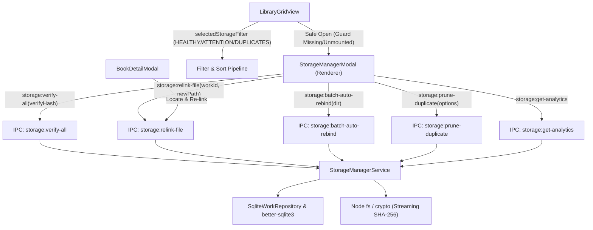

# Feature: Storage Management & File Health Architecture

## 1. Overview & Objective
This document details Baglib's Storage Management, File Health Verification, Path Rebinding, and Duplicate Pruning engine (`KEY-7: Story 7 — Storage Management & File Health`).

The primary objectives are:
1. **Periodic Integrity & File Existence Validation**: Continually verify the physical availability and byte-level integrity of all linked digital documents, detecting missing, unmounted, and corrupted files.
2. **Missing File Relocation & Path Rebinding**: Provide instant manual file re-linking for single books as well as recursive batch auto-rebinding across folders when files or directories are reorganized or moved across drives.
3. **Storage Duplicate Detection & Disk Cleanup**: Cluster identical physical files across the library by cryptographic hash (SHA-256), calculate reclaimable storage footprint, designate master copies, and allow safe database pruning with optional disk deletion.
4. **Interactive Storage Health Dashboard**: Provide users with a comprehensive overview of their digital library: visual health indicators, total storage usage, format distributions (PDF, EPUB, MOBI, AZW, DJVU, CBZ, CBR), and quick-fix actions.
5. **Integrated Library View Badging & Filtering**: Surface real-time storage issue counts on toolbar buttons, color-coded health badges in Grid and List views, safe-guard readers from opening corrupted or unmounted files, and offer a dedicated 4-way filter (`All`, `Healthy`, `Needs Attention`, `Duplicates`).
6. **Bilingual RTL/LTR First-Class Experience**: Seamless Arabic and English layouts using CSS logical properties and localized strings without hardcoded UI text.

---

## 2. Comparative Application Analysis (Calibre vs. Zotero vs. Baglib)

### 2.1 Calibre
- **Storage Strategy**:
  - Tightly coupled managed directory structure: `calibre_library/Author/Book Title (id)/Title - Author.ext`.
  - When files are renamed or moved by the user outside Calibre, the database entries become "broken paths" with no built-in automatic recursive rebinding.
  - Calibre provides a "Check Library" maintenance tool (`calibre.gui2.dialogs.check_library`), which scans database records against directory files and reports orphaned or missing files.
- **Strengths**: Built-in library consistency checks.
- **Weaknesses**:
  - Lacks non-destructive in-place file referencing without duplicating files into its internal storage folder.
  - "Check Library" is modal-heavy, slow, and requires user intervention per entry.
  - No fuzzy or hash-based automatic path rebinding when libraries are migrated across mount points or drive letters on Windows (e.g., `D:\` to `E:\`).

### 2.2 Zotero
- **Storage Strategy**:
  - Supports both stored files (inside `zotero/storage/KEY/`) and linked attachment files (`file://`).
  - Provides a "Find Available PDF" and manual re-link dialog when a linked file cannot be located.
  - Zotero plugin ecosystem (e.g., ZotFile) introduced folder watching and automatic attachment rebinding via base directory preferences (`relative_path_prefix`).
- **Strengths**: Flexible linked attachments without copying multi-gigabyte files.
- **Weaknesses**:
  - If drive paths change, users often face mass broken links unless base directory setting was strictly pre-configured.
  - Lacks cryptographic checksum auditing to detect bit rot or corrupted 0-byte downloads.

### 2.3 Baglib Design Innovations
- **Canonical In-Place Storage with Mount Awareness**:
  - Respects original file paths without forced copying or vendor lock-in.
  - Distinguishes between deleted/moved files (`status: 'missing'`) and unmounted removable drives (`status: 'unmounted'`) by checking drive roots on Windows (`fs.existsSync(path.parse(filePath).root)`).
- **Cryptographic & Fast Audit Modes**:
  - Fast Existence Check (`verifyHash: false`): Rapid `fs.statSync` and size validation for thousands of library items in milliseconds.
  - Deep Integrity Audit (`verifyHash: true`): Streaming SHA-256 calculation verifying stored content against tampering, partial downloads, and disk bit rot.
- **Intelligent Two-Stage Batch Rebinding**:
  - Recursively searches user-selected folders (`maxDepth: 6`).
  - Match Stage 1 (Exact SHA-256): High confidence match against stored hash.
  - Match Stage 2 (Normalized Basename): Cleans titles, removes punctuation, ignores case, and reconciles moved files.
- **Duplicate Cluster Management**:
  - Grouping by SHA-256 hash across works.
  - Automatic primary copy designation (earliest creation timestamp / first imported).
  - Wasted storage calculation (`(count - 1) * fileSizeBytes`).
  - Safe pruning with confirmation modal and optional physical disk unlinking.

---

## 3. Database Schema & Migration (009_storage_management)

Migration `009_storage_management.ts` adds:
- `file_size_bytes INTEGER DEFAULT 0` on `file_source_detail` for instant storage metrics and duplicate analysis without constant disk I/O.
- Index `idx_file_source_detail_state` on `(storage_state)` for high-performance health filtering.
- Backfill routine that checks existing `file_source_detail` rows on disk and populates accurate `file_size_bytes`.

```sql
ALTER TABLE file_source_detail ADD COLUMN file_size_bytes INTEGER DEFAULT 0;
CREATE INDEX IF NOT EXISTS idx_file_source_detail_state ON file_source_detail(storage_state);
```

---

## 4. System Architecture & Call Flows



---

## 5. UI & UX Highlights (Bilingual RTL/LTR)

1. **Storage Management Modal (`StorageManagerModal.tsx`)**:
   - **Real-Time Health Gauge**: 100% healthy indicator or dynamic split bar showing available, missing, unmounted, and corrupted slices.
   - **Storage Footprint & Formats**: Visual badges detailing total gigabytes/megabytes consumed and breakdowns by format (PDF, EPUB, etc.).
   - **Duplicate Clusters Tab**: Collapsible groups showing duplicate files, size wasted, primary copy badge, and "Prune Copy" modal with disk deletion checkbox.
   - **Audit Trigger**: Fast audit vs Deep integrity verification.
   - **Batch Rebind Dialog**: Select folder via native directory picker (`openDirectoryDialog`), execute recursive walk, and review preview of re-linked books.
2. **Library Grid & List Integration (`LibraryGridView.tsx`)**:
   - **Storage Toolbar Button**: Displays an attention badge with the exact count of broken files.
   - **Storage Filter Selector**: Embedded directly in the responsive 12-column filter grid (`All`, `Healthy`, `Needs Attention`, `Duplicates`).
   - **File Health Badges**: Prominently displayed on cards and list rows; clicking a "Missing" or "Corrupted" badge directly opens the Storage Manager focused on that book.
   - **Safe-Open Guard**: When opening a book whose file is missing, unmounted, or corrupted, the app prevents reading errors and opens the relocation dialog.
3. **Book Detail Modal (`BookDetailModal.tsx`)**:
   - Shows formatted file size alongside the digital file path.
   - Displays real-time status pill (`Available`, `Missing`, `Unmounted`, `Corrupted`).
   - Offers single-click "Locate / Re-link" button opening native file picker.

---

## 6. Verification & Test Suite

All 12 storage management tests in `tests/services/storage-manager.service.test.ts` pass, covering:
- Existence & stat checks (`available`, `missing`, `unmounted`, `corrupted`).
- Cryptographic hash mismatches and zero-byte file corruption.
- Single-file manual re-linking and validation against non-existent or unsupported files.
- Recursive batch auto-rebinding across nested directories.
- SHA-256 duplicate detection and cluster grouping.
- Duplicate pruning from database with optional physical file deletion from disk.

Total test suite: **287 passed across 32 test suites (100% pass rate)**.
