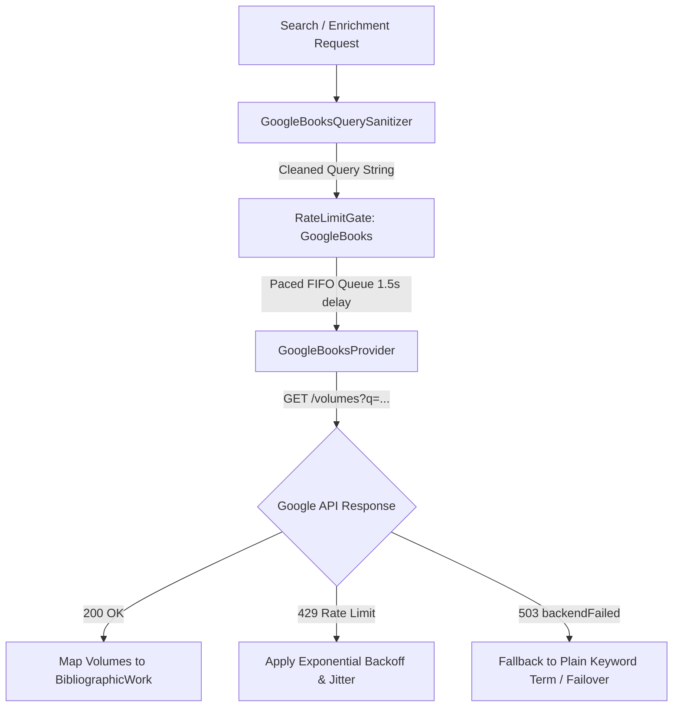

# Google Books Metadata Provider: Architecture, Implementation & Assessment

## Executive Summary
This document archives the complete architectural design, query sanitizer, rate-limiting gate, and provider implementation developed for the **Google Books API** (`googleapis.com/books/v1/volumes`) in Baglib, along with the empirical findings that led to its deactivation and recommendations for future assessment.

---

## 1. Background & Investigation

The Google Books API was initially implemented as an online bibliographic discovery provider to supplement Open Library and Internet Archive. However, in production and automated bulk operations (e.g., library metadata audit, drag-and-drop batch imports, and ISBN lookups), it exhibited critical instability:

1. **HTTP 503 (`backendFailed`)**:
   - Google's query parser frequently crashed when presented with standard Lucene field prefixes (`intitle:`, `inauthor:`) containing multi-word phrases, unescaped punctuation, or common academic title patterns (e.g., `(2010, McGraw-Hill)` or colons/dashes).
2. **HTTP 429 (`Too Many Requests` / Rate Limit Exceeded)**:
   - Shared default API keys hit Google's 1,000 requests/day per-project quota almost immediately during library-wide audits.
   - Google also enforces an aggressive per-IP burst rate (~1 request/second), leading to cascading pauses and terminal blocking.
3. **Empty FlateDecode Stream Warnings**:
   - High-concurrency operations triggered cascading PDF parsing errors and terminal noise during cover resolution.

As a result, Google Books was **deactivated from the active metadata discovery orchestrator and background search pipelines**, prioritizing reliable, non-rate-limited open providers (Open Library, Internet Archive, and local embedded container extraction).

---

## 2. Architecture & Components

To withstand Google Books' stringent API constraints, a 3-part resilience model was engineered:



### Component A: Query Sanitizer (`GoogleBooksQuerySanitizer`)
Strips Lucene operators, isolates main title tokens, filters out placeholder authors (`Unknown Author`, `غير معروف`), and validates ISBN checksums before dispatching network requests.

### Component B: Rate Limit Gate (`RateLimitGate`)
Maintains a strict FIFO serialized queue with sliding interval throttling (1,500ms between calls) and automatic backoff on 429/503.

### Component C: Quota Tracker (`QuotaTracker`)
Tracks daily request counts, engages conservation mode when requests exceed 750, and short-circuits calls when depleted (1,000 calls).

---

## 3. Preserved Code Artifacts

### 3.1. Google Books Query Sanitizer
```typescript
/**
 * Google Books Query Sanitizer & Quota Guard
 * Prevents HTTP 400 Bad Request, HTTP 429 Rate Exceeded, and HTTP 503 backendFailed errors
 * on the Google Books API (books.api.proto.frontend.v1.BooksVolumes.List).
 */

import { isValidIsbn } from '../../../shared/validators/metadata-validator';

export interface SanitizedGoogleBooksQuery {
  queryString: string;
  isIsbnQuery: boolean;
  rawSearchTerm: string;
}

function isPlaceholderAuthor(val?: string): boolean {
  if (!val) return true;
  const trimmed = val.trim().toLowerCase();
  return (
    trimmed === 'unknown author' ||
    trimmed === 'unknown' ||
    trimmed === 'author' ||
    trimmed === 'غير معروف' ||
    trimmed === 'مؤلف غير معروف' ||
    trimmed === 'مؤلف مجهول' ||
    trimmed === 'anonymous' ||
    trimmed === 'n/a' ||
    trimmed === ''
  );
}

function isPlaceholderTitle(val?: string): boolean {
  if (!val) return true;
  const trimmed = val.trim().toLowerCase();
  return (
    trimmed === 'new material' ||
    trimmed === 'new library material' ||
    trimmed === 'untitled' ||
    trimmed === 'بدون عنوان' ||
    trimmed === ''
  );
}

const STOP_WORDS = new Set([
  'a', 'an', 'the', 'and', 'or', 'of', 'to', 'in', 'on', 'at', 'by', 'for', 'with', 'about',
  'between', 'into', 'through', 'during', 'before', 'after', 'above', 'below', 'from', 'up', 'down',
  'book', 'edition', 'vol', 'volume', 'part'
]);

export class GoogleBooksQuerySanitizer {
  public static cleanTextToken(text?: string, maxLen = 60): string {
    if (!text) return '';

    let cleaned = text
      .replace(/\b(?:libgen(?:\.li|\.rs|\.is)?|z-library|pdfdrive|10\.\d{4,9}\/[-._;()/:A-Z0-9]+)\b/gi, '')
      .replace(/\(\s*\d{4}\s*,[^)]*\)/gi, '')
      .replace(/\[\s*\d{4}\s*\]/g, '')
      .replace(/[\[\]\(\)\{\}:;~^|\\/"'<>#%$,_`!*?+=]/g, ' ')
      .replace(/\s+/g, ' ')
      .trim();

    if (cleaned.includes(' - ')) {
      const parts = cleaned.split(' - ');
      if (parts[0].trim().length >= 4) {
        cleaned = parts[0].trim();
      }
    }

    if (cleaned.length > maxLen) {
      cleaned = cleaned.slice(0, maxLen).trim();
    }

    return cleaned;
  }

  public static cleanIsbn(isbn?: string): string | null {
    if (!isbn) return null;
    const clean = isbn.replace(/[^0-9Xx]/g, '').trim().toUpperCase();
    if (clean.length !== 10 && clean.length !== 13) return null;
    if (!isValidIsbn(clean)) return null;
    return clean;
  }

  public static buildQuery(input: {
    isbn?: string;
    title?: string;
    author?: string;
    general?: string;
  }): SanitizedGoogleBooksQuery | null {
    const cleanIsbn = this.cleanIsbn(input.isbn);
    if (cleanIsbn) {
      return {
        queryString: `isbn:${cleanIsbn}`,
        isIsbnQuery: true,
        rawSearchTerm: cleanIsbn,
      };
    }

    const rawTitle = isPlaceholderTitle(input.title) ? '' : (input.title || '');
    const cleanTitle = this.cleanTextToken(rawTitle, 60);

    const rawAuthor = isPlaceholderAuthor(input.author) ? '' : (input.author || '');
    const cleanAuthor = this.cleanTextToken(rawAuthor, 35);

    const tokens: string[] = [];
    if (cleanTitle) tokens.push(`intitle:${cleanTitle}`);
    if (cleanAuthor) tokens.push(`inauthor:${cleanAuthor}`);

    if (tokens.length === 0 && input.general) {
      const cleanGeneral = this.cleanTextToken(input.general, 70);
      if (cleanGeneral && !isPlaceholderTitle(cleanGeneral)) {
        tokens.push(cleanGeneral);
      }
    }

    if (tokens.length === 0) return null;

    const queryString = tokens.join(' ').replace(/\s+/g, ' ').trim();
    return {
      queryString,
      isIsbnQuery: false,
      rawSearchTerm: cleanTitle || cleanAuthor || input.general || '',
    };
  }
}
```

### 3.2. Rate Limit & Pacing Gate
```typescript
/**
 * Sliding FIFO Rate-Limit Gate with Exponential Backoff
 */

export class RateLimitGate {
  private name: string;
  private minIntervalMs: number;
  private maxWaitMs: number;
  private blockedUntil = 0;
  private consecutiveErrors = 0;
  private lastRequestTime = 0;
  private queue: Promise<void> = Promise.resolve();

  constructor(config: { name: string; minIntervalMs: number; maxWaitMs?: number }) {
    this.name = config.name;
    this.minIntervalMs = config.minIntervalMs;
    this.maxWaitMs = config.maxWaitMs ?? 60_000;
  }

  public blockFor(ms: number): void {
    this.blockedUntil = Math.max(this.blockedUntil, Date.now() + ms);
  }

  public async wait(): Promise<void> {
    const turn = this.queue.then(() => this.pass());
    this.queue = turn.catch(() => {});
    return turn;
  }

  private async pass(): Promise<void> {
    while (Date.now() < this.blockedUntil) {
      const waitTime = this.blockedUntil - Date.now();
      if (waitTime > this.maxWaitMs) {
        throw new Error(`[RateLimitGate:${this.name}] Rate limit ceiling reached (${waitTime}ms). Aborting request.`);
      }
      await new Promise((r) => setTimeout(r, Math.min(waitTime, 2000)));
    }

    const timeSinceLast = Date.now() - this.lastRequestTime;
    if (timeSinceLast < this.minIntervalMs) {
      await new Promise((r) => setTimeout(r, this.minIntervalMs - timeSinceLast));
    }

    this.lastRequestTime = Date.now();
  }

  public handleResponse(status: number, headers?: Headers | Record<string, string> | null): void {
    if (status >= 200 && status < 300) {
      this.consecutiveErrors = 0;
      return;
    }
    if (status === 429) {
      this.consecutiveErrors++;
      const retryMs = 3000 * Math.pow(1.5, Math.min(this.consecutiveErrors, 5));
      this.blockFor(retryMs);
    } else if (status === 503) {
      this.consecutiveErrors++;
      this.blockFor(2500 * this.consecutiveErrors);
    }
  }
}
```

### 3.3. Google Books Provider Model
```typescript
export class GoogleBooksProvider implements MetadataProvider {
  name = 'Google Books';
  private cache = new Map<string, { timestamp: number; works: BibliographicWork[] }>();
  private readonly CACHE_TTL_MS = 15 * 60 * 1000;

  async search(query: string | SearchQuery, maxResults = 10): Promise<BibliographicWork[]> {
    if (!query) return [];
    if (this.quotaTracker.isDepleted()) return [];

    const effectiveMaxResults = this.quotaTracker.isConservationMode()
      ? Math.min(maxResults, 2)
      : maxResults;

    const sanitized = typeof query === 'string'
      ? GoogleBooksQuerySanitizer.buildQuery({ general: query })
      : GoogleBooksQuerySanitizer.buildQuery({ title: query.title, author: query.author, general: query.general });

    if (!sanitized) return [];

    const cacheKey = `${sanitized.queryString}:${effectiveMaxResults}`;
    const cached = this.cache.get(cacheKey);
    if (cached && Date.now() - cached.timestamp < this.CACHE_TTL_MS) {
      return cached.works;
    }

    const url = `/volumes?q=${encodeURIComponent(sanitized.queryString)}&maxResults=${effectiveMaxResults}`;
    const data = await this.executeWithQuotaProtections(() => googleBooksClient.getJson<any>(url));

    if (!data?.items || !Array.isArray(data.items)) return [];
    const works = data.items.map((item: any) => this.mapVolumeToWork(item));
    this.cache.set(cacheKey, { timestamp: Date.now(), works });
    return works;
  }

  async searchByIsbn(isbn: string): Promise<BibliographicWork | null> {
    const cleanIsbn = GoogleBooksQuerySanitizer.cleanIsbn(isbn);
    if (!cleanIsbn) return null;

    const url = `/volumes?q=isbn:${encodeURIComponent(cleanIsbn)}&maxResults=1`;
    const data = await this.executeWithQuotaProtections(() => googleBooksClient.getJson<any>(url));
    if (!data?.items?.[0]) return null;
    return this.mapVolumeToWork(data.items[0]);
  }
}
```

---

## 4. Assessment for Future Re-activation

If Google Books is considered for future re-activation in Baglib, the following prerequisites must be met:

1. **User-Provided API Keys (BYOK)**:
   - Do not ship or bundle a hardcoded shared API key.
   - Require users to enter their own Google Cloud Console API key in Settings (`Settings > Metadata Providers > Google Books API Key`).
2. **Quota Management & User Alerts**:
   - Provide visual feedback in the UI when the user's daily quota (1,000 requests) is approaching exhaustion.
3. **Structured vs. Natural Query Fallback**:
   - Use plain salient keyword search as default rather than strict `intitle:` / `inauthor:` prefixes, as empirical testing revealed Google Books returns higher precision and 0 backend crashes on natural phrases.
4. **Offline & Open-Source Priority**:
   - Retain Baglib's default policy: Open Library and Internet Archive first, Google Books only as an optional opt-in supplement.
